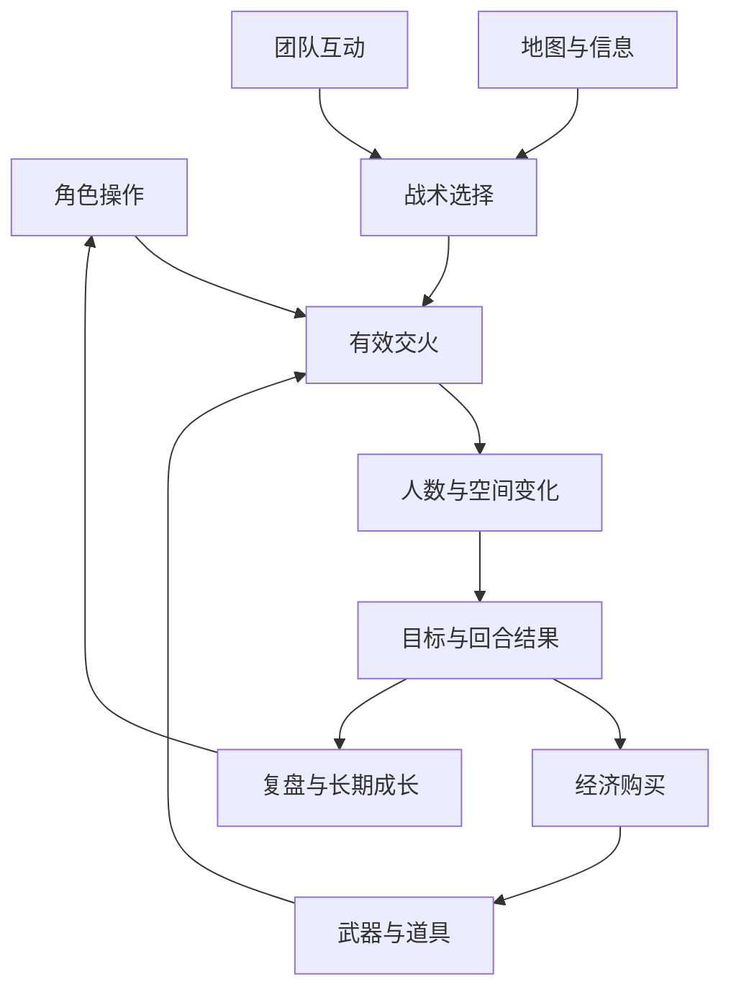
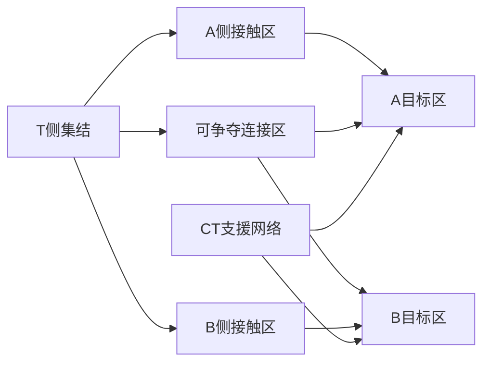
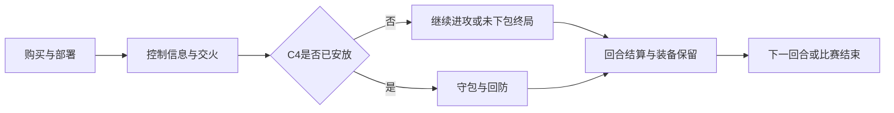
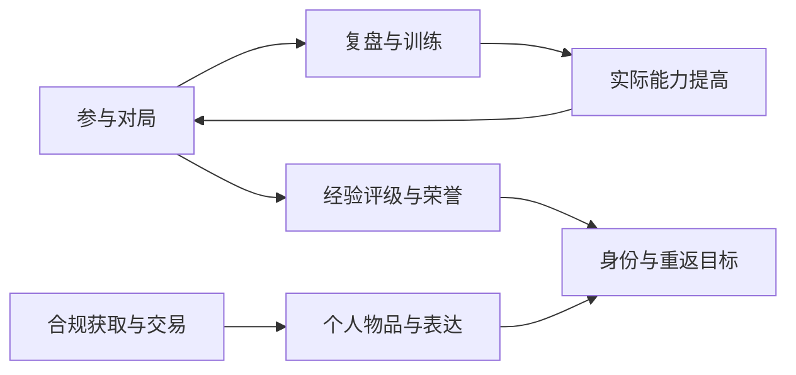

# CS2 整体架构及八大系统拆解

**专业游戏策划研究**

CS2 的主要追求是提高可重复的竞技能力，并在对手、队友、地图和有限资源共同构成的局势中完成团队目标。它把短时间的交火结果与长时间的地图学习、战术适应、经济积累和竞技身份连接起来。理解它的整体架构，需要看见系统之间的作用，而不只记住武器和模式名称。

| 文档项 | 内容 |
|---|---|
| 研究对象 | Counter-Strike 2 反恐精英 2 |
| 本版整理日期 | 2026 年 10 月 6 日 |
| 主分析范围 | 5v5 竞技爆破；其他模式、收藏、商业化与电竞社区一并分析 |
| 分析结构 | 整体架构＋八大系统；逐系统分析参与度、目的、流程、规则、压力、反馈、四维动机、玩点、优缺点与盈利联系 |
| 网络资料 | 延续 2026-10-05 已阅读并整理的五篇设计相关材料及官方支持、更新镜像与媒体；来源目录见附录 E |
| 版本口径 | 前次阅读的补丁镜像最新条目为 2026-10-02；本版主要重写研究结构，没有宣称重新核验之后的全部更新 |
| 证据口径 | 公开机制、通行数值参考、策划推导、待验证建议分别标明；本次未启动 CS2 客户端或采集玩家统计 |
| 实机插图 | 2026-10-15收齐18处插图：9张用户实机截图＋20张官方／媒体参考画面，共29张；目前无必须补拍项，来源与版本见附录G |

## 1 整体架构

### 1.1 主要系统和玩法追求

#### 1.1.1 概况

CS2 是以玩家之间的技能、信息和协作竞争为主的团队战术射击游戏。其最重要的成长发生在玩家身上：玩家逐渐知道什么时候停枪、应该预瞄哪里、怎样用一枚闪帮助队友、何时转点、何时保枪。角色本身并不因为账号游玩时间增加而永久获得更高的 AK 伤害或更大的生命上限。

从一回合看，玩家要用现有装备、位置与信息完成目标；从一场比赛看，玩家要管理经济、观察对手、调整战术并在换边后继续竞争；从长期看，玩家追求能力、竞技身份、固定队关系、赛事归属和个人收藏。三种跨度互相联系，却有不同的结算方式。

官方公开的 CS2 变化包括 Source 2、响应式烟雾、子刷新频率架构、地图视觉升级、音效与库存继承。技术更新服务的是对局可读性、交互和行为表达，不应被写成“全部网络问题已经解决”。[S06]

#### 1.1.2 核心系统及追求点

| 系统 | 主要追求 | 对局中的作用 | 长期作用 |
|---|---|---|---|
| 角色属性与操作 | 稳定进入有效精度、看懂状态、提高操作质量 | 决定交火和动作是否可靠 | 形成技能成长与可解释的复盘 |
| 武器与装备 | 根据距离、资金、职责选择工具 | 决定有效输出、机动与风险 | 积累不同武器和配装的使用知识 |
| 投掷物与战术工具 | 用有限消耗制造可利用的窗口 | 改变视线、空间、时间和目标操作条件 | 形成队伍配合与地图技巧 |
| 地图与空间 | 理解路线、时间、枪线和信息边界 | 决定可执行的进攻、转点与回防 | 反复学习固定空间，产生战术积累 |
| PVP 与回合 | 获胜、完成目标、处理残局 | 提供目标责任、失败成本与节奏 | 支撑适应对手、竞技戏剧性 |
| 经济与购买 | 将当局资源转成当局及后续竞争力 | 限制装备，组织全起、强起与节省 | 连接连续回合，保留恢复和反制机会 |
| 互动与竞技组织 | 与队友协同、获得可信的竞技对抗 | 组织组队、职责、沟通与匹配 | 建立固定关系、竞技身份和赛事社区 |
| 成长收藏与商业化 | 精进、荣誉、表达、获取和收藏 | 局外权益与目标引导 | 形成长期重返与产品经营结构 |

八大系统是本案的分类方式，不是 Valve 的内部模块名称。比如拆包钳既是装备，也参与目标操作与购买；因此第 3 章说明装备属性，第 4 章说明工具作用，第 6 章说明终局目标，第 7 章说明购买决策，避免把同一物品误当成四个独立系统。

#### 1.1.3 玩家人群与主要追求

下表是需求分类，不是对真实玩家占比的测量。同一玩家可以同时属于多个类别。

| 玩家需求 | 主要追求 | 支撑系统 | 可能的流失原因 |
|---|---|---|---|
| 技术精进 | 命中、身位与稳定性进步 | 枪械、练习、录像、竞技对局 | 对失败原因不理解；训练无法迁移到实战 |
| 战术协作 | 与固定朋友执行计划 | 组队、语音、地图、道具、经济 | 队员不同步；时间难协调；沟通冲突 |
| 排名竞争 | 获得可识别的竞技地位 | CS Rating、段位、排行榜、赛季 | 匹配可信度不足；评级反馈难理解 |
| 轻量娱乐 | 短时间射击和社交 | 休闲、死斗、搭档、军备竞赛、Rush 等 | 模式门槛与预期不符；被高水平对手持续压制 |
| 观赛与归属 | 支持战队、选手和赛事 | 赛事、观战、印花、社区内容 | 信息过载；赛事故事与游戏内连接弱 |
| 收藏与表达 | 展示偏好和身份 | 皮肤、印花、音乐盒、饰品检视 | 获取规则或交易规则不清楚；外观价值变化 |

#### 1.1.4 不同尺度的玩法循环

| 层级 | 循环 | 主要反馈 | 学习内容 |
|---|---|---|---|
| 数秒交火 | 发现线索 → 调整身位/准星 → 射击或撤离 → 判断结果 | 命中、伤害、死亡、敌人消失 | 急停、预瞄、控枪、角度 |
| 单回合 | 购装 → 获取控制与信息 → 执行目标 → 残局 → 结算 | 输赢、存活、资源变化 | 路线、协作、经济、目标意识 |
| 单场比赛 | 观察对手 → 形成策略 → 多回合验证 → 调整 → 换边 → 决胜 | 比分、对手反应、经济波动 | 适应、读局、反制与心理稳定性 |
| 长期 | 对局 → 复盘/训练 → 能力与身份积累 → 再对局 | 竞技进步、评级、同伴认可、收藏 | 将零散经验转化为稳定能力 |

短循环负责让行为有结果，单回合负责让结果有目标意义，跨回合负责让损失和保留有未来意义，长期循环负责让玩家愿意继续精进。外观收藏可以支持长期循环，但不能代替前面三层的对局价值。

### 1.2 系统之间的关联

#### 1.2.1 系统关系图



图 1 系统关联。箭头表示影响与资源转化，不表示每局都按单一顺序执行。

角色操作决定工具能否有效使用；经济决定当局有哪些工具；地图和信息决定可用的方案；团队决定方案能否同步；交火改变人数和空间；目标把变化转化为回合结果；结果又影响下回合经济与玩家的长期学习。

#### 1.2.2 八种被管理的资源

| 资源 | 如何获得或维持 | 如何消耗或失去 | 为什么影响决策 |
|---|---|---|---|
| 生命与存活人数 | 出生、避免交火、队友保护 | 伤害、死亡 | 死亡同时减少火力、道具、观察点和行动者 |
| 回合时间 | 只能利用，不能储存到下一回合 | 移动、等待、执行失败、清点 | 决定还有多少种路线和目标可选 |
| 金钱 | 回合结果、击杀、目标与版本奖励 | 购买与部分惩罚 | 限制本回合组合，影响下一回合竞争力 |
| 装备价值 | 购买、捡枪、保枪 | 死亡丢失、弹药和护甲损耗 | 将历史回合结果转化为当前能力 |
| 道具数量 | 购买与捡拾 | 投掷、死亡、未能回收 | 将空间和时间窗口变成有限消耗品 |
| 地图控制 | 进入、清点、架枪、道具和协同 | 撤离、死亡、被切断 | 决定可执行的路线、夹击与转点可能 |
| 信息与置信度 | 视线、声音、雷达、报点、历史推断 | 时间过去、信息失真、对手欺骗 | 决定如何配置资源以及是否承担风险 |
| 注意力与沟通带宽 | 熟练度、分工、清晰表达 | 多线威胁、冗长语音、压力 | 即使信息充分，队伍也可能来不及处理 |

生命、金钱和装备不是三个互相独立的统计项。一次不必要的死亡可能同时丢失主枪、剩余道具、一个关键观察位，并让下回合需要补枪；这就是行为成本的系统放大。

#### 1.2.3 关联的具体例子

| 起点 | 中间变化 | 最终影响 |
|---|---|---|
| 丢掉一个中间连接区 | 对手转点更自由，防守信息变旧 | CT 更难准确集中兵力 |
| 拿到首杀 | 人数优势与岗位缺口出现 | 对手需要补位，地图其他部分变薄 |
| 一枚烟封住狙击视线 | 通行窗口出现，同时视线信息减少 | 突破机会增大，但烟后位置仍未知 |
| 一回合虽赢但损失四把主枪 | 胜利奖金不能完全覆盖补装 | 下回合可能变得脆弱 |
| 下包成功 | 胜负计时与行动责任切换 | CT 必须推进，T 可选择守包和消耗时间 |

这些联系解释了为什么“提高一个武器伤害”可能同时改变买甲、烟闪数量、弱经济抢分、守点位置和回防成功率。局部修改必须沿依赖关系评审，不应只在靶场比较单枪。

### 1.3 压力制造与释放

#### 1.3.1 压力循环示意图


图 2 压力与释放的分析链。释放可以是获得一个角度、成功补枪、做出合理保枪或理解失败原因，不必等于最终赢下整场。

CS2 的压力不是“系统要求玩家付费补足战斗属性”，而是信息不全、时间减少、资源有限、死亡代价、对手适应和团队责任共同产生的压力。有效释放依靠可学习的反馈、可执行的反制、队友合作与经济恢复。

#### 1.3.2 各系统的压力与释放

| 系统 | 压力制造 | 正常释放途径 | 释放不足时的表现 |
|---|---|---|---|
| 角色操作 | 精度状态、短致命时间、动作窗口 | 急停、预瞄、可解释反馈与训练 | 玩家只归因于随机或设备，学不到原因 |
| 武器装备 | 资金、射程、弹量、换枪和损失 | 合适交战、夺枪、发枪、沿用装备 | 只有一种购买有效，其他选择名存实亡 |
| 战术工具 | 道具有限、投掷时不能正常输出 | 用烟闪火隔离威胁，队友跟进 | 道具很多但无人利用效果，成本没有回报 |
| 地图空间 | 清点、转点、信息时效和多角度 | 获得控制、缩减未知、可反制路线 | 玩家反复遭遇无法排序的角度 |
| PVP 回合 | 生命一次性、目标倒计时、局点 | 交换、安放、残局、明确终结 | 等待过长、输赢不明或连续无参与 |
| 经济购买 | 主枪与道具投入、跨回合连锁损失 | 失败补偿、节省、下包、保留与夺枪 | 弱经济没有局部机会，恢复周期不合理 |
| 互动组织 | 队友不同步、沟通冲突、匹配信任 | 明确职责、共同计划、治理与反馈 | 玩家无法控制的队内问题持续压过能力竞争 |
| 成长商业 | 学习落差、排名与收藏目标 | 进步反馈、适配练习、清晰获取说明 | 奖励目标挤压正常对局或形成错误消费预期 |

该表是机制层面的策划判断，不是“玩家压力评分”的统计结果。不能根据线条高低或主观打分断言某系统必然提高留存。

#### 1.3.3 压力平衡的评审原则

压力足够，意味着玩家有值得解决的问题；释放足够，意味着玩家能识别原因、选择方案并感到自己的行为有效。压力越大并不代表设计越好，自动消除压力也不代表体验更好。应检查压力来自合理对抗，还是来自看不懂的状态、无反制局面或不可信的判定。

短 TTK 要有可读的视听和可学习的接敌；跨回合损失要有恢复和局部机会；团队责任要有协作入口和冲突处理。三者缺少任何一项，压力都可能从紧张转为无力感。

### 1.4 需求度

#### 1.4.1 按玩家能力阶段观察需求

CS2 按能力与参与目标分析系统需求：玩够一定小时数不代表已经掌握相应能力，也不存在人人相同的阶段切换时间。

| 系统 | 新接触阶段 | 基础能力稳定阶段 | 深入竞技或固定队阶段 |
|---|---|---|---|
| 角色操作 | 理解移动精度、输入、目标键 | 提高一致性与身位质量 | 动作窗口、精细时序与决策稳定性 |
| 武器装备 | 认识少量主武器与护甲 | 理解距离、备用与配装 | 条件化武器选择与团队职责 |
| 战术工具 | 理解每枚道具有什么用途 | 学会有效落点和个人时机 | 同步执行、反制、保留和再利用 |
| 地图空间 | 认识目标和主要路线 | 预瞄、常见角度与转点 | timing、信息控制、读局与反套路 |
| PVP 回合 | 学会怎样获胜、下包后为何变责 | 补枪、残局、死亡成本 | 多回合适应、比分与风险调整 |
| 经济购买 | 分清够买主枪与完整配装 | 全起、节省、发枪与保枪 | 全队经济、对手预算和跨局方案 |
| 互动组织 | 报点、跟随、避免误伤 | 有效沟通和岗位协作 | 指挥、战术文件、赛制与固定队 |
| 成长商业 | 找到适配入口和最小学习目标 | 复盘、评级与荣誉反馈 | 长期精进、赛事归属或收藏表达 |

这里呈现的是需求重点的变化，不是系统重要性由低到高的统一排名。地图和经济从第一场就有作用，只是新手最初难以主动使用；收藏需求则依玩家目标变化，不能假设所有高水平玩家都热衷饰品。

#### 1.4.2 产品入口怎样承接不同需求

死斗适合提高射击接触密度，回防抽取目标终局，搭档减少组队规模，完整爆破保留跨回合经济和多阶段控制。训练入口必须说明训练了什么、没有训练什么；让新手只练静态命中，不能自然保证其学会回合判断。

整体上，CS2 的长期需求从“知道怎么操作”发展到“知道为什么这么操作”，再发展到“与队友让选择共同生效”。策划的任务是让这些转换可被观察和学习。

## 2 角色属性与操作系统

### 2.1 系统简介

#### 2.1.1 概况

该系统管理角色的生命、护甲、姿态、移动、有效精度、弹药与动作状态，并通过 HUD、动画、视听与网络反馈让玩家理解状态。其价值是建立可学习的输入与结果关系。不同武器造成不同的操作条件，但没有依账号等级自由分配永久力量、敏捷或暴击点的角色养成树。

#### 2.1.2 玩家参与度

进入战斗的玩家都要持续使用操作与状态判断，属于无法绕开的基础参与。主动研究程度则有差异：初学者主要移动与瞄准，熟练者同时管理预瞄、急停、精度恢复、交火距离、声音暴露和撤退窗口。本次没有采集参与率，不能从“所有人会移动”推出“所有人愿意深度研究急停”。

#### 2.1.3 系统目的

1. 用清楚的生命、护甲、弹药和动作状态表达即时能力。
2. 把位置、移动与开火连接为可精进的综合技能。
3. 让风险、命中和失败能够复盘，使训练有可见回报。
4. 将有效状态与声音、动画、网络判定对齐，维护玩家对规则的信任。

### 2.2 流程图与系统关系


图 3 单次接敌的操作链。预瞄与移动可能同时发生；完整接敌耗时包含识别与瞄准，不能仅按枪械理论 TTK 解释。

操作影响武器输出，掩体影响可见身体，声音影响敌人判断，网络与性能影响双方看到状态的时刻。因此操作系统的验收既要有靶场任务，也要有真实转角、移动、投掷和不同网络条件下的接敌。

### 2.3 系统说明

#### 2.3.1 属性和状态分类

| 属性或状态 | 作用 | 玩家如何改变 | 与其他系统的联系 |
|---|---|---|---|
| 生命 | 伤害累计后的存活条件，常见基础 100 HP | 通过避免伤害与队友保护维持 | 人数、回合操作权与经济损失 |
| 护甲与头盔 | 按命中条件影响伤害与受击 | 购买、沿用，随战斗损耗 | 购买预算、武器穿甲与致命断点 |
| 移动速度与姿态 | 转移、轮廓与精度条件 | 移动输入、持有装备、站蹲跳 | 地图 timing、声音、枪线 |
| 射击精度与后坐力状态 | 决定当前有效命中机会 | 停走、姿态、射击长度与补偿 | 武器类型、距离与交火时间 |
| 弹药与动作 | 决定能否持续开火及恢复成本 | 开火、换弹、切枪 | 团队掩护、声音、动作窗口 |
| 可知信息 | 对位置和局势的判断依据 | 观察、听声、雷达和沟通 | 战术、地图控制、未知风险 |

基础 HP 与装备价格等通行参考不是本次客户端实测导出。属性显示也不是公开所有敌方属性，竞技信息权限仍需按模式区分。

```cs2-screenshot
IMG-01｜基础战斗 HUD 与角色状态
状态：已补历史实机HUD
截图位置：CS2 的练习爆破地图中，进入正常第一人称视角；Dust II 即可。
画面包含：完整雷达、回合时间与比分、生命/护甲、当前武器与弹药、现金和道具栏，同时保留场景与准星。
拍摄要点：关闭购买菜单后截图，HUD 保持可读；站在安全位置即可，不需要刻意制造受伤。
已补文件：CS2_实机截图/IMG-01_完整战斗HUD：Dust II A坡道交战.jpg
来源与版本：逐图来源、截图日期线索与适用范围见阅读版图下及附录G。
```

#### 2.3.2 后坐力和精度状态

后坐力决定连续开火时存在怎样的可学习偏移；散布决定子弹围绕实际射击方向仍可能产生怎样的误差。移动、空中状态、连续开火与武器类型都可能改变精度。准星视觉、摄像机表现和最终弹着点也不是同一个概念。

这使玩家需要同时学习“如何修正方向”和“什么状态值得开火”。不能把射击训练压缩成一张固定弹道图片。[S01] [S02]

#### 2.3.3 命中伤害和 TTK

若目标生命为 H，每次命中实际伤害恒为 D，射速为 R 发/分钟，且从第一发命中时开始计时：

```text
所需命中数 N = ceil(H / D)
理想射击间隔 TTK = (N - 1) × 60 / R
```

它只适用于假设条件成立的理想连续命中。混合命中部位、衰减、护甲、穿透、漏枪、重新瞄准、单发栓动与其他机制，都要求更具体的模型。

完整接敌耗时还需拆成发现、识别、瞄准、达到可用精度、输出和状态反馈等部分。竞技 FPS 的参数分析应同时提供理想输出与实际命中条件，而不是只按一个理论 TTK 给全武器排名。

同样增加一点伤害，对“本来就能一发击杀”的场景可能无影响；对“从四发变为三发”的场景却可能明显改变胜率。断点应至少按有无护甲、部位、距离和穿透条件分组。

狙击枪的强度不能只看 DPS；霰弹枪不能只看单颗弹丸；经济枪不能只看标准长距离步枪对决。武器的实际价值来自条件化输出、操作负担、地图机会和经济成本。

#### 2.3.4 移动与急停

| 动作或状态 | 即时作用 | 与其他系统的联系 | 玩家要判断什么 |
|---|---|---|---|
| 正常移动 | 快速转移、抢位置 | 声音、移动精度、暴露时间 | 时间收益是否值得信息暴露 |
| 静步 | 降低特定移动声音，谨慎接近 | 更慢的路线与更少的可选时间 | 当前是否有必要隐藏接近意图 |
| 下蹲 | 改变轮廓、视线和精度状态 | 掩体、头线、移动与撤离 | 是否会变成难以撤离的固定目标 |
| 跳跃 | 越过地形、获取或隐藏短暂信息 | 空中精度、落地、速度与声音 | 得到的视线是否值得风险 |
| 切换武器 | 选择移动或作战状态 | 移速、拔枪窗口与敌情 | 是否可能在未持枪时遭遇敌人 |
| 重新装填 | 恢复持续输出能力 | 声音、时长、队友保护 | 当前弹药是否足够，何时是安全窗口 |
| 开镜与解除开镜 | 改变瞄准和视野 | 精度、注意力、机动和声音规则 | 是否缩小了对其他角度的感知 |

标准 CS2 不以通用冲刺条、翻滚、俯卧或英雄位移技能为主要角色操作。切刀加快某些移动情境，会同时承担更换回枪的成本；它不是零成本机动。

急停的价值是让角色更快进入适合射击的速度状态，并保持接敌节奏。它把“选择移动方向”“停止”“预瞄”“开火”连接成一项综合能力。不能把急停描述成某个固定按键组合无条件令所有武器瞬间达到完美精度。

#### 2.3.5 身位与动作窗口

| 类型 | 目标 | 风险 |
|---|---|---|
| 小幅探查 | 获取有没有架枪的信息 | 仍可能被击中；视角差与网络时序影响结果 |
| 宽拉 | 改变对手预瞄位置，争取单角度对决 | 暴露面积和更多潜在枪线 |
| 贴近或远离角落 | 调整暴露时序与可见身体 | 摄像机位置、几何和敌人距离共同起作用 |
| 高低位变化 | 改变头线，使用掩体或队友托举 | 退出路径、模型暴露和可被预期性 |
| 同步拉出 | 用时间同步形成交换与多目标压力 | 若站位重叠，可能被一条枪线连续处理 |

角度优势不能只用“高处一定更强”概括。要观察可见身体、头线、撤离路线、对手可能出现的多个方向，以及是否能被投掷物迫离。

投掷物、换弹、切枪与安放 C4 都可能暂时减少直接开火能力。队友掩护的作用，是在这个窗口承担威胁。一个优秀动作系统让玩家提前安排窗口，而不是只在输入后等待动画播放。

#### 2.3.6 信息判断与声音

| 信息类别 | 例子 | 可靠性问题 | 应引导的判断 |
|---|---|---|---|
| 直接观察 | 刚看见敌人经过入口 | 敌人此后可以转移 | “此时此地出现过”，不是永久位置 |
| 声音线索 | 脚步、枪声、投掷物、开镜与普通换弹等 | 楼层、距离、遮挡与欺骗 | 结合其他线索估计位置与状态 |
| 系统信息 | 击杀栏、雷达、队友状态、C4 状态 | 展示范围、刷新与模式权限 | 识别确定事件与推断的区别 |
| 队友报点 | 敌人数、武器、路线、道具 | 看错、延迟、表述不清 | 带时间与置信度地共享 |
| 历史信息 | 对手连续多局的站位与购买 | 对手可主动换套路 | 调整概率，不直接当成当局事实 |
| 缺失信息 | 长时间未见敌人、某区没有声音 | 静步、未观察、其他路线 | 不能把没有看见等同于没有人 |

刚看见敌人进入 B 区，并不意味着十秒后仍在同一位置。经过足以转点的时间后，这条信息应降低置信度。地图控制的重要作用，就是限制对手能走的路径，让已有信息更难快速失效。

探头、前压、反清和投道具侦察都可能消耗生命、道具、位置隐蔽性或时间。若某位置可无代价持续确定对手全部动向，佯攻、转点和路线选择会被压缩。信息收益与风险的关系是地图与系统平衡的关键。[S01] [S03]

声音不仅是氛围，还承担状态识别、方向判断、距离提示、威胁优先级与行为时机。应分别测试发声事件、传播条件、玩家能否正确识别，以及同一事件在不同音量/设备下是否有过大的体验差异。

消音器不等于绝对无声，静步不等于所有动作都无声，没听到换弹也不等于对方弹匣一定充足。

#### 2.3.7 静默操作的时间与信息取舍

2026-09-22 更新镜像与次日报道描述：按住换弹键可以更慢地静默换弹；狙击武器解除开镜不再发出相应声音。这与许多旧拆解直接冲突，必须注明时间。[S08] [S09] [S10]

| 选择 | 收益 | 成本 | 更适合的条件 |
|---|---|---|---|
| 普通换弹 | 更快恢复弹匣 | 可能透露行为与可攻击窗口 | 有队友保护、暴露代价低、时间紧 |
| 静默换弹 | 减少这项声音暴露 | 更长的不能正常输出窗口 | 有足够时间，隐藏位置或状态有价值 |
| 暂不换弹 | 保留立即开火能力 | 后续可能缺弹 | 当前剩余弹药足以处理预期威胁 |

策划推导：新增机制让时间与信息之间多了一次主动取舍。它的实战采用率、实际时长和胜率影响需要采样；公开公告不证明它已经改善全部竞技体验。

#### 2.3.8 UI 和有效状态反馈

第一层是立即改变存活与目标行动的信息；第二层是队伍和战局；第三层是成绩与外观表达。信息展示不应因为装饰效果遮挡敌人轮廓、目标提示或弹药状态。

雷达比例、位置、楼层、方向与队友标识影响地图意识；准星与开镜设置影响精度状态理解。2026-09-22 与 09-30 更新镜像显示准星进行了调整和后续修正，因此不把首发新准星的行为当成已稳定不变的最终规则。[S08] [S13]

优秀反馈应让玩家辨认：当前是否能射击、为何精度差、投掷物已否准备、是否正在安放/拆除，以及回合因何结束。它同时要保留适当的信息不确定性；向每位玩家额外公开敌人的实时位置，会破坏核心博弈。

允许准星、灵敏度、画面与音频设置满足不同玩家需求，但评估时要区分个人偏好和能否获得过量信息。无障碍与清晰度不是只把所有提示放大，而是让必要信息在不同条件下仍能被理解。

“看见弹匣已经插入”与“服务器允许开火”的关系，会影响用户对操作窗口的判断。投掷、换弹、拔枪和目标操作的反馈需要精确表达状态。测试应记录输入、动画关键帧、有效状态与玩家认知，不能只问动画是否流畅。

#### 2.3.9 网络和性能

官方介绍描述服务器能记录移动开始、开枪和投掷等行为更具体的时刻。其产品目标是提高行为的时间表达一致性。但“子刷新频率”不等于服务器没有 tick、没有延迟、没有插值，也不证明各种网络条件下命中与动画永远完全一致。[S06]

| 技术维度 | 对玩家的影响 | 应怎样评估 |
|---|---|---|
| 输入采样与处理 | 什么时候开始动作 | 输入到本地反馈的延迟分布 |
| 网络传输 | 对方什么时候看到或收到行为 | 延迟、丢包、抖动与地区条件 |
| 权威判定 | 命中、死亡与目标完成怎样被裁定 | 权威事件与双方展示的时序 |
| 状态插值与预测 | 移动是否平顺、是否回拉 | 接敌与转角场景下的偏差 |
| 投掷一致性 | 学过的投掷能否重复 | 同版本、同输入条件下的落点分布 |
| 客户端性能 | 玩家能否稳定辨认与操作 | 帧时间、卡顿与高负载场景 |

用户说“我明明打中了”，需要对输入、瞄准、精度、网络、权威事件与反馈共同分析；不能用“子弹穿过两个离散坐标之间的缝隙”解释所有问题。

烟雾、火、光照与资产细节既服务视觉，也消耗渲染资源。客户端帧时间波动可能改变操作舒适度与信息辨认。应在真实设备、典型交火和多个特效同时发生的场景下测试，不能用空地图平均 FPS 代替。

### 2.4 压力制造与释放

| 阶段或场景 | 压力制造 | 释放方法 | 设计要观察什么 |
|---|---|---|---|
| 初次交火 | 移动射击效果与直觉不同，死亡快 | 对照移动与停枪任务，清楚解释精度 | 玩家能否说出失败可改变的原因 |
| 基础对枪 | 同时管理瞄准、停止与射击长度 | 预瞄减少调整，分段练习再实战迁移 | 练习是否只提高静态成绩 |
| 多方向威胁 | 角度、弹药和注意力不足 | 用掩体缩减威胁，队友分工 | 是否存在无法排序的必死信息负担 |
| 残局 | 低血、缺弹、时间和声音暴露 | 安排动作窗口，选择隐蔽或快速恢复 | 玩家是否理解正常与静默换弹的代价 |
| 判定疑惑 | 本地反馈与结果感觉不一致 | 对照输入、精度、网络和权威事件 | 不把每次漏枪都归因于一个技术概念 |

压力释放应让玩家获得更可靠的行为能力，而不是通过永久购买属性免除射击和位置判断。状态反馈若不可信，技能积累就无法成为稳定的长期目标。

### 2.5 玩家反馈

本章反馈口径为设计材料中的讨论线索与需要采集的玩家问题。S01、S02 涉及精度、TTK 和操作，但其中错误描述已剔除；不能用它们替代有代表性的玩家抽样。

| 反馈问题 | 已有依据或证据状态 | 应采集的玩家表现 |
|---|---|---|
| 不知道移动为何打不准 | 有精度机制分析，理解程度未测 [S01] [S02] | 对失败原因的解释、停走任务与实战表现 |
| 不理解命中与死亡时序 | 官方提供架构方向，个案原因需复现 [S06] | 输入、状态、延迟与回放的同局证据 |
| 旧听声习惯受到静默操作影响 | 近期机制有版本依据 [S08] [S10] | 采用条件、误判与新输入的理解 |
| 动画看似完成但仍无法开火 | 为本案验收问题，未证明普遍严重程度 | 动画关键帧、有效状态和玩家判断 |

### 2.6 分析

#### 2.6.1 玩家愿意参与此系统的原因

| 维度 | 正向价值 | 不足与代价 |
|---|---|---|
| 荣耀 | 稳定首发、正确身位和残局操作能体现个人掌握，产生可归因的成就 | 表现不稳定或失败无法理解时，荣誉回报很弱；总击杀也不能表达全部操作贡献 |
| 互动 | 队友掩护换弹、同步拉出、互相补枪，使个人动作连接团队行动 | 只追求个人击杀可能破坏跟进；队友缺少同步会让动作窗口暴露 |
| 目标 | 学会一个可复现技巧，并把它迁移到实战，形成清楚的短期追求 | 学习目标若只剩准星或设置模仿，难以保证实际能力成长 |
| 惊喜 | 用正确准备完成超出预期的命中或残局，产生“原来可以这样”的发现 | 随机散布或异常反馈若占据归因，会让惊喜变成不可理解的挫败 |

#### 2.6.2 玩点简介

| 玩点 | 简介 | 玩家作出的选择 |
|---|---|---|
| 停走接敌 | 把移动、预瞄和开火合成稳定动作 | 何时停止、何时重新移动 |
| 身位管理 | 通过角度、距离和撤离路径改变对决 | 接哪个角、放弃哪个角 |
| 输出节奏 | 在首发、恢复和弹量之间安排射击 | 点射、短连射、扫射或暂不交火 |
| 动作与声音 | 在换弹、切枪、隐蔽和时间之间取舍 | 当前是否值得恢复弹药或暴露行为 |

#### 2.6.3 优缺点比较

| 优点 | 欠缺或风险 | 判断条件 |
|---|---|---|
| 基础动作不多，却能与位置和信息产生深度 | 初次理解成本高，短死亡时间放大失误 | 是否有能解释并练习最小机制的入口 |
| 能力提高可长期复用 | 熟悉动作后也可能因反馈疑惑失去信任 | 输入、表现和权威结果是否能一致解释 |
| 操作与团队任务关联紧密 | 个人技巧炫耀可能脱离目标 | 是否同时评估目标与协作贡献 |

#### 2.6.4 系统的盈利点

该系统没有按现实货币出售生命、精度或武器伤害的直接盈利点。它提供可信的技术成长与第一人称展示场景，间接支撑 Prime、赛事参与和外观表达。把“核心玩法支持消费”与“付费增强当局操作能力”区分开，才能正确分析 CS2 的经营结构。

## 3 武器与装备系统

### 3.1 系统简介

#### 3.1.1 概况

CS2 的武器装备是可购买、捡拾、给予、消耗和保留的当局能力。武器差异包括有效输出、精度、后坐力、射程、机动、弹量、动作与信息表现；护甲和功能装备改变存活或目标操作条件。玩家的选择同时受到现金、已有装备、配装菜单、阵营、地图与团队计划约束。

装备系统的追求不是把同一把 AK 长期炼成更高攻击的账号资产，而是在不断变化的局面中选择和使用合适工具。皮肤是第 9 章分析的收藏对象，与对局购买武器属于不同资源层。

#### 3.1.2 玩家参与度

交火中玩家必然使用武器，购买、配装和保留管理则依模式不同。完整爆破中参与是持续性的：开局买装、过程中捡枪或换枪、结束时保留装备；死斗与军备竞赛的装备组织不同。本次未获得各武器真实选择率，不能把常见主枪的重要性写成统计占比。

#### 3.1.3 系统目的

1. 让玩家用资金、距离、机动和有效输出换取不同机会。
2. 为强经济、弱经济、突破、架枪、守点和夺枪提供条件化工具。
3. 通过装备保留与丢失连接连续回合。
4. 让团队通过发枪、配装与岗位分工提高整体能力。

### 3.2 装备分类图与使用流程


图 4 对局装备的生命周期。死亡掉落还可能被对手或队友捡拾；保留装备是后续作战能力，不是新增钱包现金。

| 分类 | 组成 | 与其他系统的关联 |
|---|---|---|
| 主武器 | 冲锋枪、步枪、狙击枪、霰弹枪、机枪 | 交战距离、地图枪线、购买与岗位 |
| 副武器 | 手枪 | 低预算威胁、主枪动作窗口与备用 |
| 近战与极近距离工具 | 刀、Zeus | 机动、特殊范围与高风险行动 |
| 防护装备 | 防弹衣、头盔 | 致命断点、对手配装、补装预算 |
| 目标与消耗工具 | C4、钳、投掷物 | 第 4 章工具、第 6 章目标、第 7 章经济 |

### 3.3 系统说明

以下包含 34 种常规枪械：10 种手枪、7 种冲锋枪、7 种自动步枪、4 种狙击枪，以及 4 种霰弹枪与 2 种机枪。标准购买阵营不限制捡拾对方武器；当局购买还受自己的配装约束。

#### 3.3.1 手枪

| 武器 | 标准购买侧 | 主要职责 | 关键取舍与学习点 |
|---|---|---|---|
| Glock-18 | T | 默认进攻手枪，近距离协同 | 需要距离与集体推进；不能按远距离精确枪的方式理解 |
| USP-S | CT | 默认精确手枪、消音与远一点的首发 | 弹药管理和持续交火负担；单次失误可能失去窗口 |
| P2000 | CT | 另一种默认手枪选择 | 相对弹药与表现特点，是否适合个人习惯 |
| P250 | 双方 | 低价升级、经济回合与备用 | 较低投入换取一定威胁，仍受命中与距离限制 |
| Five-SeveN | CT | 近中距离经济战与连续输出 | 不能将低价威胁等同于全距离步枪替代 |
| Tec-9 | T | 近距离推进与手枪配合 | 节奏和交火距离影响价值；移动射击也受机制限制 |
| CZ75-Auto | 双方 | 近距离快速输出、夺枪机会 | 弹匣、切换与持续作战成本明显 |
| Dual Berettas | 双方 | 高弹量的近距离压制 | 精度、穿甲与持续射击控制是取舍 |
| Desert Eagle | 双方 | 少量资金制造高致命命中机会 | 首发、恢复和身位要求高；不能靠连续乱点稳定替代步枪 |
| R8 Revolver | 双方 | 具有特殊射击输入节奏的侧武器 | 预备时间与输出方式改变接敌；用途依场景和版本 |

#### 3.3.2 冲锋枪

| 武器 | 标准购买侧 | 主要职责 | 关键取舍与学习点 |
|---|---|---|---|
| MAC-10 | T | 低成本近距离推进、反经济 | 远距离与有甲目标的有效性降低 |
| MP9 | CT | 近距离防守、机动反清、反经济 | 不应沿用所有旧版本跳射结论；2025-07 补丁调整后坐力与跳跃精度 |
| MP7 | 双方 | 相对通用的冲锋枪交火 | 购买成本与步枪替代之间的机会成本 |
| MP5-SD | 双方 | 消音的冲锋枪方案 | 需要比较信息表现、伤害与射程，而非只看消音 |
| UMP-45 | 双方 | 预算限制下的近距离有效输出 | 射速、距离衰减与目标护甲共同决定价值 |
| PP-Bizon | 双方 | 大弹匣、较长连续交火 | 不能把高弹量当成高有效击杀能力 |
| P90 | 双方 | 高弹量机动交火 | 较高价格与不同击杀经济，使其不等于廉价反经济模板 |

#### 3.3.3 自动步枪

| 武器 | 标准购买侧 | 主要职责 | 关键取舍与学习点 |
|---|---|---|---|
| Galil AR | T | 预算步枪、有限经济仍争夺中距离 | 用较低买价保留护甲与道具空间 |
| FAMAS | CT | 预算步枪与特定射击模式 | 价格、控枪与有效输出共同决定是否优于其他预算组合 |
| AK-47 | T | 高致命首发与通用自动火力 | 精度状态、后坐力、距离和穿透仍影响结果 |
| M4A4 | CT | 弹量与持续防守、补枪、转移 | 需要比较弹匣、射速、经济与另一把 M4 的具体差异 |
| M4A1-S | CT | 消音、可控的连续输出 | 弹量、射程表现与信息特征形成取舍 |
| AUG | CT | 带瞄准镜的特定距离控制 | 费用、视野、开镜状态与机动负担 |
| SG 553 | T | 带瞄准镜的精确交火 | 射速、控枪、机动与购买成本；不能只按爆头能力判断 |

#### 3.3.4 狙击枪

| 武器 | 标准购买侧 | 主要职责 | 关键取舍与学习点 |
|---|---|---|---|
| SSG 08 | 双方 | 预算远距离精确命中 | 身体伤害与补枪配合，不能照搬 AWP 接敌方式 |
| AWP | 双方 | 高致命性架枪、抢首杀、改变路线选择 | 高投入、开火后的恢复与回撤窗口；对闪光、多人同步和近身敏感 |
| G3SG1 | T | 连续狙击输出、特定防守/压制 | 高价格与机动限制；对手可用道具或多线打破枪线 |
| SCAR-20 | CT | 连续狙击输出、特定区域控制 | 与 G3SG1 类似，需比较具体参数和地图条件 |

#### 3.3.5 霰弹枪与机枪

| 武器 | 标准购买侧 | 主要职责 | 关键取舍与学习点 |
|---|---|---|---|
| Nova | 双方 | 预算近距离角落防守 | 多弹丸命中与距离是核心条件 |
| XM1014 | 双方 | 半自动近距离连续威胁 | 成本、连续输出和空间距离；击杀奖励需按当前版本核对 |
| MAG-7 | CT | 狭窄入口与近距离伏击 | 对位置依赖强，转点后可能失去条件优势 |
| Sawed-Off | T | 极近距离的低价条件攻击 | 距离与执行成本明显，不能替代正常中距离火力 |
| M249 | 双方 | 大弹匣持续输出的高价方案 | 费用与机动成本限制常规使用 |
| Negev | 双方 | 持续压制与特殊连续射击节奏 | 输出准备、精度状态与机动暴露带来机会成本 |

#### 3.3.6 近战与 Zeus

刀承担移动、近距离击杀及有限弹药外的攻击职责；背身、攻击方式和命中条件影响结果。Zeus x27 是极近距离条件武器，需要按当前版本核对充能、价格、奖励和有效范围，不沿用早期“一次使用即消耗”等旧结论。

#### 3.3.7 武器参数分类

| 参数组 | 包含内容 | 玩家可控制的部分 | 策划关注点 |
|---|---|---|---|
| 基础输出 | 单发伤害、射速、爆头倍率、命中部位 | 瞄准部位、射击时机 | 致命命中次数是否适合武器职责 |
| 有效精度 | 初始精度、移动/跳跃/连续开火误差、恢复 | 停走节奏、射击长度、姿态 | 状态反馈是否可理解 |
| 后坐力 | 连续射击的方向偏移与规律 | 反向补偿、分段射击 | 可学习性与控枪负担 |
| 射程与穿透 | 距离衰减、护甲作用、材质与厚度 | 选择距离、穿透路线 | 地图与武器是否相互匹配 |
| 操作与机动 | 移速、拔枪、开镜、换弹、弹匣与备弹 | 预先切换、弹药管理 | 输出之外是否有真实取舍 |
| 经济 | 买价、击杀奖励、丢失与捡拾价值 | 购买、发枪、保枪 | 单回合强度与长期回报 |
| 信息表现 | 枪声、曳光、枪口效果、消音与命中反馈 | 暴露管理、位置转移 | 读局、压制与视听公平 |

#### 3.3.8 有效输出与操作方式

| 行为 | 适用判断 | 收益 | 代价 |
|---|---|---|---|
| 点射 | 远距离、小目标、需要精度恢复 | 更容易保持有效首发 | 失误后再次输出的节奏较慢 |
| 短连射 | 中距离、需要兼顾伤害与控制 | 有一定失误补偿，便于停枪恢复 | 仍需管理连续开火精度 |
| 扫射 | 近中距离、可持续跟踪或转移目标 | 输出密度高，可补救部分首发失误 | 控制难度、弹药消耗与暴露增加 |
| 扫射转移 | 多名目标同时出现 | 一段输出处理多个威胁 | 需要读懂偏移状态与切换路径 |

一个高价武器在有甲长距离对决占优，不代表它适合所有转角、快攻与回防。武器评价要用“资金与职责—预期交战条件—输出可靠性—失败损失”的链路，不能只按单发伤害排行。

#### 3.3.9 护甲与功能装备

| 装备 | 功能 | 策划上的价值判断 |
|---|---|---|
| 防弹衣 | 在适用命中条件下影响伤害与受击效果 | 提高存活概率，但不保证抵抗所有致命命中 |
| 头盔 | 在适用武器与条件下影响头部伤害 | 要结合对方武器判断，不是任何回合都同等重要 |
| 拆包钳 | 缩短有效拆除时间 | 同一时间窗口下增加回防可行性，构成 CT 额外经济负担 |

护甲不是另一条简单生命条，头盔也不是绝对免爆头。买钳涉及团队覆盖：由谁携带、在哪个点位、该玩家死亡后队友能否拾取，都会影响有效收益。

#### 3.3.10 获取及跨回合保留

购买是用现金获得工具；发枪是把已有工具转交队友；捡拾是把地图上的掉落重新纳入可用装备；保枪是降低本回合争夺，将装备带到后续。四者对钱包、团队装备和风险的影响不同。

例如捡到对方步枪可以减少下回合购枪需求，同时承担离开安全位置去拾取的风险；保留 AWP 可以改善后续火力，却不保证值得放弃仍可完成的目标。弹药、护甲和剩余道具也会影响“保留价值”，不能把武器买价当作全部净收益。

#### 3.3.11 配装菜单

配装菜单将完整武器库与当局可购买选择分开。CS2 的配装允许一定范围内重新组合选项，不能沿用 CS:GO 的“一次只能选 M4A4 或 M4A1-S 其中一把”作为通用解释。退款降低购买误操作和团队临时改计划的成本，但受购买窗口、物品使用状态等条件限制。

配装带来的是习惯、地图与经济用途的提前选择；它不是通过账号等级永久提高武器伤害的技能树。

```cs2-screenshot
IMG-03｜局外配装菜单
状态：已补配装参考图
截图位置：主界面的配装/装备选择界面，打开一个阵营的武器配装栏。
画面包含：阵营标识、武器分类、当前配装槽位和可选武器。
拍摄要点：展开到能看清武器名称的状态；使用你当前真实配装即可。
已补文件：CS2_实机截图/IMG-03_CT配装栏与库存备选（第三方攻略实机）.webp
来源与版本：逐图来源、截图日期线索与适用范围见阅读版图下及附录G。
```

#### 3.3.12 枪械库的总体取舍

枪械库让玩家在资金、距离、精度、机动、弹量、信息暴露和击杀回报之间作选择。它并不要求全部枪械使用率均等，也不证明所有武器都始终拥有同样清晰的竞技生态位。分析冷门武器时，要区分“存在局部用途”和“足以成为有吸引力的选择”。

### 3.4 压力制造与释放

| 场景 | 压力制造 | 释放方法 | 不足风险 |
|---|---|---|---|
| 学习新武器 | 不同输出、精度恢复、弹量与动作 | 在可控距离学习，再迁移地图场景 | 参数很多却没有清楚的使用理由 |
| 弱经济 | 买主枪后缺甲、缺道具 | 预算枪、队友给予、近点与夺枪 | 低价工具不能提供任何实际威胁 |
| 完整配装 | 高价投入失败时损失大 | 利用距离、掩体与岗位，避免无保护交火 | 因为装备贵就错误追求单人英雄行为 |
| 后续补装 | 本回合获胜仍可能损失主枪 | 统计已有装备与团队资金，统一计划 | 只看比分，忽略连锁经济薄弱 |
| 装备选择 | 常用武器与场景需求不同 | 提前配装、临时发枪和退款 | 配装习惯过窄，弱经济缺少合适选项 |

长期追求来自理解不同武器能在哪些条件下生效。若所有枪都只有一个线性“更贵更强”的顺序，经济选择、地图差异和局部逆转都会被压缩。

### 3.5 玩家反馈

| 反馈问题 | 已有依据或证据状态 | 应采集什么 |
|---|---|---|
| 一些武器用途不明确 | 枪械库存在差异；当前生态位强弱未统计 [S02] | 分地图、预算、技能和配装的选择及表现 |
| 旧攻略与现在武器手感不同 | MP9 有明确历史改动依据 [S07] | 版本、参数、场景和旧知识迁移 |
| 只关注主枪，忽略护甲道具 | 是本案购买行为假设 | 新手预算解释与队伍实际配装 |
| AWP、AK 被描述为无条件秒杀 | 已纠正来源中的绝对说法 | 部位、距离、护甲、穿透与漏枪条件 |

### 3.6 分析

#### 3.6.1 玩家愿意参与此系统的原因

| 维度 | 正向价值 | 不足与代价 |
|---|---|---|
| 荣耀 | 熟练掌握某种武器、用弱装备打出有效局部优势，能体现能力 | 只看昂贵主枪或总击杀，容易忽略发枪、保留和经济贡献 |
| 互动 | 发枪、交换、捡枪和岗位配装把个人资源变成队伍能力 | 临时队伍若购买分歧大，个人偏好会破坏整体预算 |
| 目标 | 学会不同武器条件并优化配装，形成阶段性掌握 | 冷门武器若缺少真实场景，收藏知识未必转化为玩法选择 |
| 惊喜 | 夺枪、特殊距离优势、备用手枪成功处理威胁能逆转局面 | 若逆转被归因于纯随机，难以形成可学习的惊喜 |

#### 3.6.2 玩点简介

| 玩点 | 简介 | 决策核心 |
|---|---|---|
| 条件化选枪 | 为地图、距离和任务选择火力 | 强度必须与场景一起判断 |
| 预算组合 | 主枪、护甲、道具不能同时无限投入 | 放弃什么，换来什么 |
| 夺枪与沿用 | 使用已存在的装备改变购买压力 | 获取风险与后续价值 |
| 团队发枪 | 资金分散但工具可共享 | 谁承担主火力与功能缺口 |
| 装备保护 | 活着结束回合可保留能力 | 当局目标与未来机会 |

#### 3.6.3 优缺点比较

| 优点 | 欠缺或风险 | 判断条件 |
|---|---|---|
| 价格、距离和动作形成多维选择 | 部分武器可能长期缺少吸引力 | 分条件使用数据能否找到明确用途 |
| 装备得失连接回合 | 高价损失可能放大连续弱经济 | 恢复周期与可行反制是否合理 |
| 同一武器依岗位产生不同价值 | 常见攻略容易把固定配装当成唯一解 | 是否让玩家解释本局购买理由 |

#### 3.6.4 系统的盈利点

标准对局购买使用游戏美元，不构成现实货币变现。武器模型、第一人称检视、击杀与观战展示为武器外观提供表达场景；武器箱、钥匙、特定饰品购买和市场流通在第 9 章构成商业层。对局武器强度与饰品稀有度必须分开，不能把稀有皮肤写成战斗升级。

## 4 投掷物与战术工具系统

### 4.1 系统简介

#### 4.1.1 概况

道具系统让玩家在直接交火以外改变局面：烟切断视线，闪减少有效反应，火限制可站立区域，高爆手雷改变生命或短暂烟雾窗口，诱饵干扰线索。C4 和拆包钳则与目标操作相连。它们都是工具，其价值由之后发生的人员行动和目标变化决定。

CS2 的工具追求主要是用途、位置、时机和同步执行。

#### 4.1.2 玩家参与度

基础操作容易接触，主动价值判断和组合执行更难。新手可能只在买完枪后随机补道具；熟练者会为路线和职责预留预算；固定队会安排投掷、进入、补枪、安放和撤离的共同时间。本次没有获得道具使用率或有效率，不能把“买过烟”当作“会用烟”。

#### 4.1.3 系统目的

1. 让玩家通过有限工具改变视线、空间、信息和时间。
2. 为强枪线和人数差提供有成本的反制。
3. 创造需要队友利用的行动窗口，形成非击杀贡献。
4. 让目标操作与战斗组织互相约束。

### 4.2 流程图与组合关系


图 5 道具效果转成目标收益。工具已经生效，不代表队伍已经获得控制；最后两步决定道具是否有战术价值。

### 4.3 系统说明

#### 4.3.1 工具职责矩阵

| 道具 | 主要改变的资源 | 正向用途 | 反制与代价 | 失败表现 |
|---|---|---|---|---|
| 闪光弹 | 视听能力、有效接敌时机 | 为拉出、突破、反清、撤离创造窗口 | 背闪、掩体、距离与朝向；可能影响队友 | 道具到位但队友没有同步；反而闪到自己人 |
| 烟雾弹 | 视线、信息与通行风险 | 切断枪线、掩护通行、隔离目标、辅助拆包 | 盲射、穿烟、反清、HE 消散与子弹局部作用 | 烟有缺口；只降低己方信息；敌方从烟中主动出击 |
| 高爆手雷 | 血量、残血击杀与烟雾交互 | 对集中位置造成伤害、补伤害、制造短暂视线窗口 | 位移、遮挡、护甲、投掷时机 | 在无人区域爆炸；只追求伤害而错过关键烟雾窗口 |
| 燃烧瓶／燃烧弹 | 可站立区域、路线与时间 | 清角、延迟进攻、阻止安放或拆除、限制撤退 | 避开范围、烟雾灭火、抢时间突破 | 没封住必要路径；燃烧期间无人利用效果 |
| 诱饵弹 | 对手对声音等线索的判断 | 成本较低的干扰和特定欺骗 | 敌人识别、其他线索校正 | 被当作确定信息；没有战术联动 |

官方确认 CS2 的烟雾是响应环境、光照、子弹和爆炸的动态三维对象。它的策划价值既在遮挡，也在交互产生的新窗口。烟雾遮挡视线，并不保证通行安全；对手仍可判断常见路线、盲射或穿烟反清。[S06]

```cs2-screenshot
IMG-04｜烟雾遮挡的前后对照
状态：已补官方演示前后帧
截图位置：练习 Dust II，选择 A 大道或中门的一条稳定观察视线。
画面包含：同一站位、同一朝向下，先截无遮挡画面，再截烟雾完全展开并遮挡该视线的画面；两张保留 HUD 和雷达。
拍摄要点：两张尽量保持位置与视角一致。标为 IMG-04a（无烟）、IMG-04b（烟雾展开）。
已补文件：CS2_实机截图/IMG-04a_烟雾展开前（官方演示 00_00.300）.jpg；CS2_实机截图/IMG-04b_烟雾展开后（官方演示 00_01.700）.jpg
来源与版本：逐图来源、截图日期线索与适用范围见阅读版图下及附录G。
```

#### 4.3.2 库存与购买限制

道具同时受金钱、可携带数量、同类数量与购买规则制约。标准竞技常见携带总量为四枚，闪光可携带两枚；这不是所有模式通用的上限。2026-09-22 补丁镜像还描述了总量设置对单回合购买量的限制，因此“当前携带量”和“本回合累计买过多少”不能混为一谈。[S08]

#### 4.3.3 多工具与人员的组合

烟雾负责隔离某条枪线，燃烧负责逼离某个位置，闪光负责让负责补位或接敌的人失去有效反应窗口，跟进的队友负责真正获取空间。道具的价值常由“效果发生后谁能行动”决定，而非投掷动画是否漂亮。

可用以下链路分析一套爆弹：

```text
确定希望占领的空间
→ 列出阻止占领的枪线和站位
→ 用烟隔离、用火迫离、用闪压缩反应
→ 人员按职责同步进入
→ 补枪、安放、建立守包结构
```

补充判断：烟同时减少对手和己方的视线；闪的收益取决于爆开时队友是否能行动；火逼敌人离开以后，必须有人观察其出口或利用空出来的位置。所谓“完美落点”若没有任务联系，也可能是浪费。

#### 4.3.4 C4 的工具职责

1. 给 T 提供明确、可完成的主动目标。
2. 用安放操作制造需要保护的动作窗口。
3. 用安放位置决定守包视线和 CT 的清点方向。
4. 在安放后改变行动责任，让 CT 必须推进。
5. 用倒计时让局面有确定终点，并产生有意义的拖延与假动作。

| 安放方案 | 获得什么 | 承担什么 |
|---|---|---|
| 借掩体安全安放 | 降低安放过程被击杀的风险 | 守包可能必须靠近 C4，远处队友难以保护 |
| 面向远距离队友的开放安放 | 可从更远位置守包，扩大防守结构 | 安放时更容易暴露，必须先获得更多控制 |
| 特定残局位置 | 配合自己剩余武器、血量和道具 | 容易被对手从信息推断计划；撤退空间受限 |

“最好的包位”随双方人数、控制区、时间、装备和对手位置改变，不是一处永远正确的坐标。

C4 的携带者是可被击杀、可能与队伍脱节的行动者。掉包位置影响队伍后续行动；安放区域需要已获得相应控制。工具、人物与地图共同决定目标能否完成，完整胜负规则见第 6 章。

```cs2-screenshot
IMG-09｜C4 安放时的操作窗口
状态：已补安放中实机画面
截图位置：练习爆破地图，T 阵营携带 C4，在合法包点开始安放。
画面包含：安放动作、进度提示、目标区环境与 HUD。
拍摄要点：在安放进行中截图，而非完成后；用练习环境拍即可。
已补文件：CS2_实机截图/IMG-09_B包点掩体后安放C4，完整HUD.webp
来源与版本：逐图来源、截图日期线索与适用范围见阅读版图下及附录G。
```

#### 4.3.5 拆包钳与假动作

拆包钳把目标动作时间从无钳的常用约 10 秒缩短到约 5 秒，改变回防可行性；它仍需要抵达、清点、开始并持续完成操作。假拆可以制造声音和威胁以逼守包者行动，但不能保证对手相信。正确判断要结合剩余时间、位置、枪线和钳的可能性。

```cs2-screenshot
IMG-11｜有钳与无钳拆除的状态展示
状态：已补有钳／无钳状态示例
截图位置：练习地图或自己的录像中，CT 分别在无拆包钳和有拆包钳状态下拆除 C4。
画面包含：两张拆除进行中的画面，包含拆除进度、C4、HUD 及当前工具状态的实际提示。
拍摄要点：标为 IMG-11a（无钳）、IMG-11b（有钳）。在消息中注明携带状态；静态图片本身不证明 10/5 秒时长。
已补文件：CS2_实机截图/IMG-11a_无拆弹器：拆除提示与9.859秒倒计时.png；CS2_实机截图/IMG-11b_有拆弹器：钳图标与3.296秒倒计时.jpg
来源与版本：逐图来源、截图日期线索与适用范围见阅读版图下及附录G。
```

#### 4.3.6 反制与二次利用

| 道具状态 | 对手可能怎样回应 | 己方可怎样继续利用 |
|---|---|---|
| 烟已隔离枪线 | 盲射、穿烟、转移、HE 窗口 | 利用有限通行时机，保持入口警戒 |
| 闪已迫使背闪 | 后退、避开角度、队友架第二线 | 同步进点，避免只打一条已避开的枪线 |
| 火已迫离近点 | 退到后位或抢时间穿过 | 控制退出路线，进入空出的区域 |
| 对手交出大量早期道具 | 收缩、改变站位或保留剩余 | 在仍有时间时选择进点或转点 |
| 己方道具耗尽 | 对手可更直接重夺路线 | 靠人数、交叉火力和目标时间维持局面 |

反制的存在让工具形成取舍，而非“买到就必然拿到区域”。道具也会改变声音、注意力和视觉，因此要检查多种特效同时发生时的可读性与性能。

```cs2-screenshot
IMG-05｜HE 与烟雾的局部交互
状态：已补官方HE交互帧
截图位置：练习地图的固定视线处，先投烟，再让 HE 在烟雾内或附近生效。
画面包含：同一角度的完整烟雾，以及 HE 生效后出现局部视线变化的瞬间。
拍摄要点：标为 IMG-05a（交互前）、IMG-05b（交互瞬间）。可从自己录制的画面取帧；如果没有拍到清楚变化，先留空。
已补文件：CS2_实机截图/IMG-05a_HE 生效前的烟雾（00_54.900）.jpg；CS2_实机截图/IMG-05b_HE 爆炸打开视线窗口（00_55.300）.jpg
来源与版本：逐图来源、截图日期线索与适用范围见阅读版图下及附录G。
```

#### 4.3.7 效果评价

应记录：创造的通行窗口、迫使敌人离开的岗位、拖延秒数、接闪后的有效击杀、己方被闪时间、道具消耗后是否获得空间，以及回合终结时的未使用资源。高伤害投掷物可能没有帮助目标，零伤害烟雾可能决定整次突破。

### 4.4 压力制造与释放

| 场景 | 压力制造 | 释放方法 | 不足风险 |
|---|---|---|---|
| 强枪线阻挡 | 正面接敌死亡风险高 | 烟分割、闪压缩反应、多人同步 | 工具反制不稳定或投掷机会过少 |
| 入口与角落 | 清点角度多、可用时间少 | 火迫离、信息与有顺序的清点 | 只有固定背点，缺少临场判断 |
| 库存耗尽 | 后续阶段无法继续改变空间 | 明确预算、保留、共享投掷任务 | 早期堆道具，终局无工具可用 |
| 目标倒计时 | 拆除、安放与动作窗口受限 | 用工具保护行动或拖延对手 | 只追求伤害，错过目标时机 |
| 团队不同步 | 道具与进入错开 | 用共同信号组织行动 | 严重依赖长语音，陌生队难使用 |

从学习阶段看，压力从“记住作用”转到“投到有用位置”，再转到“让效果和人员同步”。前一阶段通过不代表后一阶段已经掌握。

### 4.5 玩家反馈

| 反馈问题 | 已有依据或证据状态 | 应采集什么 |
|---|---|---|
| 学了投掷点却不会在对局中使用 | 本案训练迁移假设 | 投掷目的解释、时机与实际后续行动 |
| 烟的交互改变旧战术 | 官方确认动态烟雾 [S06] | 可重复落点、多视角与窗口利用 |
| 道具对团队的贡献不明显 | 效果类型可分析，贡献认知未测 | 队友能否识别烟闪创造的机会 |
| 买入和携带上限混淆 | 有近期购买限制记录 [S08] | 购买反馈、累计次数与模式规则 |

### 4.6 分析

#### 4.6.1 玩家愿意参与此系统的原因

| 维度 | 正向价值 | 不足与代价 |
|---|---|---|
| 荣耀 | 用一枚有效工具帮助队伍突破或回防，形成技术和判断成就 | 贡献不总能由伤害、击杀或赛后数据表达 |
| 互动 | 投掷者、突破者与补枪者互相依赖，强化共同执行 | 陌生队若没有信号和保护，工具可能伤害自己人 |
| 目标 | 学会一套有用途的组合，再依据局面调整 | 只背落点数量会把目标与真实任务分离 |
| 惊喜 | HE 打开短窗口、反闪、临时烟或最后一枚火能改变残局 | 视觉或碰撞不一致造成的意外不是可靠设计回报 |

#### 4.6.2 玩点简介

| 玩点 | 简介 | 决策核心 |
|---|---|---|
| 视线分割 | 让原本同时存在的多条枪线变成可排序威胁 | 封哪条、留哪条 |
| 窗口协同 | 用闪和人员同步争取接敌条件 | 谁投、谁拉、何时生效 |
| 区域迫离 | 让对手离开强位置，改变防线 | 对方去哪、谁观察出口 |
| 目标保护与拖延 | 为安放、拆除或倒计时提供条件 | 当前工具应立即用还是留到关键时刻 |
| 反制与欺骗 | 对工具、声音和对手预期作回应 | 对方会怎样调整，自己付什么成本 |

#### 4.6.3 优缺点比较

| 优点 | 欠缺或风险 | 判断条件 |
|---|---|---|
| 少量共享工具产生丰富空间变化 | 投掷知识门槛与地图版本维护成本 | 入门是否先说明用途，再教落点 |
| 非击杀行为可对胜负产生贡献 | 贡献归因和反馈不足 | 是否记录空间、拖延与有效接闪 |
| 有限资源要求阶段分配 | 工具堆叠可能产生不可读交火 | 多效果场景是否仍可识别目标和状态 |

#### 4.6.4 系统的盈利点

标准烟闪等购买使用对局美元，没有按现实货币售卖更大范围或更强效果的常规商业结构。其主要产品价值是维持战术深度、团队合作和观赛可理解性。若某些物品拥有外观表达，商业价值属于表达层，也不应改变竞技效果参数。

## 5 地图与空间系统

### 5.1 系统简介

#### 5.1.1 概况

地图是时间、信息和行动路线的共同容器。地形决定谁能先到一个位置、哪些枪线相互覆盖、从什么地方能转点、取得控制后能排除哪些未知，以及下包后的守包和回防需要付出什么成本。

固定地图并不意味着每局相同。出生位、装备、人数、道具、控制区和对手习惯不断改变相同空间的价值。地图的长期吸引力来自可学习的稳定结构与可变化的局势共同存在。

#### 5.1.2 玩家参与度

所有行动都发生在地图上，但主动控制程度依能力变化。初学者认识路线，熟练者知道角度与 timing，高水平队伍会用位置限制对手路径、提高信息置信度和诱发错误转点。此处描述的是参与方式，不是地图熟练度的统计分布。

#### 5.1.3 系统目的

1. 给进攻、防守、转点、回防和残局提供互相制约的路线。
2. 用空间约束信息获取与敌情有效期。
3. 给不同武器、预算和道具创造条件化机会。
4. 支撑可重复学习与多个有效策略，避免只有不可反制的固定解。

### 5.2 地图关系图



图 6 爆破地图的功能拓扑。它表示职责与连接，不是一张实际地图的比例平面；不能由此推导所有地图都需要三条主路或相同到达时间。

### 5.3 系统说明

#### 5.3.1 六个分析层次

| 层次 | 要看什么 | 常见问题 |
|---|---|---|
| 拓扑 | 区域节点、入口、连接、闭环 | 是否只有一条可行进攻路线 |
| 时间 | 出生点至接触区、转点、回防的时间 | 是否某侧无条件先占所有关键区 |
| 视线 | 可见距离、交叉火力、高低差 | 一个位置是否控制过多入口且没有合理反制 |
| 信息 | 可安全观察的位置、声音路径、雷达可读性 | 获得信息是否完全无代价 |
| 目标 | 安放区、守包枪线、拆除可达性 | 完成安放后是否变成不可反制的固定解 |
| 道具与资产 | 反弹、落点、烟形、材质、颜色、性能 | 美术或碰撞是否破坏战术可靠性 |

主路径、接触区、连接路线和攻守转点的研究来自多个地图专题；本案将其放进时间和信息结构中，而不把“三条路”“田字形”提升为硬性标准。[S01] [S03] [S04]

#### 5.3.2 时间关系与出生位

出生位到关键节点的时间差决定谁能先架枪、先投烟、先获得控制。时间差必须按实际出生位、持有装备、移动方案和路径测试。地图可以故意让某侧更早获得某个位置，再用道具、侧路或其他空间作补偿。

因此“双方到所有阻塞点必须同时”不是正确的硬门槛。应检查有没有稳定得无法反制的先手，以及先手是否带来相应代价。

#### 5.3.3 节点和连接路线

交战节点限制可同时通过的人数和可用枪线，使队伍可以集中道具和火力；连接路线允许绕行、转点、夹击与反清。节点过强可能让进攻反复碰壁，连接过密则可能让防守信息永远失效。

增加一个入口会改变清点成本、补枪机会和回防路线，并非只让地图“更丰富”。每新增一条路，都要回答它解决什么决策问题、谁能控制它、控制代价是什么。

#### 5.3.4 掩体与视线

| 掩体特征 | 提供的玩法 | 需要检查的风险 |
|---|---|---|
| 可撤离的防守位 | 拿信息或交火后保留角色 | 是否变成反复免费开枪的无代价位置 |
| 难撤离的近点 | 高风险伏击与交换 | 是否完全没有投掷物或交叉清点方案 |
| 头线掩体 | 减少身体暴露 | 角色可读性、几何差与穿透可预期性 |
| 中央掩体 | 多侧绕行和残局路径 | 是否让进入者同时面对过多不可排序的角度 |
| 可穿透材质 | 预判、压制、穿墙信息价值 | 视觉材质与实际可穿透性是否一致 |

清点成本要与可用时间、道具和人数一起评估。相同的角落数量，在普通默认和十秒残局中产生完全不同的压力。

#### 5.3.5 空间控制和信息

控制一个区域，需要用人员、枪线、工具和清点持续限制敌人。走过不等于控制，扔过烟也不等于控制。控制丢失后，对手的可用路线扩大，先前的敌情会更快失效，队伍需要重新分配观察与支援。

信息位置同时承担风险。一个前场观察位可能很早看见进攻，却难以安全撤离；一个安全后位信息来得晚，但能保留角色和工具。地图通过这种取舍让反清、佯攻、转点与收缩有意义。[S03] [S04]

#### 5.3.6 地图类型与横向比较

下列地图用于说明 CS 系列在 CS2 中可研究的空间类型，不等同于本次已经完整核验的当前 Premier 七图列表。地图池轮换应另从对应赛季公告与客户端确认。

| 地图 | 主要空间特征 | 关键博弈 | 需要重点分析的系统 |
|---|---|---|---|
| Dust II | 路线可辨认，中间连接与长距离枪线突出 | A 大、短路、中门与 B 侧连接的控制 | 出生 timing、狙击视线、双向突破和转点 |
| Mirage | 中间控制可连接多方向，A/B 进攻结构较明确 | 中路与连接控制如何影响点位压力 | 默认、夹击、道具组合、反清 |
| Inferno | 通道、转角、二楼与香蕉道造成较高区域争夺密度 | 信息获取、道具交换、转点与存活防守 | 时间资源、近距离交换、道具保留 |
| Nuke | 双层目标、外场与多条竖向连接 | 上下层位置判断与跨层转点 | 声音、楼层雷达、回防时间和多维地图控制 |
| Ancient | 连接区、室内转角和进点区域相互制约 | 近点清理与连接控制 | 道具迫离、清点、材质与视觉可读性 |
| Anubis | 不同水域/通道与连接路线形成多方向进攻机会 | 中间连接与目标点入口协同 | 分割防守、转点、道具与信息 |
| Overpass | 前场空间、不同高度和较长控制链 | CT 何时争前场、何时回收防线 | 主动信息、时间、长路线与回防 |
| Train | 列车与高低位形成密集交叉枪线 | 多枪线分割与站位清理 | 掩体、长距离、烟墙与点内可读性 |
| Cache | 中间连接与两个目标区形成可辨认的战略关系 | 中间控制、快速支援与路线变化 | timing、转点、点内清理；版本改动另核对 |
| Vertigo | 高差、窄路与垂直感明显 | 局部通道推进和声音推断 | 高低差、道具、坠落风险与转移 |
| Office／Italy 等人质图 | 目标与动线以救援组织 | 救援方突破、携带目标转移 | 人质规则、主动责任、救援路线 |

**地图多样性应如何定义**

不能只按主题区分沙漠、城市和工业。应比较：主要接敌距离、控制链长度、转点效率、竖向信息、道具依赖程度、守包结构、弱经济策略和特定武器机会。换了美术但决策结构完全相同，未必提供足够玩法差异。

#### 5.3.7 Dust II

**结构。** A 大、短路、中央通行关系和 B 侧路线，让玩家较容易建立进攻方向的概念；进入点位和实际控制仍需要具体几何知识。中间区域的价值来自它能影响信息、转点与多向进入，并非“控制中路自动获胜”。

**代表决策。** T 直接争 A 大可以抓早期 timing，也可能交出其他区域；控制短路或中间连接可以形成更多方向，却要付出人数、道具与接敌风险。CT 用较少人员保留一个区域时，必须决定是获取信息、收缩防守还是提前补位。

**系统联系。** 长距离枪线给精确武器价值，烟可切断观察和通行风险，高低位和入口关系决定守包及回防。出生 timing 会改变同一方案能否成功。

**验证重点。** 不同出生位的早期接触时间；中间控制之后新增了哪些可行路线；A/B 的安放率、守包成功率与回防时间；弱经济队伍能否获得局部机会。不要把旧版本的中门视线结论直接用于新地图几何。[S01] [S03]

```cs2-screenshot
IMG-06｜Dust II 的 A 大道与 A 目标区
状态：已补官方历史实机
截图位置：练习 Dust II，从 A 大道朝 A 包点观察。
画面包含：大道通路、坡道/平台和目标区方向，尽量带上可读雷达；让主要掩体和枪线关系出现在画面内。
拍摄要点：取能同时看见通行路线与目标区的角度，随后可按你的画面补位置箭头。
已补文件：CS2_实机截图/IMG-06_Dust II：从 A 大道朝 A 区推进（00_53.600）.jpg
来源与版本：逐图来源、截图日期线索与适用范围见阅读版图下及附录G。
```

#### 5.3.8 Inferno

**结构。** 香蕉道、二楼与狭窄通行空间使局部交战和道具覆盖容易成为回合重点。其价值并非“路窄所以战术多”，而是有限入口、可重复争夺的信息和回收防线的时机形成了决策。

**代表决策。** CT 早期投入道具延迟香蕉道，可以换来信息和部署时间，却减少后续守点资源。T 持续逼出防守道具可以降低晚期进点成本，但若拖得过晚，转点和安放的余地也会减少。

**系统联系。** 对手仍有烟/火时和道具耗尽时，同一条通道的突破价值不同；队伍若进入狭窄处的顺序不当，人数优势可能无法转换为有效枪线。

**验证重点。** 早期与晚期道具消耗的条件化回合结果；香蕉道控制后信息能维持多久；道具到位至进入的时间差；防守方撤退与补位路线是否有真实选择。

```cs2-screenshot
IMG-07｜Inferno 香蕉道的通行约束
状态：已补官方场景图
截图位置：练习 Inferno，在香蕉道靠 T 侧的位置朝 B 区观察。
画面包含：通道宽度、转角、关键掩体与通往 B 区的方向，保留雷达。
拍摄要点：避开烟火完全遮满画面的时刻，先拍清楚空间结构。
已补文件：CS2_实机截图/IMG-07_Inferno：香蕉道朝 B 区方向（官方商店图）.jpg
来源与版本：逐图来源、截图日期线索与适用范围见阅读版图下及附录G。
```

#### 5.3.9 Nuke

**结构。** 上下层目标、外场、坡道和竖向通道，使平面位置不能充分说明威胁。某些声音与雷达标记必须结合楼层理解。

**代表决策。** 外场控制可以威胁不同目标和路线，迫使 CT 对下层与其他入口重新分配；防守者听到声响后既要推断位置，也要判断信息是否足够确定。错误转点可能给对手新的突破窗口。

**系统联系。** 多层空间提高声音表达、队友报点和 UI 楼层提示的价值；快速竖向转移也放大了地图知识差。高低位的武器选择和投掷物作用必须按实际几何验证。

**验证重点。** 不同声音位置被误判楼层的比例；玩家从信息出现到正确转点的时长；新手对上下层目标与连接的理解；两点回防时长和清点顺序。[S03]

```cs2-screenshot
IMG-08｜Nuke 的上下层目标区
状态：已补官方上下层场景图
截图位置：练习 Nuke，分别进入上层 A 区和下层 B 区。
画面包含：两层各一张完整场景，带目标区特征、主要入口和雷达；画面应足以区分楼层。
拍摄要点：标为 IMG-08a（上层 A）、IMG-08b（下层 B）。使用明确不同的入口或目标区角度。
已补文件：CS2_实机截图/IMG-08a_Nuke 上层 A 区（官方场景图）.jpg；CS2_实机截图/IMG-08b_Nuke 下层 B 区（官方商店图）.jpg
来源与版本：逐图来源、截图日期线索与适用范围见阅读版图下及附录G。
```

#### 5.3.10 平衡与白盒验证

换边机制可以改善整体公平，却不消除强烈单侧优势造成的挫败。应同时分析总体比赛结果、单侧回合、不同经济条件、武器使用、首杀、下包、回防、出生位和技术层级。不能从某届赛事的小样本单侧胜率直接断言地图永久不平衡。

白盒顺序应先测试目标和连接，再测试出生到接触的时间、交战距离、可撤离位置与回防。随后加入道具、弱经济策略、视觉和碰撞，再扩大玩家样本。美术主题不能替代动线验证，静态布局图也不能证明真实对抗中的空间成立。

地图改动需要检查旧知识：一个箱子改变可能影响烟落点、预瞄、视角差、穿透和模型可读性；一条新路改变可能影响支援时机和可保留信息。更新并不是只测新资产有没有显示。

### 5.4 压力制造与释放

| 场景 | 压力制造 | 释放方法 | 不足风险 |
|---|---|---|---|
| 初次进入 | 不认识点位、角落和回防路线 | 少量区域任务、雷达和常用报点 | 大地图知识一次性灌输，无法记住用途 |
| 进入目标区 | 多角度、掩体与交叉枪线 | 分割视线、有顺序清点、同步交换 | 清点成本超过可用资源而无替代路线 |
| 中期控制 | 对手可以反清和转移 | 保持观察、保护连接、更新信息 | 控制收益没有可见后续价值 |
| 晚期转点 | 路线长、信息过期、安放窗口缩小 | 提前收集信息，取消无效执行 | 每次转点都只能赶到无法安放的终点 |
| 竖向地图 | 楼层、声音与位置理解难 | 楼层雷达、清楚报点和分层学习 | 不同来源给出相互矛盾的空间线索 |

地图压力的释放不是把所有角落移除或让双方完全镜像。应确保玩家有能够理解、执行和反制的选择，并让地图特色产生不同决策。

### 5.5 玩家反馈

| 反馈问题 | 已有依据或证据状态 | 应采集什么 |
|---|---|---|
| 中间控制是否真正有价值 | 专题提供拓扑与信息模型 [S03] [S04] | 获得后新增路线、敌情有效期和结果 |
| 新手看不懂上下层 | Nuke 的竖向结构可分析，误判率未测 | 声音定位、雷达理解、正确转点时间 |
| 地图偏侧是否就是不公平 | 需要条件化分析，不能用单一胜率裁定 | 换边、经济、出生位、技能与策略样本 |
| 地图变化使旧道具失效 | 需要按具体版本验证 | 点位重复性、碰撞、轨迹和变化说明 |

### 5.6 分析

#### 5.6.1 玩家愿意参与此系统的原因

| 维度 | 正向价值 | 不足与代价 |
|---|---|---|
| 荣耀 | 用路线、timing、反清和守包知识赢得局面，体现掌握 | 地图贡献难由总击杀表达，新手容易认为只是偶然站位 |
| 互动 | 报点、夹击、支援和转点必须在同一空间模型上协作 | 报点体系和楼层理解不同，会制造沟通错位 |
| 目标 | 从学会一条路线到掌握控制与反套路，形成长期知识目标 | 地图池与选图若阻断练习机会，学习回报可能受损 |
| 惊喜 | 熟悉地图仍可用新部署和欺骗制造不同局势 | 隐藏碰撞或不可读视角带来的意外，会伤害规则信任 |

#### 5.6.2 玩点简介

| 玩点 | 简介 | 决策核心 |
|---|---|---|
| 抢先手 | 利用出生与路线 timing | 先手收益及所需装备、道具、风险 |
| 控制连接 | 限制转移并保留多向机会 | 需要多少人员、信息能维持多久 |
| 多向进攻 | 让防守处理多个方向 | 两侧是否同步，失败如何取消 |
| 收缩与回防 | 放弃部分前场换取人员和工具 | 保留收益是否大于丢失控制 |
| 守包空间 | 让安放位置与己方站位匹配 | 谁有视线、谁拖延、谁看后路 |

#### 5.6.3 优缺点比较

| 优点 | 欠缺或风险 | 判断条件 |
|---|---|---|
| 稳定空间支持长期精进 | 新手知识缺口大，错误学习会重复 | 入门是否有可迁移的最小路线 |
| 多目标与连接提供策略分支 | 连接过多或过强会使信息失去价值 | 控制、转点与清点是否有合理成本 |
| 地图特色给不同工具机会 | 参数平衡可能被个别地图条件破坏 | 武器、经济和道具是否共同分层验证 |

#### 5.6.4 系统的盈利点

地图主要提供对局内容、学习回报和赛事舞台，不在本案中假设官匹地图存在单独付费准入或付费战术优势。创作者、赛事、平台与收藏可能依地图内容产生相关服务价值，但具体采用、分成与合同必须核对。地图的内容供给和维护成本在附录 D 统一评估。

## 6 PVP 与回合系统

### 6.1 系统简介

#### 6.1.1 概况

PVP 是 CS2 的核心活动。规则为两队提供共同的胜负目标，回合限制生命、时间和装备使用，攻守转换改变双方责任，多回合比赛让队伍能够观察和适应对手。击杀很重要，但 C4、人数、空间、计时与未来经济共同定义行动价值。

CS2 的死亡后等待是规则的一部分：减少生命使交火有成本，也让少数人残局更突出。设计者必须同时看到其戏剧性和低参与风险，尤其不能只用“死亡越重越刺激”评价新手体验。

#### 6.1.2 玩家参与度

标准竞技对局从开始到结束都围绕 PVP 与目标推进，属于产品的主要参与。不同模式改变参与密度：死斗提高重返交火速度，回防集中终局，完整爆破保留默认、执行和经济。CS2 的参与比例需要按模式和活跃玩家样本另行统计。

#### 6.1.3 系统目的

1. 用明确目标和计时推动局势，避免双方无限等待。
2. 让生命、位置与资源损失产生可理解的风险。
3. 让团队协作和个人执行都能影响胜负。
4. 通过多回合观察、换边与规则组织维持适应和整体公平。

### 6.2 回合状态图



图 7 标准爆破的分析状态。控制、执行和残局是玩家行为阶段；不能凭该图认定服务器代码内部具有完全相同的状态类。

### 6.3 系统说明

#### 6.3.1 阵营目标

| 阵营 | C4 未安放时 | C4 安放后 |
|---|---|---|
| T | 在有效时间内安放 C4，或消灭 CT | 保护 C4、阻止拆除、等待爆炸；也可消灭 CT |
| CT | 阻止安放、消灭 T，或令进攻时间耗尽 | 在爆炸前完成拆除；仅消灭全部 T 不保证获胜 |

在炸弹已安放时，即使全部 T 都死亡，C4 的威胁仍存在，CT 还需完成拆除。这条规则确保目标本身具有独立于击杀的意义。[S02]

#### 6.3.2 单回合流程

| 状态 | 输入与行为 | 出口条件 | 需要反馈的信息 |
|---|---|---|---|
| 准备与购买 | 队伍商量、购买、退款、发枪、分工 | 准备结束 | 队友金钱、存活装备、比分、阵营 |
| 开局部署 | 跑位、抢时机、投早期道具 | 接敌或进入控制阶段 | 初始路线、道具结果、已知敌情 |
| 控制与试探 | 清点、默认、反清、压制、佯攻 | 目标确定或资源/时间逼迫 | 已控制区、人数、剩余道具与时间 |
| 突破与安放 | 爆弹、补枪、选安放位置 | C4 安放或回合结束 | 安放进度、保护任务、可见威胁 |
| 守包与回防 | 回防、守包、假拆、拖延 | 拆除、爆炸、其他终局 | C4 倒计时、剩余人数、拆包钳状态 |
| 结算与保留 | 清算奖励、保留存活装备 | 下一回合或比赛结束 | 胜负原因、奖金、装备和比分 |

“开局部署”“控制与试探”等是本案对玩家行为的划分，并非声称游戏程序内部具有同名状态。

```cs2-screenshot
IMG-12｜回合终结与结果反馈
状态：已补回合反馈实机图
截图位置：练习对局或自己的比赛录像中，在一回合刚结束时截图。
画面包含：胜负提示、能看清的终局原因、比分变化与 HUD；若有奖励提示也保留。
拍摄要点：选择消灭、爆炸或拆除中的一种，并随图注明是哪种终局。
已补文件：CS2_实机截图/IMG-12_回合胜利与MVP反馈.jpg
来源与版本：逐图来源、截图日期线索与适用范围见阅读版图下及附录G。
```

#### 6.3.3 常用规则数值

| 项目 | 标准竞技爆破的常用参考 | 策划意义与限制 |
|---|---|---|
| 人数 | 每队 5 人 | 不适用于休闲、搭档、回防、Rush |
| 常规半场 | 最多 12 回合后换边，MR12 | 常规先到 13 分获胜；12:12 后处理依模式 |
| 回合活动时间 | 常见为 1 分 55 秒 | 不能从这里推导出真实单场时长 |
| C4 安放操作 | 常见约 3.2 秒 | 必须预留安放窗口和到达时间 |
| C4 安放后倒计时 | 常见约 40 秒 | 将回防推进与守包拖延压缩到短窗口 |
| 拆除时间 | 无拆包钳约 10 秒；有钳约 5 秒 | 影响买钳、回防启动和假拆判断 |
| 基础生命 | 100 HP | 护甲并非直接把生命值加成更多 HP |
| 手枪回合资金 | 常见每人 $800 | 与整场金钱持有上限是不同概念 |

这些数值作为通行规则参考，本次没有在客户端逐条复测。冻结时间、购买有效窗口、加时起始金钱等配置必须分别按普通竞技、Premier 与赛事规定记录，不能用一个数字代表全部模式。

#### 6.3.4 终局与事件顺序

目标完成、阵营消灭与计时结束可能在相近时刻出现。任何实现或复盘系统都必须记录权威事件时间、裁定顺序和最终原因。策划讨论可以描述逻辑优先关系，但不能凭网页推导全部服务器边界行为，例如最后一帧拆除与爆炸发生时的内部处理。

#### 6.3.5 安放后的责任转换

T 从必须推进的队伍变成可用时间获利的队伍；CT 从等待进攻的一方变成要清角、换血并完成目标操作的一方。整张地图的通行关系没有全部改变，风险和收益却改变了。因此同一组空间可以承载两种节奏。

回防应先估算：抵达时间、清点和接敌时间、拆除时间，以及是否有能够改变这些成本的道具。还要比较成功概率、丢失装备的风险和下一回合的资金。保枪是合理的资源决策，但过度保枪也可能让对手轻易获得多回合收益。

可以用概念模型帮助讨论，不能当成游戏内真实公式：

```text
尝试回防的价值
≈ 成功概率 × 本回合获胜与后续收益
 + 失败但保留部分资源的收益
 - 装备损失、道具消耗及未来竞争力损失
```

假拆的目的可能是逼 T 暴露位置、结束拖延或让守包者提前交出投掷物。T 判断时应使用剩余时间、听到的动作、己方枪线与对手是否可能有钳，而不是把一个声音当成对方必然完成拆除的证明。

残局会把团队人数优势、信息差和行动窗口集中到少数人身上。1vX 的可行性通常来自拆散对手的同步，让一次面对的威胁少于总人数；它不证明个人始终可以无视团队。

```cs2-screenshot
IMG-10｜下包后的守包位置
状态：已补用户实机截图
截图位置：练习爆破地图，在 A 或 B 区安放 C4 后，站到能观察包位的守包角度。
画面包含：已安放 C4 的位置或可见提示、守包视线、掩体和实际 HUD。
拍摄要点：让包位与守包视角能建立直观关系；拍不到包本体时，保留目标提示并随图注明包位。
已补文件：CS2_实机截图/IMG-10_用户实机_20261015181746_1.jpg
来源与版本：逐图来源、截图日期线索与适用范围见阅读版图下及附录G。
```

#### 6.3.6 人质目标的区别

人质地图需要单独分析 CT 的救援、转移与抵达救援区域，及 T 的阻止目标。它与爆破在主动方、目标移动性、携带负担、地图路线和奖励上不同。用爆破地图的下包/回防结构直接套入人质模式，会误判风险与节奏。

#### 6.3.7 其他模式

| 模式或入口 | 主要结构 | 提供的体验 | 与完整 5v5 爆破的差别 |
|---|---|---|---|
| Premier／优先模式 | 5v5 竞技、CS Rating、候选地图选择 | 综合竞技与地图学习 | 有独立的选图、评级与赛季组织 |
| 普通竞技 | 按地图进行竞技比赛，地图相关的段位体系 | 对熟悉地图的深入练习 | 不能把段位与 Premier 分数直接互换 |
| 休闲 | 较多人参与的简化回合对抗 | 更低承诺的射击与社交 | 装备、伤害、人数和观战规则会改变行为 |
| 搭档 Wingman | 2v2、缩小的作战空间 | 两人合作和短局部攻防 | 兵力分配、补枪距离与残局结构不同 |
| 死亡竞赛 | 死亡后较快重返交火 | 热身、瞄准、武器熟悉 | 不训练完整经济和目标链路 |
| 军备竞赛 | 用武器阶段推进获得最终胜利 | 多武器接触与快速反馈 | 购买与固定岗位的重要性下降 |
| 回防 Retakes | 直接从已下包局面开始，选择配装卡 | 高频训练守包与回防 | 省略默认控制和完整经济积累 |
| Rush | 3v3、随机选取战斗区域、控制塔并向敌方城堡推进 | 较快的连续小队对抗 | 空间序列与获胜目标不同于爆破 |
| 练习／创意工坊 | 按工具与地图具体规则 | 机制实验、技术训练、社区玩法 | 不保证其规则、武器和物理设置等于官匹 |
| 第三方竞技平台 | 在 CS2 基础上组织匹配与赛事 | 独立天梯、组织与服务 | 评级、反作弊、惩罚与服务器配置依平台 |

模式表按功能分类，不保证所有地区、账号与队列在任意时刻拥有同样入口。Retakes 的 2025-10-22 公告镜像描述了 4v3 下包场景；Rush 的 2026-09-22 公告镜像与 2026-09-23 报道一致描述 3v3 结构。[S11] [S17] [S08] [S09] [S10]

**模式的策划分工**

死亡竞赛提高射击反馈密度，回防抽取最紧张的目标阶段，搭档降低组队规模，Rush 提供另一种短节奏空间推进，完整爆破则保留最多的跨阶段决策。应比较“每种模式训练了什么”和“省略了什么”，而不是把它们都理解为更简单的竞技爆破。

**不宜直接继承旧版本入口清单**

CS:GO 曾经存在的模式、官方运营过的活动与社区后来实现的玩法，需要分别说明。尤其不能因为网上找到旧危险地带攻略，就把它当成当前 CS2 官方常驻队列。

#### 6.3.8 比赛节奏与 MR12

| 节奏层 | 变化来源 | 策划应观察什么 |
|---|---|---|
| 瞬时 | 急停、开火、动作窗口 | 玩家是否能理解死亡原因 |
| 局部 | 道具交换、清点、同步推进 | 战斗密度与可行动窗口 |
| 回合 | 默认 → 执行 → 残局 | 等待是否积累决策，而非空转 |
| 跨回合 | 经济、比分、对手调整 | 装备差距是否保留合理竞争机会 |
| 半场与全场 | 换边、局点、加时 | 承诺时间、压力与整体公平 |

常规比赛的可用回合减少，会提高每回合比分和经济决策的相对权重。手枪回合、失败后购买选择和强起的结果更值得仔细研究。它通常缩短可用的常规回合序列，但真实比赛时间还受安放、暂停、加时和对局行为影响。

需要验证的权衡包括：较低时间承诺是否增加开局参与；较少回合是否减少适应机会；经济压制是否连续剥夺完整交火；手枪胜利与整场胜利的条件相关性是否过大。这里提出问题，不声称已经从本次研究获得因果结论。

购买与部署让玩家形成预期，默认控制积累悬念，突破产生高密度事件，残局把责任集中到少数人。观赛中的高潮常由“理解局面 → 预期失败/成功 → 出现意外执行”产生。单纯增加持续爆炸和连续交火，不一定提高戏剧性。

等待让生命有意义，也让队友行为值得观看；但新手若多次开局即死，会长期失去操作参与。应分析每场实际有效参与时间、首死位置、是否能理解队友行动，以及是否有适合其阶段的低承诺训练入口。

#### 6.3.9 完整回合示例

以下是本案编写的示例局面，用来解释系统关联；它不是实际比赛记录，也没有实测胜率。

T 全队可以形成步枪、护甲与主要道具的组合；CT 有完整主火力，但一名防守者道具较少。双方都不了解当局具体站位。T 希望先控制连接区，保留两个目标的可能。

| 阶段 | 行动 | 获得的资源 | 支付的成本 | 仍未知的事情 |
|---|---|---|---|---|
| 购买 | 有钱者发枪，资源不足者补关键烟闪 | 五人职责完整 | 现金消耗 | 对手是否换部署 |
| 开局 | 两人争连接，两人保持另一侧压力，一人支援 | 多条路线可用 | 人员分散、道具使用 | 防守人数与武器细节 |
| 信息 | 看见狙击枪线，另一侧听到延迟道具 | 更新敌情与道具推断 | 探查者有死亡风险 | 防守是否是假动作 |
| 选择 | 决定多向进 A，保留足够安放时间 | 计划更聚焦 | 放弃部分 B 侧控制 | 点内具体隐藏位置 |
| 执行 | 烟隔离一条枪线，闪掩护两侧同步 | 入口与反应窗口 | 道具耗尽、位置公开 | 反闪与烟后主动拉出 |
| 交火 | 首位被击杀，跟进立即交换 | 维持人数，获取防守位置 | 死亡与装备损失 | 未接触的支援者 |
| 下包 | 选择队友可从后方保护的位置 | 目标计时启动 | 安放窗口与暴露 | CT 回防路线和有无钳 |
| 守包 | 避免追杀，留一枚道具限制拆除 | 时间转化为收益 | 失去主动信息 | CT 是否假拆诱导 |
| 结算 | 获胜并统计存活与装备损失 | 比分、奖金、保留装备 | 被击杀者下局需要补装 | 下一回合对手购买 |

**连接争夺失败。** 原计划的多向进入失去条件，应重新决定直接爆弹、转点、抓反清或放弃高风险方案；继续按原定动作往往会让两侧不同步。

**有首杀但没有空间。** 人数领先仍需要转成控制和目标机会。若队伍分散，对手可用局部优势处理落单者。

**安放成功但站位脱节。** 若守包者都离开能观察或及时接近 C4 的位置，目标可能仍被安全完成。保持自己存活与确保对手不能拆除不是同一个问题。

该案例展示了“工具—路线—信息—执行—人数—目标—后续经济”的依赖，不能证明某套套路在具体地图始终有效。

### 6.4 压力制造与释放

| 阶段 | 压力制造 | 释放方法 | 需要特别检查 |
|---|---|---|---|
| 开局 | 出生 timing、抢控制、早期信息少 | 明确部署、有限道具、保护交换 | 新手是否每局过早死亡而长期无参与 |
| 中期 | 敌情不全、位置变化、时间减少 | 默认、反清、共同判断和取消计划 | 等待是否有信息收益，还是纯空转 |
| 执行 | 暴露、多角度、同步要求高 | 分割威胁、多人跟进、安放保护 | 一个人成功投道具能否被队伍利用 |
| 终局 | 少人、低资源与计时逼迫 | 拆散威胁、假动作、工具保留或合理保枪 | 是否存在无法反制的固定终局 |
| 比赛后段 | 局点、换边和连锁经济 | 根据比分调整风险、适应对手 | 经济选择是否仍有实际分支 |

胜利是最强的释放之一，但“我知道这次输在哪里，并且能改进”也是核心释放。反复输给无法解释的外部因素，会损害整个精进循环。

### 6.5 玩家反馈

| 反馈问题 | 已有依据或证据状态 | 应采集什么 |
|---|---|---|
| 击杀所有敌人后为什么仍没赢 | 有明确爆破目标逻辑 | 新手对下包后责任和计时的解释 |
| 死亡等待是否过长 | 由规则产生的风险，严重程度未测 | 首死、有效操作时间、观战理解与退出 |
| MR12 是否放大手枪与经济影响 | 是规则改变后的分析问题 | 分技能、地图、组队的条件相关与恢复周期 |
| 短模式是否帮助完整竞技 | 模式规则有依据，训练迁移未测 [S08] [S11] | 模式迁移后的目标、协作与经济能力 |

### 6.6 分析

#### 6.6.1 玩家愿意参与此系统的原因

| 维度 | 正向价值 | 不足与代价 |
|---|---|---|
| 荣耀 | 关键交换、目标完成、残局和团队获胜提供明确的竞技成就 | 只奖励击杀叙事会忽略保护安放、拖延和合理保枪 |
| 互动 | 共用胜负让合作、欺骗、交换和反制有真实意义 | 共同失败也可能引发归责与队内冲突 |
| 目标 | 当局获胜、整场调整和长期提高形成多级目标 | 连续无参与或不可信失败会使目标失去吸引力 |
| 惊喜 | 人数劣势、信息欺骗和最后时刻操作能造成可理解逆转 | 只依靠随机或异常结果的逆转难以持续支撑掌握感 |

#### 6.6.2 玩点简介

| 玩点 | 简介 | 决策核心 |
|---|---|---|
| 默认与试探 | 保留路线并更新敌情 | 时间消耗是否换来信息或资源优势 |
| 执行与交换 | 同步改变局面并完成目标 | 多人火力如何真正同时生效 |
| 守包与回防 | 目标倒计时改变推进责任 | 如何把时间转成胜利，何时仍值得尝试 |
| 残局 | 少量行动者集中处理信息和窗口 | 怎样减少同时面对的威胁 |
| 跨局适应 | 依据对手习惯换方案 | 什么时候反套路，如何确认信息 |

#### 6.6.3 优缺点比较

| 优点 | 欠缺或风险 | 判断条件 |
|---|---|---|
| 目标与计时迫使局势变化 | 规则初看简单，终局责任容易误解 | 目标反馈是否在关键时刻清楚 |
| 单次死亡使选择有成本 | 新手可能被迫长时间观战 | 有效参与与学习反馈是否合理 |
| 多回合允许适应与戏剧性 | 整场承诺、断线和连败影响体验 | 模式、暂停与重连规则是否明确 |

#### 6.6.4 系统的盈利点

PVP 本身创造核心竞技价值，间接支持 Prime 资格、赛事参与、外观展示和相关平台服务。不能写成“输给对手后购买更强枪械属性”这一类 MMO 式变现。竞技对局如果失去可信度，外围消费和长期精进都可能受到影响，但影响幅度需要真实经营与行为数据。

## 7 经济与购买系统

### 7.1 系统简介

#### 7.1.1 概况

对局经济把过去的回合结果转为当前工具限制，又把当前购买和损失转为未来机会。其状态不仅是现金，还包括已有主枪、护甲、功能装备、失败补偿档位、双方可能预算、比分与剩余回合。

该系统并不要求玩家永远存钱或永远全起。它要求队伍在不同资金条件下仍能选择有意义的风险，并让获胜、下包、保留、夺枪与损失形成长期取舍。

#### 7.1.2 玩家参与度

完整爆破中每个购买回合都涉及经济。新手通常看自己能不能买一把枪，熟练者考虑完整配装，队伍进一步考虑五人的工具组合和下一回合。死斗、军备竞赛与回防不使用完全相同的经济，因此不能把完整爆破的购买参与套进所有模式。

#### 7.1.3 系统目的

1. 让工具强度和数量有机会成本。
2. 连接回合，并为失败、保留与夺枪提供未来意义。
3. 保留落后方的恢复与局部威胁，让多回合对抗可继续。
4. 让个人钱包通过发枪和职责分工转成团队能力。

### 7.2 经济流程图


图 8 现金和装备的双账本。装备保留进入下回合的工具状态；奖励进入钱包；两者不能重复算成同一笔现金。

### 7.3 系统说明

#### 7.3.1 三层经济

| 经济层 | 内容 | 是否直接决定回合战斗装备 |
|---|---|---|
| 对局内经济 | 游戏美元、购买枪械、护甲和道具 | 是 |
| 账号成长与获取 | 经验、掉落、军械库积分等 | 不是用同一钱包购买当局 AK |
| 商业与交易经济 | 现实货币、钥匙、饰品、社区市场 | 外观与获取层，不应被写成对局属性成长 |

同一玩家拥有昂贵皮肤，并不意味着其手枪回合能携带更高价值的战斗配装。分析这三层时要分别画资金流与物品流。

#### 7.3.2 现金收入与结果奖励

```text
下回合可用金钱
= 当前余额 - 本回合购买净支出
 + 击杀收入 + 目标操作收入
 + 回合结果奖励 + 版本特有团队奖励
 - 适用的违规惩罚
并受金钱持有上限与模式配置约束
```

这里的变量名是分析用语。实际奖金是否在行为发生时或回合结算时发放，需要以服务器与对应模式为准；装备保留则另计，不能重复当成钱包现金。

| 收入或规则 | 通行爆破参考 | 分析要点 |
|---|---|---|
| 半场手枪回合起始 | 每人 $800 | 这是起始资金，不能误写成全场持有上限 |
| 常规消灭／CT 无下包耗时胜利 | 每人常见 $3250 | 回合胜利方式影响奖金 |
| T 引爆／CT 拆除胜利 | 每人常见 $3500 | 目标完成与单纯消灭的奖励区分 |
| 安放操作 | 安放者常见额外 $300 | 个人操作奖励与全队结果奖励不同 |
| 安放后 T 失败 | 全队常见额外 $800/人 | 不能缩减为仅奖励活着的队员；与胜利方式要分别处理 |
| 拆除操作 | 拆除者常见额外 $300 | 不能把它当成所有队友都有的额外个人奖 |
| 失败补偿 | $1400、$1900、$2400、$2900、$3400 五档 | 档位是一项历史状态，不只是看最近一局 |
| T 未下包、时间耗尽仍存活 | 存活者有失败收入限制，常见为无当局失败奖金 | T 保枪与 CT 保枪不能机械地等价处理 |
| CT 击杀团队奖励 | 2025-07-15 公告：每消灭一个 T，CT 获得 $50 团队奖励 | 旧经济表应更新；不能凭镜像扩写全部结算资格 |

常用奖金由基础资料交叉整理，精确运行配置仍应在客户端确认；CT 团队奖励有明确补丁镜像依据。[S01] [S02] [S07]

标准常见持有上限为 $16000，它与半场手枪回合 $800 起始资金不同。具体服务器配置、加时设置和特殊模式应分别登记，不能由一张攻略总表覆盖。

#### 7.3.3 失败补偿状态

失败通常提高补偿档位，胜利会使档位下降，而不是必然立刻回到底档。因此玩家要关注一个跨回合维护的状态。半场开局的初始化又可能使第一次失败对应不同于“从最低档开始”的直觉，常见手枪败局收入为 $1900。

策划分析时应将“领取哪一档”与“结算后如何更新档位”分成两列，再验证胜负交替、半场重置、重新连接等边界。不能把网页中“第几次连败”的简表当成完整状态机。

#### 7.3.4 武器击杀经济

| 情况 | 常见参考 | 为什么要分开分析 |
|---|---|---|
| 普通步枪与多数手枪 | 通常 $300 | 基础经济收益 |
| 多数冲锋枪 | 通常 $600 | 在反经济场景下提高收益，但要承受适用条件限制 |
| P90 | 通常 $300 | 不能把所有冲锋枪统一处理 |
| AWP、CZ75-Auto 等特例 | 常见 $100 | 强力局部输出和收入之间存在取舍 |
| 多种霰弹枪 | 可有较高奖励 | 局部条件收益；具体武器和版本需逐项确认 |
| 刀 | 常见 $1500 | 鼓励有风险的极近距离行为，不等于值得任何时候主动找刀杀 |
| Zeus 及其他特例 | 按当前数据记录 | 旧攻略中的零奖励等说法不可自动继承 |

奖励差异可以影响行动，但不应诱导玩家为经济收益放弃明确的胜利。好的分析要同时计算击杀机会、回合胜率和装备损失风险。

#### 7.3.5 购买回合类型

| 术语 | 定义 | 主要目的 | 容易误用的地方 |
|---|---|---|---|
| Full buy 全起 | 配装达到当前计划所需的主火力、护甲和关键功能 | 最大化计划执行能力 | 不一定人人买最贵武器，也不是只看现金过某个固定值 |
| Eco 经济回合 | 有意识地压低开支，为未来回合买装 | 恢复资金，同时争取击杀、夺枪、下包等收益 | 不是完全放弃赢局，也不必每人都零支出 |
| Force buy 强起 | 资源不足以理想配装时仍投入较多，接受未来风险 | 抢关键分、破坏对手经济或利用局部机会 | 不能把任何廉价枪购买都叫强起 |
| Half buy 半起 | 限制当局支出，保留未来配装门槛 | 兼顾当局威胁与下回合 | 不是反经济的同义词 |
| Anti-eco 反经济 | 预计对手配装弱时采用相应计划 | 稳定拿分、控制损失并获得收益 | 对手若强起，近距离乱冲会遭受高致命手枪与夺枪 |
| Bonus／沿用装备回合 | 根据已有低价装备与对手配装决定继续沿用 | 降低新增投入、改变风险回报 | 不应一律视为失败购买 |
| Save 保枪 | 在本回合无法合理完成目标时保留装备 | 保持后续竞争力 | 有敌方追剿风险，T 的超时收入也有特殊限制 |

#### 7.3.6 购买判断顺序

1. 当前比分、半场位置和比赛终结风险是什么？最后可用回合不能照搬为下一回合存钱的策略。
2. 哪些队员已经有可用装备？谁必须补枪、补甲、补钳或补道具？
3. 全队配装与当前战术是否匹配？只计算五人的平均现金会掩盖某个位置没有主火力的问题。
4. 是否可以通过发枪和职责调整形成完整组合？
5. 若当局投资失败，下一回合处于哪一档资金与装备状态？
6. 对手可能拥有什么装备，哪些路线可以减小装备差距？

以常见 T 配装价格作计算示例：AK $2700、防弹衣与头盔合计 $1000、烟 $300、两枚闪共 $400、燃烧瓶 $400，则新购总计 $4800。该示例用于说明完整预算构成，不是经过本次客户端导出的当前全武器价目表。

一个有 $3600 且无装备的玩家，不能只因为“够买 AK”就判断可以完整全起。可以选择更便宜的主武器以保留护甲与关键道具，或者依队伍安排节省。一个只有 $2500 但保有步枪、护甲的玩家，反而可能承担完整的当局职责。

```cs2-screenshot
IMG-02｜购买菜单与配装预算
状态：已补历史购买界面
截图位置：练习爆破地图的出生购买区，在可购买阶段打开购买菜单。
画面包含：现金、武器分类及买价、护甲和道具选项；若界面显示已有装备、购买时限或退款提示，也一起保留。
拍摄要点：选择能清楚展示一套配装选择的界面；阵营是 T 或 CT 均可，随图注明阵营。
已补文件：CS2_实机截图/IMG-02_购买菜单：现金、五类商品与退款入口（2023年历史实机）.jpg
来源与版本：逐图来源、截图日期线索与适用范围见阅读版图下及附录G。
```

#### 7.3.7 团队发枪与职责

个人钱包分开，作战能力却共享。富裕者发枪能让资源不足的队员用自己的钱补护甲与道具。团队最优组合不必等于人人独立购买自己最喜欢的枪。

队伍经济可以表达为：现金向量、存活装备向量、关键道具向量、下回合预期收入和岗位需求。高价武器优先给谁，应由战术与实际能力判断，不能写成 AWP 永远拥有绝对优先权。

一个岗位缺烟或缺钳，可能比全队平均余额略低更直接地影响目标。队伍经济面板应先回答“计划缺什么”，再回答“谁有钱”；不能只把五个人的钱相加当成完整作战预算。

```cs2-screenshot
IMG-13｜团队资金与发枪协作
状态：已补历史队伍经济图
截图位置：正常爆破对局的购买阶段，打开能看到队友经济和装备的当前界面。
画面包含：实际可见的队友现金、已有武器/装备与个人状态；如果界面能看见掉落武器，也一起保留。
拍摄要点：用自己正常游玩时可见的队伍信息。若当前界面不显示现金，就拍实际装备信息并注明。
已补文件：CS2_实机截图/IMG-13_冻结时间的队伍资金与装备信息.png
来源与版本：逐图来源、截图日期线索与适用范围见阅读版图下及附录G。
```

#### 7.3.8 退款和购买窗口

退款允许玩家在规则范围内撤销未使用的误买或应对队伍改计划，减少非策略性损失。必须分别确认购买窗口、可退款状态、已使用物品、拾取和跨回合保留条件。配装菜单选择范围见第 3 章，不能将菜单里的全部武器都假定为当局可买。

#### 7.3.9 保枪和经济胜利

赢回合、保装备和扩大经济优势形成正反馈；失败补偿、低价致命武器、夺枪和 T 的下包收益保留恢复机会。恢复机制并非保证翻盘，也并非自动把双方经济拉成相等。其作用是让落后队伍仍能作有意义的选择。

本回合多拿一分，同时损失大量装备，可能给下回合留下薄弱经济；失败但保存 AWP，或让对手损失多把主枪，也可能产生未来收益。这些局面说明“赢了”不足以描述完整回合结果。

保枪需要比较当前目标仍有多少完成机会、可能损失什么、下一局能否形成竞争力，以及对手追剿风险。T 未下包且超时存活的收入限制说明：相似的“活到回合结束”，因阵营与终局原因不同，会有不同经济结果。

#### 7.3.10 预算状态的正确复盘

| 错误复盘 | 正确检查 |
|---|---|
| 够买 AK 所以本局是全起 | 加入护甲、道具、已有装备和岗位任务 |
| 输了所以一定不该强起 | 比较当时信息、比分、未来预算和局部机会，不能只看结果倒推 |
| 赢了所以本局经济完美 | 统计装备损失、补装和对手下局状态 |
| 保枪者没贡献 | 比较当前可行目标与保留的未来收益，也要检查是否过早放弃 |
| 平均现金高所以整队很强 | 看每个岗位实际拥有的工具与分配方案 |

### 7.4 压力制造与释放

| 场景 | 压力制造 | 释放方法 | 不足风险 |
|---|---|---|---|
| 手枪回合 | 资金少，甲、手枪和道具互相挤占 | 明确职责与廉价组合 | 用固定价格门槛掩盖真实功能缺口 |
| 第一局损失后 | 下一局工具差距扩大 | 补偿、节省、强起或下包收益 | 没有可行恢复路径，持续失去参与 |
| 胜利但多人死亡 | 必须用奖金重建装备 | 发枪、沿用与有限补装 | 赢一局后立即陷入无组织购买 |
| 连续弱经济 | 强火力和道具不足 | 近点、集火、夺枪和未来预算 | 只能等待失败补偿，没有行动机会 |
| 最后可用回合 | 未来存钱不再同等有用 | 根据比赛终局调整投入 | 沿用一般 eco 规则而错过当局机会 |

经济压力应该产生有成本的不同方案，而不是强迫全队遵循机械的“输一局全起、再输就不买”口诀。弱经济有胜利机会，也必须避免廉价组合长期无成本地替代完整配装。

### 7.5 玩家反馈

| 反馈问题 | 已有依据或证据状态 | 应采集什么 |
|---|---|---|
| 经济攻略数值互相矛盾 | 前次已剔除两篇错误或旧价材料 [S15] [S16] | 当前规则、奖励资格、价格与初始化状态 |
| CT 预算感觉更紧 | 有钳、装备和奖项差异；实际程度待测 | 完整配装、保枪、失败历史与地图分层 |
| 不知道何时该跟队起枪 | 本案团队决策问题 | 五人预算、指挥信号与购买解释 |
| 新奖励是否缩短恢复周期 | CT 团队奖有版本依据 [S07] | 修改前后可比条件，避免只看平均余额 |

### 7.6 分析

#### 7.6.1 玩家愿意参与此系统的原因

| 维度 | 正向价值 | 不足与代价 |
|---|---|---|
| 荣耀 | 用合理投入、夺枪和保留为队伍创造后续竞争力 | 经济贡献隐性，容易被总击杀和本局比分遮蔽 |
| 互动 | 富裕队员发枪、岗位补工具，让五人资源共同生效 | 陌生队伍购买分歧可能制造无意义的混合配装 |
| 目标 | 本局与下一局预算形成短中期追求 | 若恢复节奏只剩被动等待，目标缺少主动行为 |
| 惊喜 | 弱装备通过局部条件获胜，形成经济反转 | 不能靠不可理解的随机输出维持逆转机会 |

#### 7.6.2 玩点简介

| 玩点 | 简介 | 决策核心 |
|---|---|---|
| 跨回合筹划 | 用当局支出影响下一局工具 | 当局胜率与未来竞争力 |
| 队伍分配 | 资金各自持有，装备可以分享 | 功能缺口和岗位优先级 |
| 弱经济局部策略 | 将对决带进廉价工具有利条件 | 怎样降低装备差距而保持目标机会 |
| 经济破坏 | 使对手补装成本增加 | 追剿收益是否值得自身损失 |
| 保留与夺取 | 用已有装备重构预算 | 取枪或保枪的风险和未来价值 |

#### 7.6.3 优缺点比较

| 优点 | 欠缺或风险 | 判断条件 |
|---|---|---|
| 回合得失有持续意义 | 连锁劣势可能压缩完整交火 | 恢复周期与弱经济选择是否有效 |
| 资源共享强化团队决策 | 独立钱包增加沟通和协调成本 | 队友资金、装备与缺口是否容易理解 |
| 同一枪械价格影响多种选择 | 调价可能引发整队间接变化 | 不只测被调武器，还测护甲、道具和地图 |

#### 7.6.4 系统的盈利点

对局美元不通过充值增加，也不能当作 Steam 钱包提现。它为竞争、恢复和多回合适应服务。现实饰品市场是另一套供给、交易和费用系统；两者都叫“经济”，但目的、货币和结算对象不同，必须分开评审。

## 8 互动与竞技组织系统

### 8.1 系统简介

#### 8.1.1 概况

CS2 的互动主要围绕共同目标、信息共享、资源给予、岗位协作、匹配与竞技身份组织。好友和固定队提供持续关系，陌生队伍需要最低限度的共同语言，赛事、观战和社区把局内经验连接到局外讨论与学习。

匹配、评级和行为治理也是协作得以成立的条件。个人愿意练习，前提之一是相信队友、对手与裁定足够可靠。因此“让玩家能够说话”和“让玩家能够有效共同完成目标”是不同的设计任务。

#### 8.1.2 玩家参与度

团队对抗中的互动不只包括语音：让位、看同一条枪线、发枪、接闪和补枪都是互动。主动指挥、固定战术和赛事组织属于更深参与层。本次没有统计单排、组排或开麦比例，也不能把开麦次数直接当成合作质量。

#### 8.1.3 系统目的

1. 把分散的敌情、工具与行动转成共同计划。
2. 让岗位贡献可以被使用和理解。
3. 为玩家找到适合的对抗、竞技身份与长期伙伴。
4. 用清楚的规则和治理维护团队合作及对局信任。

### 8.2 互动流程图


图 9 从组队到持续合作。固定关系不自动产生高质量战术；必须让信息、职责和执行能够对齐。

### 8.3 系统说明

#### 8.3.1 玩家旅程与组队信息

| 旅程 | 主要问题 | 需要的信息与操作 |
|---|---|---|
| 进入产品 | 我能玩什么，门槛是什么 | 模式、Prime/等级条件、队伍状态 |
| 组队与匹配 | 朋友是否就绪，等待和选图如何进行 | 人员、队列、地图候选、连接状态 |
| 购买 | 本局计划是什么，我能买什么 | 自己与队友资金、装备、功能缺口、退款 |
| 战斗 | 我在哪，目标是什么，还有多久 | 雷达、生命护甲、弹药、道具、人数与时间 |
| 死亡观战 | 队友在做什么，我能提供什么 | 合法观战信息、目标状态、沟通 |
| 结算 | 为什么输赢，下局还能买什么 | 回合原因、资金与装备变动、比分 |
| 赛后 | 我的表现和下一步是什么 | 比赛记录、评级、经验、奖励、复盘入口 |
| 收藏与交易 | 这是什么物品，如何获取和使用 | 物品身份、外观、限制、价格与获取规则 |

库存检视需要表达物品身份和外观差异；军械库需要表达通行证进度、积分获得与兑换；队伍界面需要表达成员的准入条件。商业入口可以清楚可见，但不应干扰用户对匹配条件和当前任务的理解。

```cs2-screenshot
IMG-14｜模式入口与玩家旅程
状态：已补用户实机截图
截图位置：主界面的开始游戏/模式选择页。
画面包含：你当前账号实际显示的模式名称、队列选项与入口条件提示。
拍摄要点：保持完整界面，不要求所有模式都已解锁；当前页面显示什么就截什么。
已补文件：CS2_实机截图/IMG-14a_用户实机_20261015181449_1.jpg；CS2_实机截图/IMG-14b_用户实机_20261015181506_1.jpg；CS2_实机截图/IMG-14c_用户实机_20261015181521_1.jpg；CS2_实机截图/IMG-14d_用户实机_20261015181528_1.jpg；CS2_实机截图/IMG-14e_用户实机_20261015181534_1.jpg；CS2_实机截图/IMG-14f_用户实机_20261015181540_1.jpg；CS2_实机截图/IMG-14g_用户实机_20261015181548_1.jpg
来源与版本：逐图来源、截图日期线索与适用范围见阅读版图下及附录G。
```

#### 8.3.2 岗位与贡献

CS2 的团队岗位主要由武器、站位、信息任务与协作方式形成。它们不是五个具有独占技能的英雄职业，同一玩家可随局面改变职责。

| 职责 | 要解决的问题 | 对团队的贡献 | 应避免的机械理解 |
|---|---|---|---|
| 指挥／IGL | 把信息、资源与目标变成共同计划 | 减少行动分歧，及时调整 | 指挥必须负责每个瞬间所有动作 |
| 突破者 | 打开入口、接触敌人并暴露防守信息 | 获取空间、创造交换 | 首位死亡就必然发挥差；也不能把无配合送人头当成有效突破 |
| 交换与跟进者 | 及时处理与首位交火的敌人 | 让死亡成本转化为人数交换 | 一味等首位死后才开始移动 |
| 道具与支援者 | 在恰当时间改变枪线和反应窗口 | 提升队友有效接敌条件 | 只要投了记住的道具就算完成任务 |
| 狙击职责 | 控制关键枪线与抢致命命中机会 | 改变对手路线和执行成本 | 永远需要最大经济优先或固定不动 |
| 自由人／Lurker | 管理另一条路线、迟到信息与后路 | 牵制、反转点、夹击 | 远离队伍、每回合最后死亡就叫自由人 |
| 守点／Anchor | 在资源有限时维持目标防线 | 拖延、稳定信息、减少被瞬间突破 | 死守同一点而不根据局势撤离或反清 |
| 支援／Rotator | 在两个区域间调配火力与信息 | 提高防守机动性 | 看到一点有烟就无条件转点 |

#### 8.3.3 同步、报点与战术文件

跟进者必须能在对手击杀首位后迅速形成有效对决，同时不能与首位完全重叠成容易被连杀的一列。适合的间距随入口宽度、武器、闪光与对手枪线变化，不存在覆盖所有场景的固定米数。

有效报点建议包含“位置、时间、人数或行为、确定程度、需要的协助”。例如“刚看见一人进连接，带 AWP，我没有继续看住”，比“连接有人”更容易形成正确决策。

行动呼叫需要共同时间基准：“闪爆后一起进”“我下一枚烟结束后回收”，比含糊的“快来”更可执行。残局中过度描述猜测，会挤占听声音和决策的带宽。

一套可执行战术应写明：适用经济与比分、开局分工、要获取的区域、关键敌情、道具数量与时刻、进入顺序、谁补枪、谁带 C4、下包位置、守包展开、失败后的转点/撤离分支，以及什么条件下取消计划。

只列“某人扔某烟，某人扔某闪”不够。战术真正的目标是让队伍达到新的局面，投掷物是实现目标的一部分。

战术目的的分类见附录 C。岗位数量可以多于五个，因为它描述任务而非独占角色；同一玩家也可以在开局守点、中期支援和终局指挥中改变职责。

#### 8.3.4 等级与竞技身份

| 信息 | 表达什么 | 不应被误解成 |
|---|---|---|
| Profile 等级与经验 | 账号的活动与成长进度 | 直接代表精准的竞技实力 |
| 地图竞技段位 | 对应竞技体系中的技能身份 | 可无损换算成所有地图或其他平台水平 |
| CS Rating | Premier 的可量化竞技评级与排行身份 | 已公开的全部匹配算法或真实技能的无误差测量 |

官方介绍说明 CS Rating 在 Premier 获得，并用于全球与区域排行；具体算法权重并未在本次资料中确认。[S06]

```cs2-screenshot
IMG-18｜竞技评级与个人身份反馈
状态：已补用户实机截图
截图位置：打开显示你当前 CS Rating、地图段位或个人资料等级的界面，任选一种。
画面包含：该指标的名称、数值/段位、所属模式或地图，及实际显示的赛季等上下文。
拍摄要点：随图注明展示的是 CS Rating、地图段位还是资料等级；三者不互相替代。
已补文件：CS2_实机截图/IMG-18_用户实机_20261015181456_1.jpg
来源与版本：逐图来源、截图日期线索与适用范围见阅读版图下及附录G。
```

#### 8.3.5 Prime 与准入

当前读到的 Steam 官方支持写明：Premier 需要 Prime，并且账号 Profile Level 10；Prime 用户获得经验、竞技技能组、CS Rating 和周奖励资格。与非 Prime 好友组队时，队伍按非 Prime 匹配处理。这些规则比“买 Prime 就一定匹配安全”更具体，也并不保证没有作弊。[S18]

#### 8.3.6 Premier 地图选择

旧版常见解释是逐步禁图直到剩一张。2026-09-22 更新镜像与 TalkEsport 正文描述的新顺序是：

1. 队伍 1 选择一张地图。
2. 队伍 2 选择两张地图。
3. 队伍 1 再选择一张。
4. 从四张候选中随机选出比赛地图。

公开公告给出的理由是增加玩家实际玩到自己投入学习的地图的机会。策划分析应研究玩家可控性、地图学习回报、随机性接受度和队内投票体验。这个调整属于 Premier，不能直接写成职业赛事的 BO3 veto 已全部改变。[S08] [S09] [S10]

普通竞技、Premier 和赛事在常规平局后的处理不同。公开常用说明中，普通竞技可以以 12:12 结束，Premier 有有限加时，赛事可能连续加时；加时半场长度、起始金钱、暂停与最终终结方式应以对应规则确认。

本案不把未经当前客户端或赛事规则核验的加时金额和比分上限写成统一规范。竞技产品的设计文件应提供“模式 × 规则版本”配置表。

```cs2-screenshot
IMG-15｜Premier 的地图选择界面
状态：已补2026年9月官方选图演示
截图位置：你正常游玩 Premier 时，在开局地图选择阶段截图。
画面包含：地图候选、已选/已禁状态、轮到哪方和界面上的当前步骤提示。
拍摄要点：随图注明所在选择步骤。没有该资格或暂时未遇到这个画面时，可以稍后再补。
已补文件：CS2_实机截图/IMG-15a_Premier四张候选地图：双方各选两张（Valve 2026-09-22官方演示00_01）.png；CS2_实机截图/IMG-15b_四候选抽定Inferno后的结果帧（同一官方演示00_05）.png
来源与版本：逐图来源、截图日期线索与适用范围见阅读版图下及附录G。
```

#### 8.3.7 匹配的取舍

匹配需要同时考虑技能接近、等待时长、延迟、组队规模和行为质量。这些是产品分析维度，不等于本案已经知道 Valve 使用每个维度的具体权重。

公平感既受实际胜率影响，也受玩家能否理解结果影响。同分组队依然可能在地图熟练度、角色配合和沟通上差距明显；不能把一场压倒性比分直接当作匹配算法失败的充分证据。

组队规模、地图知识和沟通能力会影响实际对抗；相同评级并不表示所有能力维度相同。评审应同时看等待时间、延迟、可比较的技能差、退出与赛后信任，避免用一场大比分判断完整匹配体系。

#### 8.3.8 对局治理与信任

| 风险 | 破坏什么 | 设计/运营所需的职责 |
|---|---|---|
| 非法信息或瞄准辅助 | 不完全信息与技能竞争 | 检测、处理、记录、反馈和申诉 |
| 炸鱼与账户滥用 | 技能接近和新手体验 | 账号行为分析、匹配与行为治理 |
| 消极比赛与故意伤害 | 团队目标与协作 | 明确规则、举报、惩罚与恢复 |
| 离开与断线 | 人数对称和玩家时间 | 重连、暂停/替代规则、结果处理 |
| 辱骂与骚扰 | 沟通质量与安全感 | 静音、举报、可理解的处理入口 |
| BUG 或未预期利用 | 规则可预测性 | 复现、修补、版本说明与赛事应对 |

玩家抱怨频率不能当成确认的作弊率。对某平台“反作弊一定更好”的比较，应有测量或明确研究依据。

如果玩家认为失败主要来自无法识别的违规，训练与复盘的回报感会降低，核心精进循环会受损。需要分别测量确认违规、举报倾向、玩家主观信任和实际留存；这几项相关但不等同。

竞技体验需要持续的服务器、版本维护、客服、反作弊、数据、匹配、测试和赛事支持。外观数字商品的边际复制成本较低，并不能推导整个产品运营“零成本”。

#### 8.3.9 电竞与观战

| 参与者 | 提供什么 | 获得什么 | 与玩法的联系 |
|---|---|---|---|
| 普通玩家与固定队 | 对局、反馈、社交 | 技能、排名、娱乐与归属 | 是竞技和社区内容的基础 |
| 职业队、选手与赛事方 | 高水平执行、赛事内容和故事 | 比赛机会、品牌与商业收益 | 为战术、训练和观赛提供示范 |
| 地图/饰品/工具创作者 | 新内容与学习工具 | 认可、创作机会及按规则的收入 | 扩充内容与技术学习路径 |
| 第三方竞技和分析平台 | 匹配组织、数据、训练或交易服务 | 平台服务收益 | 补充官方之外的组织形式 |

职业比赛将地图、经济和执行能力展示在高压力场景下。玩家可以学习战术、认同队伍、模仿动作并参与讨论。赛事饰品将支持与游戏内表达连接起来。它们可能形成积极循环，但赛事曝光、商品销售和玩家留存的因果关系仍需数据验证。

观众可以被提供更全面的位置和经济信息，以理解双方决策；场上玩家需要保持不完全信息。X-ray、导播切换、队伍 HUD、地图总览和回放提高理解，但直播与场上通信必须按赛事规则管理。

观赛难度主要来自：信息太多、无法理解某次等待的意义、地图知识缺口、经济决策和战术分工不直观。转播不应只跟随击杀，应帮助观众理解为何这次击杀、安放或保枪改变局面。

观战让不同参与者理解同一局势，但场上与观众信息必须分开。普通死亡观战、录像复盘、赛事导播和社区直播也不是同一个权限与时效场景。

#### 8.3.10 社区创作与第三方平台

官方介绍明确 Source 2 工具服务社区地图制作者和艺术家；社区还能提供练枪和其他辅助内容。创作者内容经过发布、反馈、迭代和选择，可能进入更广泛使用的范围，具体采用与收益按对应规则决定。[S06]

这让社区成为内容与方法的供给者，也带来版本兼容、规则偏差、质量和发现成本。用户投票并非自动入选的保证，某个旧 CS:GO 工坊工具的名称也不能证明其 CS2 版本当前可用。

FACEIT、国内完美竞技与 5E 等可提供独立天梯、赛事与平台治理。其服务质量、反作弊、付费方案和服务器配置会变化。分析应分别记录功能、费用、匹配和处理体验，不从一篇文章的主观排名推导平台优劣。

CS:GO 的 128 tick 叙事不能无条件搬到 CS2。涉及 CS2 的网络与服务器配置，应使用具体当前平台文档和技术证据。

社区内容还可以把能力培养变成公开方法：练枪地图、投掷演示、战术讨论和录像分析为玩家提供不同学习路径。但工具存在不等于玩家能正确使用，实际效果仍需迁移验证。

### 8.4 压力制造与释放

| 场景 | 压力制造 | 释放方法 | 不足风险 |
|---|---|---|---|
| 陌生队伍 | 共同语言、目标和岗位不一致 | 简明报点、最小分工、可见预算 | 把复杂职业战术当成所有队伍的前提 |
| 固定队 | 执行要求提高，成员贡献不同 | 战术文件、取消条件与共同复盘 | 责任过度集中或成员长期被责怪 |
| 排名竞争 | 身份目标、失分与局点压力 | 解释评级结果、关注可改变行为 | 追分压过正常团队目标 |
| 信任受损 | 怀疑违规、消极队友或裁定 | 复现、举报、处理反馈与申诉 | 只宣传安全而没有可靠处理 |
| 赛事与社区 | 高水平信息复杂、知识差大 | 合理导播、空间和经济解释 | 只展示击杀，观众看不懂等待价值 |

社会压力的释放需要让玩家能采取有效行动：请求支援、解释计划、静音不当沟通、复盘失败或选择适配入口。它不等于单纯增加聊天渠道和好友数量。

### 8.5 玩家反馈

| 反馈问题 | 已有依据或证据状态 | 应采集什么 |
|---|---|---|
| 队友不同步影响计划 | 职责与同步关系可分析，发生率未测 | 同局人员位置、道具时机和有效交换 |
| 排名是否反映真实能力 | Rating 有官方公开方向，算法权重未确认 [S06] | 长期表现、地图差异和评级反馈理解 |
| 混合 Prime 队伍为何改变匹配 | 有官方准入与混合队说明 [S18] | 组队界面的理解与队列反馈 |
| 新选图是否改善地图学习回报 | 有近期改动理由与流程 [S08] [S09] [S10] | 偏好命中、可控感、退出与地图实际分布 |
| 玩家是否信任治理 | 主观信任与确认违规必须分开 | 处理记录、误判、申诉及信任变化 |

### 8.6 分析

#### 8.6.1 玩家愿意参与此系统的原因

| 维度 | 正向价值 | 不足与代价 |
|---|---|---|
| 荣耀 | 评级、队伍认同、关键协作和赛事参与使能力得到他人认可 | 个人成绩不能完整表达支援、指挥和保护任务 |
| 互动 | 共同计划、交换信息和连续合作形成真实依赖与归属 | 共同失败可能放大冲突，陌生队沟通门槛较高 |
| 目标 | 固定队进步、竞技身份和赛事挑战形成持续目标 | 如果目标只剩上涨分数，可能诱发归责和不当行为 |
| 惊喜 | 队友临场配合、新套路和高水平执行提供共同发现 | 社会惊喜依赖关系质量，不能靠更多聊天功能自动产生 |

#### 8.6.2 玩点简介

| 玩点 | 简介 | 决策核心 |
|---|---|---|
| 信息合并 | 把不同视角的线索形成共同判断 | 报点的时效、置信度与缺失信息 |
| 职责配合 | 用位置、工具和行动分工 | 谁先行动、谁保护、谁取消计划 |
| 固定队适应 | 在多回合与多场中形成共同经验 | 怎样复盘并改变队伍方法 |
| 竞技身份 | 获得相应体系内的评级与认可 | 身份反馈是否帮助正常竞争 |
| 观战与创作 | 从高水平样本和社区工具学习 | 观察结果能否迁移到自己的任务 |

#### 8.6.3 优缺点比较

| 优点 | 欠缺或风险 | 判断条件 |
|---|---|---|
| 共享目标让互动具有实际作用 | 队友质量与沟通会产生玩家控制外的压力 | 陌生队是否有最低可执行合作方式 |
| 评级和赛事建立长期身份 | 身份焦虑可能压过学习和团队目标 | 反馈是否清楚，是否只奖励表面成绩 |
| 创作者与第三方补充内容和组织 | 版本、规则与治理质量不一 | 当前可用性与平台配置是否有证据 |

#### 8.6.4 系统的盈利点

Prime 提供对应竞技和成长权益，属于直接权益入口；赛事商品、音乐盒和外观提供归属与展示，属于相邻商业系统；第三方竞技、训练与分析可以提供自己的服务收入，不能统一计入 Valve 营收。固定关系和可信对局可能支持长期重返，但本次没有内部数据量化其贡献。

## 9 成长收藏与商业化系统

### 9.1 系统简介

#### 9.1.1 概况

CS2 的长期追求由三条线组成：实际能力、可见身份和个人物品。能力通过训练与对局积累，身份通过评级、荣誉和同伴认可表达，物品通过获取、收藏和装饰表达偏好。它们可以互相支持，但结算对象不同。

商业化以账号权益、外观获取、游玩进度、赛事商品和交易费用等形式展开。高价或稀有物品不提高当局武器伤害；探员与外观表现仍需接受可读性评审，不能因为是装饰就忽略竞技视觉影响。

#### 9.1.2 玩家参与度

所有持续游玩的玩家都在积累某种经验或知识，但不是人人主动追分、开箱、购买通行证或交易。收藏、观赛、练习和组队可以是互相重叠的人群。应按动机分层，不能把某个商品的购买率当成整个长期系统参与率。

#### 9.1.3 系统目的

1. 让玩家看见可改变的能力进步，形成长期精进。
2. 提供适配的训练、荣誉与重返目标。
3. 让玩家表达个人审美、竞技历史和赛事归属。
4. 用清楚的权益、供给与交易规则支持产品经营。

### 9.2 成长与物品流程图



图 10 能力、身份和物品三条长期线。物品不会通过箭头转成更高的生命、伤害或永久精度；成长线的联系来自参与和表达。

### 9.3 系统说明

#### 9.3.1 长期目标分类

| 系统 | 提供的长期目标 | 与竞技实力的关系 | 风险 |
|---|---|---|---|
| 经验与 Profile 等级 | 活动进度、准入和阶段反馈 | 不等于实际技能 | 为经验效率牺牲正常玩法 |
| 服役勋章等荣誉 | 纪念活动与参与 | 展示投入，不能替代能力测量 | 时间投入被误读为竞技地位 |
| 段位与 CS Rating | 比较与竞争 | 是对应体系的估计与身份 | 过分追分、队友归责、等级焦虑 |
| 周奖励资格与选择 | 给重返产品一个周期性理由 | 不增加当局枪械属性 | 刷取动机挤压对局目标 |
| 收藏与个性化 | 形成个人审美与历史 | 可展示偏好，不代表实际水平 | 市场价格变化影响情绪和信任 |
| 好友与固定队伍 | 可延续的协作关系 | 强化战术与社会学习 | 高门槛社交、时间和队内冲突 |
| 赛事支持与纪念 | 与战队、选手、比赛建立联系 | 观赛可影响理解，但并非直接升级 | 过度把消费等同于支持 |

Prime 用户获得经验、评级与周奖励资格，以及 Premier 准入要求，来自本次读到的官方支持；周奖励具体候选物品与掉落池属于会变动的内容，不把旧攻略列表当成固定完整清单。[S18]

能力线通过训练和对局改善表现；身份线通过评级、荣誉和同伴认可提供可见反馈；物品线通过获取、收藏和装饰形成长期归属。它们相互支持，但不应该被合并为“花钱提升实力”。

#### 9.3.2 能力成长

| 能力层 | 具体能力 | 推荐的验证方式 |
|---|---|---|
| 基础输入 | 移动、停枪、切枪、投掷、使用目标 | 可重复的基础任务，无对手干扰 |
| 射击 | 预瞄、首发、控枪、跟踪、转移 | 固定条件与动态目标分开评估 |
| 空间 | 地图路线、常见角度、撤离、时间 | 指定起点与目标的路线任务 |
| 道具 | 作用理解、落点、时机、组合 | 看结果和跟进行动，而非只看轨迹正确 |
| 经济 | 预算、发枪、失败补偿、保枪 | 给出局面，解释本局与下局配装 |
| 信息 | 报点、声音、置信度、缺失信息 | 回放关键时刻，识别事实与猜测 |
| 团队 | 补枪、同步、职责和取消计划 | 小队任务、真实对局复盘 |
| 适应 | 判断对手变化、调整风险 | 多回合观察与策略切换 |

不按“玩够 200 小时就进阶”划分能力阶段；练习方法、设备、伙伴、已有 FPS 经验和反馈质量都会改变成长速度。

#### 9.3.3 新手障碍与训练迁移

**规则障碍：** 不知道下包后为什么消灭敌人还没赢。应先解释目标与计时责任。

**动作障碍：** 不知道移动为何降低有效精度。应提供有清楚反馈的停走射击任务。

**知识障碍：** 不认识角度、报点和道具落点。应先教一小段可重复的路线与一个有用途的组合。

**社会障碍：** 不知道如何发枪、报点和跟进，受到队友压力。应让玩家学习最小协作行为，而不是一开始背完整职业战术。

创意工坊练枪、离线投掷、死斗与回防各自训练不同环节。若缺少任务设计，玩家可能大量训练静态击杀，却不会在实战中选择安全角度。训练效果应通过迁移测试验证。

#### 9.3.4 新手路径的改进建议

这是本案提出的改进方案，不是对现有官方教程的描述：

```text
理解一局如何获胜
→ 体验移动与精度的关系
→ 学会一条路线与几个必清角度
→ 用一枚道具帮助队友行动
→ 完成一次补枪或守包
→ 用预算选择配装并解释原因
→ 参与低压力完整回合
→ 复盘一个可改变的失误
```

验收应看玩家是否能独立完成和解释任务，不仅记录教程播放完毕。

#### 9.3.5 周期目标、留存与赛季

技术进步、固定朋友、地图熟悉度、竞技身份、观赛归属和收藏可能共同支持重返。应按玩家群体检验，而不把单一皮肤经济或单一核心玩法写成已证明的全部留存原因。

赛季能提供新的竞争窗口和反馈节点，也可能带来地图变化、评级重新确认与老玩家重返。要区分欢迎重返和让现有玩家反复重新承担入门负担。精确的赛季评级规则与奖励，应按对应公告核验。

周奖励提供重返理由，评级提供竞争窗口，固定队提供连续关系，收藏提供表达目标。应检查这些目标是否支持正常对局，而不是只记录用户是否完成一次奖励进度。

#### 9.3.6 饰品属性与磨损

| 属性或类别 | 含义 | 为什么能产生差异 |
|---|---|---|
| 武器与外观款式 | 对应武器的表面设计 | 颜色、主题、识别和个人喜好 |
| 稀有度 | 获取体系中的分类 | 来源、概率和市场供给不同 |
| 磨损类别与 float | 生成时的外观状态参数 | 同一款式不同个体的外观不同 |
| Pattern／图案模板 | 影响部分外观的图案排列 | 某些图案被特定收藏群体偏好 |
| StatTrak | 带计数表现的对应版本 | 身份与记录价值，规则按物品类别 |
| Souvenir／纪念品 | 与赛事获取等关联的类别 | 来源和纪念性 |
| 印花 | 对武器的装饰及赛事表达等 | 款式、位置、组合、来源与处理状态 |
| 刀与手套外观 | 高频第一人称展示 | 动画与装扮组合强化个性 |
| 探员外观 | 角色表现与身份 | 地图中可辨认性也需关注 |
| 挂件、涂鸦、音乐盒等 | 不同使用或展示场景的装饰 | 表达场景多样，价值不可只按武器皮肤衡量 |

磨损不是正常使用后逐步磨坏的耐久消耗，不能为玩家建立错误预期。float 是外观状态，不是命中率或伤害。并非每种饰品都拥有上表的全部属性，某些皮肤有自身浮点范围和特殊图案规则。[S02]

常见称谓为崭新出厂、略有磨损、久经沙场、破损不堪和战痕累累。具体浮点边界与单款式可生成范围，应从物品数据核对。价格不必随磨损严格单调，稀有图案、收藏偏好、供给和组合会改变估值。

```cs2-screenshot
IMG-16｜物品检视与外观属性
状态：已补租赁物品检视示例
截图位置：库存中检视一件你已拥有的武器外观；打开实际可见的物品详情或信息提示。
画面包含：武器外观、物品名称，以及页面实际显示的品质、磨损类别或其他属性。
拍摄要点：以你拥有的物品为准。若一张图不能同时展示外观与属性，可再补一张详情图，标为 IMG-16b。
已补文件：CS2_实机截图/IMG-16_AK-47 _ Inheritance租赁物品的检视与属性浮窗（资料截图）.webp
来源与版本：逐图来源、截图日期线索与适用范围见阅读版图下及附录G。
```

#### 9.3.7 外观表现与可读性

CS2 的场景主题提供地点识别，枪械和角色提供现实器械语境，UI 与特效承担竞技状态表达。官方介绍强调地图光照、材质与可读性改进；这能作为公开方向依据，不能替代对所有地图、角色和设置组合的实际检查。[S06]

| 表现对象 | 竞技职责 | 验证重点 |
|---|---|---|
| 角色轮廓 | 发现敌人与瞄准部位 | 背景对比、距离、不同角色外观 |
| 烟雾与火 | 表达遮挡和危险边界 | 内外一致性、透视差、边缘误导 |
| 枪口、曳光、命中 | 表达开火、方向与结果 | 是否过度遮挡，是否让玩家误读位置 |
| 地图光照与材质 | 区域识别和掩体理解 | 亮暗、反射、可穿透预期、性能 |
| 武器动画 | 表达操作、恢复和可射击状态 | 视觉事件是否与有效状态一致 |
| 外观饰品 | 身份、收藏与审美表达 | 是否影响目标发现和必要信息识别 |

高优先级声音应包括当前威胁与目标时机；环境、音乐和荣誉表现应避免抢占这些信息。对于不同楼层、室内室外和遮挡，应测玩家的定位结果，而不只是技术上是否用了混响。

#### 9.3.8 获取入口与商业结构

| 入口 | 用户获得的价值 | 交易结构 | 策划要评估什么 |
|---|---|---|---|
| 免费本体 | 进入产品并体验多种模式 | 免费下载与游玩 | 漏斗入口、实际限制和首局体验 |
| Prime | 准入、成长、评级与奖励资格等 | 账号权益购买 | 价值是否清楚、好友混合组队的预期 |
| 武器箱与钥匙 | 随机获得外观物品 | 箱体与开启方式 | 获取、概率、成本与用户理解 |
| 军械库通行证 | 通过活动积累积分，兑换军械库内容 | 付费资格与游玩进度 | 目标与正常玩法是否兼容 |
| 音乐盒及其他商店物品 | 个性表达 | 商品直接购买等 | 使用场景、展示与可感知价值 |
| 赛事商品 | 战队/选手支持、纪念与观赛参与 | 赛事商店与对应规则 | 情感联系与收益归属是否清楚 |
| Steam 社区市场 | 购买特定物品、出售符合条件的物品 | 用户间交易、平台与游戏费用 | 价格发现、流通、限制和安全 |
| 第三方服务 | 竞技或交易等外部服务 | 平台各自商业模式 | 不直接计为 Valve 所有收入 |

把所有变现压缩成“开箱”会漏掉实际存在的权益和进度结构。也不能把第三方成交金额、玩家库存估值与 Valve 营收相加。

#### 9.3.9 军械库通行证与积分

本次读取的官方 Steam 支持确认：[S12]

- Prime 账号可在游戏内购买军械库通行证。
- 激活后，在符合条件的 Valve 官方服务器获得 XP 时推进军械库积分。
- 每个通行证可获得 40 积分，最多同时激活并推进五个。
- 积分不能直接购买；通行证无到期日。
- 通行证不能赠送、交易或在社区市场出售；激活后的退款规则也与未激活不同。

设计推导：该系统把“付费获得资格”和“正常游玩获得进度”结合，可让用户对具体兑换目标形成预期。必须验证其是否促成正常对局，或导致刷取、消极比赛和目标冲突。通行证本身无到期日，与某个限时兑换内容的可用期是不同事项。

```cs2-screenshot
IMG-17｜军械库积分与兑换入口
状态：已补历史军械库界面
截图位置：打开军械库主界面或通行证/积分说明页。
画面包含：当前显示的通行证状态、积分区和兑换内容或说明；未激活状态也可。
拍摄要点：截已有页面即可，保持当前真实状态；注明画面属于拥有还是未拥有通行证。
已补文件：CS2_实机截图/IMG-17_军械库积分、已激活通行证与兑换内容（2024年历史实机）.jpg
来源与版本：逐图来源、截图日期线索与适用范围见阅读版图下及附录G。
```

#### 9.3.10 物品供给、消耗与汰换

物品供给来自特定箱体、收藏、奖励、兑换和活动等；合约、应用装饰与其他处理产生不同物品流和消耗。普通汰换与特殊品质合约不能混为同一套规则。

2025-10-22 补丁镜像描述了五件隐秘品质物品参与刀/手套相关汰换的新功能，并区分 StatTrak 与普通输入。这个变化会重组不同品质之间的需求关系，不能用只知道早期十件常规合约的旧经济解释覆盖全部当前产品。[S17]

箱体来源、兑换池、合约输入、装饰应用、市场购买和玩家交易，需要分别记录物品流与限制。一个入口的随机规则不代表全部物品都只能随机获得；“拥有高价库存”也不能直接等同于已经实现的经营利润或现金收益。

#### 9.3.11 社区市场和钱包

官方 FAQ 当前写明 Steam 交易费为 5%（含最低费用），CS2 的游戏费用为 10%；它还说明交易使用 Steam 钱包，市场所得不能直接提现或转到其他账户/银行。费用基数、最低值和舍入都会影响小额交易，因此不能把“按买方总支出直接扣 15%”写成精确结算公式。[S19]

在普通大额、忽略舍入的说明中，可以用“卖方净收款基础上加费用形成买方支付”来理解；真实确认金额应以产品展示为准。第三方平台的现金交易与官方钱包市场属于不同系统。

#### 9.3.12 长期信任与经营口径

外观交易使物品具备表达、收藏、交换与价格预期等多重价值。稀缺性、长期库存继承与赛事归属可能强化购买意愿，但也提高玩家对规则变动的敏感度。

专业分析要区分：游戏性价值、审美价值、社会价值、收藏价值与投机预期。开箱概率、用户年龄、地区规则、获取说明和消费预期属于真实设计约束，但本次没有获得足以写成全球统一规定的全部资料。

本案不采用 S05 的营收、月活、市场规模和作弊频率结论，不将它们当作“CS2 成功已被量化证明”的数据。即使找到媒体估算，也需要说明方法、日期、口径和是否得到官方确认。开箱数量乘以钥匙价格只是特定估算的一部分，不等于财务报表。

### 9.4 压力制造与释放

| 玩家目标 | 压力制造 | 释放方法 | 不足风险 |
|---|---|---|---|
| 技术提高 | 对手强、失败重复、练习效果难迁移 | 最小技能任务、可解释复盘与实战迁移 | 只用时长和靶场分数评价成长 |
| 排名身份 | 分数、段位、赛季比较 | 明确反馈，关注可改变表现 | 目标焦虑导致归责或不正常竞争 |
| 收藏表达 | 获取成本、外观偏好和稀缺预期 | 清楚说明获取、物品属性和使用场景 | 把收藏价值错误当成战斗或收益保证 |
| 进度兑换 | 付费资格与游玩投入 | 正常对局推进，清楚的积分规则 | 为进度刷取或消极参与 |
| 老玩家重返 | 版本、地图和听声知识改变 | 简明更新、适配练习和小目标 | 反复要求从头学习而不解释变化 |

军械库通行证本身无到期日，某项限时兑换内容的期限则是另一回事。时间压力、进度压力和获取压力应分别说明，不应靠混淆期限制造错误预期。[S12]

### 9.5 玩家反馈

| 反馈问题 | 已有依据或证据状态 | 应采集什么 |
|---|---|---|
| 练习很多但没有实战进步 | 是能力迁移的评审问题 | 训练条件、真实任务与失败解释 |
| 用户是否理解 Prime 权益 | 有官方资格说明 [S18] | 购买前后对准入、经验和奖励的理解 |
| 军械库积分与通行证期限混淆 | 有官方说明 [S12] | 规则理解、兑换行为和退款原因 |
| 饰品磨损是否因使用增加 | 是需纠正的物品预期 [S02] | 库存说明、检视与新手理解 |
| 新合约改变收藏市场预期 | 有合约更新依据，价格效果未调查 [S17] | 输入供给、需求与时期，区分因果与同时变化 |
| 市场价格与实际收款不一致 | 官方费用、钱包与舍入说明 [S19] | 确认页基数、限制及用户理解 |

### 9.6 分析

#### 9.6.1 玩家愿意参与此系统的原因

| 维度 | 正向价值 | 不足与代价 |
|---|---|---|
| 荣耀 | 段位、荣誉、能力被认可、个人收藏和赛事表达提供可见身份 | 活动投入、竞技能力与物品价格可能被误当成同一地位尺度 |
| 互动 | 固定队训练、讨论外观、赛事支持和创作连接玩家 | 单纯提高收藏价值不自动增加有效对局合作 |
| 目标 | 技能任务、评级、荣誉、兑换与收藏提供不同跨度的追求 | 若只剩刷进度或消费，可能偏离核心精进 |
| 惊喜 | 发现新技巧、得到喜爱物品、共同完成挑战提供不同回报 | 随机获取不能替代玩法质量；错误概率或价格预期会伤害信任 |

#### 9.6.2 玩点简介

| 玩点 | 简介 | 决策核心 |
|---|---|---|
| 能力复盘 | 从可改变的失误建立下次任务 | 改哪个问题、如何确认改善 |
| 竞技身份 | 参加对应评级体系与赛季 | 目标与学习、团队行为是否一致 |
| 收藏搭配 | 武器外观、印花、音乐等表达偏好 | 选择哪些场景与组合 |
| 获取与兑换 | 按公开规则获得想要物品 | 资格、投入、随机性与限制 |
| 创作与赛事归属 | 参与作品、战队和比赛相关内容 | 如何连接个人兴趣与社区关系 |

#### 9.6.3 优缺点比较

| 优点 | 欠缺或风险 | 判断条件 |
|---|---|---|
| 能力、身份、物品支持不同玩家目标 | 三条线易被等级、价格或时长混淆 | 是否分别表达能力与获取 |
| 外观变现保留基础战斗参数 | 外观可读性和消费预期仍需治理 | 角色轮廓、概率、规则和限制是否清楚 |
| 周期进度提供重返理由 | 奖励效率可能诱导非正常玩法 | 进度与有效参与是否兼容 |
| 库存继承与市场增加长期表达 | 供给变化影响收藏预期与信任 | 规则变化是否清楚说明并有证据边界 |

#### 9.6.4 系统的盈利点

| 入口 | 收费或收入联系 | 用户价值 | 必须分开的口径 |
|---|---|---|---|
| Prime | 购买账号权益 | 对应竞技、成长和奖励资格 | 权益购买与反作弊保证 |
| 箱体和钥匙 | 对应物品获取的消费 | 外观获取与收藏 | 开箱数量、成交额与正式营收 |
| 军械库通行证 | 付费资格与游玩进度 | 积分兑换目标 | 购买资格与直接购买积分 |
| 直接商品 | 音乐盒及具体商店内容 | 审美、表达与展示 | 商品售价与实际使用价值 |
| 赛事商品 | 相应赛事内容购买 | 支持、纪念与参与 | 平台、赛事与相关方收益归属 |
| 社区市场 | Steam 和游戏费用 | 特定物品流通与价格发现 | 卖方净收、买方支付、钱包和现金 |

这些入口可以被完整描述，但本次没有收入、转化、留存和净利润数据，不能给出未经证实的“贡献最大”或收入占比。经营评审还要计入持续网络、治理、内容、客服和交易维护成本。

## 附录 A 分析结构与证据口径

### A.1 系统分析模块

| 分析模块 | 本案位置 | 分析原则 |
|---|---|---|
| 主要系统和玩法追求 | 1.1 产品、核心追求与玩家阶段 | 分析竞技能力、目标与协作 |
| 系统之间的关联 | 1.2 系统关联图与资源关系 | 画资源和行为联系，给出具体例子 |
| 压力制造与释放 | 1.3 总表与每章第 4 节 | 分场景解释可行动的释放，不用充值补强替代 |
| 需求度 | 1.4 能力阶段和目标差异 | 按能力与动机阶段分析需求重点 |
| 简介、参与度、目的 | 八章的第 1 节 | 描述参与方式，未采集的数据不写百分比 |
| 流程及关系图 | 八章的第 2 节 | 每张图解释用途、约束和资源转换 |
| 详细介绍 | 八章的第 3 节 | 规则、参数作用、玩家选择及依赖 |
| 玩家反馈 | 八章的第 5 节 | 公开线索与采样待验分开，不伪造论坛反馈 |
| 荣耀、互动、目标、惊喜 | 八章的第 6.1 节 | 分析四维动机，同时记录价值与代价 |
| 玩点简介 | 八章的第 6.2 节 | 每个玩点必须对应具体选择 |
| 优缺比较 | 八章的第 6.3 节 | 列出优点、欠缺和判断条件 |
| 系统盈利点 | 八章的第 6.4 节 | 区分直接收入、间接产品价值与对局美元 |

本案按 CS2 的实际机制划分为八个系统，统一使用上述分析模块和逐系统推导方法。

本版用分阶段矩阵与四维评价表表达判断；没有凭主观印象画玩家百分比、评分雷达或压力数值曲线。

### A.2 事实与反馈规范

| 标记口径 | 含义 | 可得出的结论 |
|---|---|---|
| 官方公开机制 | 来自 Valve 或 Steam 支持的明确说明 | 说明公开规则和功能，不扩写内部实现 |
| 补丁镜像与交叉报道 | 明确日期的变更记录，近期主要规则另有报道 | 说明对应版本变化，不自动等于当前全参数 |
| 通行规则参考 | 系列与标准竞技常见规则 | 支持设计理解，实装前需核对模式和版本 |
| 策划推导 | 本案对机制、选择、体验与风险的解释 | 提出可讨论判断，不冒充开发者原始意图 |
| 反馈线索 | 已有材料中的讨论主题或机制引出的用户问题 | 决定采集什么，不证明问题比例或严重程度 |
| 验证建议 | 指标、实验和改进方法 | 描述后续如何确认效果，不是已发生的结果 |

八章的参与度都采用“参与方式和深度”口径，没有未证实的比例。玩家反馈表注明依据或待验性质，没有编造访谈、论坛原话、投票或统计结论。三种经济、不同模式、静默换弹与旧版本知识分别处理。

### A.3 四维分析如何用于评审

荣耀要回答“什么贡献能够被自己和他人看见”；互动要回答“谁依赖谁，交换了什么”；目标要回答“玩家下一步具体想完成什么”；惊喜要回答“超出预期的结果怎样仍可理解”。四维不需要每个系统同样强，也不能简单相加得到质量总分。

例如一个烟雾系统的互动很强、个人荣耀表达较弱，并不自动意味着要加随机奖励。可先改善有效烟闪的贡献反馈，让已有协作更易辨认。一个武器系统的惊喜来自局部逆转，也不需要为每把武器增加随机暴击。

## 附录 B 数值与版本登记

本表的用途是防止把“常用参考”误写成“当前实测”。**目前没有任何一项被本案标记为本机 CS2 客户端实测通过。**

| 项目 | 本案使用的值/规则 | 证据级别 | 若要用于实装或精确模拟，还应确认 |
|---|---|---|---|
| 爆破人数 | 5v5 | 通行规则参考 | 模式配置与例外 |
| 常规赛制 | MR12，常规先到 13 | 通行规则参考 | 平局与加时配置 |
| 回合活动时间 | 常见 115 秒 | 通行规则参考 | 实际配置与特殊模式 |
| 安放时长 | 常见约 3.2 秒 | 通行规则参考 | 中断、边缘位置与操作状态 |
| C4 倒计时 | 常见 40 秒 | 通行规则参考 | 事件时间与终局优先级 |
| 拆除 | 常见 10／5 秒，无钳／有钳 | 通行规则参考 | 打断与最后时刻结算 |
| 半场初始钱 | 常见 $800 | 通行规则参考 | 初始化与换边重置 |
| 金钱持有上限 | 标准常见 $16000 | 通行规则参考 | 加时与其他模式 |
| 胜利奖励 | 常见 $3250／$3500 | 通行规则参考 | 各原因与额外个人奖励 |
| 失败补偿 | 五档 $1400 至 $3400，间隔 $500 | 通行规则参考 | 更新顺序、初始档与特殊资格 |
| CT 团队击杀奖励 | 每消灭一名 T 的 $50 团队奖 | 2025-07-15 补丁镜像 [S07] | 获奖资格、时点、后续改动 |
| 军械库积分 | 每证 40，最多同时五证 | 官方支持 [S12] | 奖励内容与资格异常 |
| Premier 准入 | Prime 与 Profile Level 10 | 官方支持 [S18] | 账号实际状态和地区入口 |
| Premier 选图 | 1 张、2 张、1 张，然后四候选随机 | 2026-09-22 镜像与报道 [S08] [S10] | 客户端实现及后续规则 |
| 静默换弹 | 按住换弹，更慢且隐藏对应声音 | 2026-09-22 镜像与报道 [S08] [S10] | 各武器时长、打断、声音与状态 |
| Retakes | 4v3，下包阶段，配装卡 | 2025-10-22 公告镜像 [S11] | 当前队列、规则及人数分配 |
| Rush | 3v3、随机战斗区、塔与城堡 | 2026-09-22 镜像与报道 [S08] [S09] [S10] | 当前完整经济、计时与推进规则 |
| 五件隐秘汰换 | 普通/StatTrak 规则分开 | 2025-10-22 补丁镜像 [S17] | 所有合法组合、输出和限制 |
| 市场费与钱包 | Steam 5%，CS2 10%；钱包不能提现 | 官方 FAQ [S19] | 基数、最低费用、舍入和地区规则 |

本表继承 2026-10-05 网页研究的证据登记。本次更新日期为 2026-10-06，更新的是文档结构与分析内容；未执行全客户端复测，也未把研究日期当成所有数据的实测日期。

## 附录 C 战术分类与竞品取舍

### C.1 战术按目的分类

| 战术 | 目的 | 必要条件 | 可被怎样反制 |
|---|---|---|---|
| Default 默认 | 获取信息、控制连接、消耗对手资源 | 人员职责和互相保护关系明确 | 主动反清、抓落单、保留道具、改变部署 |
| 快攻／Rush | 在对手部署或信息不足时迅速制造局部优势 | 接触 timing、队员同步、有限清点 | 延迟道具、交叉火力、后撤等待支援 |
| Execute 爆弹执行 | 分割防守并同步突破目标 | 足够道具、投掷时机、入口配合 | 反闪、反烟、前压干扰、撤后回防 |
| Split 多向夹击 | 让防守同时处理多个方向 | 两侧到达时间、通信与空间控制 | 提前处理一侧、切断连接、改变防守线 |
| Fake 佯攻 | 诱发错误防守资源转移 | 对手相信该威胁，己方保留真进攻时间 | 保持信息点、延迟转点、识别人员数量 |
| Contact 接触打法 | 尽量不提前暴露集结，接触后加速 | 安静接近、反应与跟进准备 | 前场信息、主动反清、交叉观察 |
| Re-clear 反清 | 重获空间与确定信息 | 资源同步、可退路径、目标明确 | 对手诱导反清、提前埋伏、多线压力 |
| Stack 重防 | 用信息或赌读局集中防守 | 对对手意图有理由，承担另一点风险 | 转点、默认信息获取、保持路线选择 |
| Retake 布置回防 | 前线难守时保留人和资源，组织后续推进 | 适合回防的路线、道具、时间与装备 | 开放下包、前顶截援、拖延 |
| Weak-buy trap 弱经济伏击 | 把交战拉进廉价武器的有效条件 | 集火、近点、夺枪与撤退路径 | 不单人近身、道具清点、远距离交火 |

### C.2 不完全信息的分析边界

CS2 可以按多阶段、不完全信息的团队对抗来分析，但一局比赛不是静态剪刀石头布。信息更多并不保证胜利，执行能力、时间、位置、武器和团队同步仍约束可用策略。均衡概念能帮助思考反制与策略稳定性，不能替代实际玩家数据，也不能推导“收益相等就是平衡”。

### C.3 竞品机制对照

以下是机制与体验比较，不是市场份额结论，也不判断用户群完全互不重叠。

| 维度 | CS2 | VALORANT | Rainbow Six Siege | PUBG／大逃杀 | Tarkov 等搜打撤 |
|---|---|---|---|---|---|
| 主要组织 | 小队回合目标对抗 | 小队回合目标对抗 | 回合攻守与准备/信息 | 多队进入大场景，生存到最后 | 携装进入、搜集并撤离 |
| 角色差异 | 主要由武器、岗位、站位形成 | 英雄技能形成工具和职责差异 | 干员装备与能力形成差异 | 依具体产品和模式 | 依装备、进度与具体模式 |
| 地图价值 | 反复学习固定战术空间 | 固定空间与技能覆盖相互作用 | 可破坏空间、入口与信息设备 | 大地形、圈与移动路线 | 搜集热点、撤离与遭遇路线 |
| 资源跨度 | 跨回合购买与装备保留 | 跨回合购买，技能资源等 | 装备、技能和回合条件 | 当局搜集与生存 | 常见跨局库存与装备损失 |
| 信息结构 | 视听、控制、队友与推断 | 视听加多种技能信息/干扰 | 侦察设备、破坏和垂直信息 | 搜索、声音与圈势 | 听觉、遭遇、资源与撤离推断 |
| 典型失败成本 | 本回合操作退出与后续经济 | 本回合退出与经济/技能影响 | 本回合退出与团队信息/工具损失 | 结束当局，重新进入完整过程 | 可能失去跨局装备与搜集收益 |
| 主要学习对象 | 精度、地图、道具、经济和协作 | 精度加英雄与技能组合 | 地图破坏、设备、干员与协作 | 生存、移动、射击、搜集 | 地图、装备、风险与撤离 |

**与 VALORANT 的直接设计比较**

二者都重视回合目标、经济和精确交火。CS2 用共享工具与岗位协作形成差异；VALORANT 用英雄技能增加信息、空间控制与组合。技能可以提供不同贡献路径，也可能增加理解负担。不能简单说英雄技能“削弱技术”或“自动更易上手”，应拆开瞄准、决策、技能知识与团队执行各维度。

**与 Siege 的比较**

Siege 的可破坏结构、侦察工具与干员差异，使空间可随回合变化。CS2 的重复空间更有利于积累固定 timing、角度与投掷知识，但仍通过动态烟雾、道具和人员部署产生变化。两者的“战术深度”来自不同组合，不能只按功能数量评高低。

**与大逃杀和搜打撤的比较**

大逃杀将多队遭遇、长距离转移与外部安全区纳入决策；搜打撤将跨局装备价值和撤离风险纳入收益。CS2 更集中在可反复学习的小空间和多回合适应。设计者应先选择希望玩家承担何种风险，再决定资源跨度，不应只拼接这些品类的流行功能。

### C.4 可迁移的设计方法

**优先迁移关系，再迁移表面功能**

| 可迁移方法 | 在 CS2 的体现 | 迁移到其他游戏时的条件 |
|---|---|---|
| 用目标迫使行为变化 | 回合计时与下包后责任切换 | 玩家需看懂目标与转换时刻 |
| 用有限资源赋予行动价值 | 道具、钱、生命与时间 | 成本必须可理解并有替代选择 |
| 用保留与损失连接多局 | 装备保留和经济历史 | 后续差距仍要有合理竞争机会 |
| 用空间约束信息 | 控制路线延长敌情有效期 | 地图、视线与声音必须一致 |
| 用共享工具形成合作 | 烟闪、补枪、发枪与岗位 | 队友可看到并利用贡献 |
| 用重复内容支持掌握 | 固定地图、可学习控枪与投掷 | 反馈可信、变化不毁掉全部旧知识 |
| 用外围表达延长归属 | 赛事、社区与收藏 | 外围激励不能破坏核心目标 |

**不宜直接照搬**

低 TTK、高死亡等待、跨回合经济、固定地图和高社交要求，是一组相互支撑也相互制约的选择。若新产品只拿走短 TTK，却没有清晰视听、适合的地图、稳定网络与学习路径，可能只获得高挫败。

外观交易依赖平台、账户、安全、供给、创作与用户规模等条件；引入随机获取和二级市场，不会自动产生 CS2 的生态。五人队伍也不是所有平台和用户时间安排的最佳规模。

**若开发同类原型，建议的验证顺序**

1. 先验证输入、精度、伤害和接敌反馈，确保用户能解释死亡与命中。
2. 用最小白盒验证双目标、时间与攻守转换，确保目标产生真实选择。
3. 加入少量有明确取舍的武器与道具，验证空间、信息和协作。
4. 加入跨回合购买、失败补偿与保留，验证连续回合仍有竞争机会。
5. 验证多种队伍、技能与网络条件，再扩充地图和模式。
6. 在核心体验可复现后讨论长期成长、商业化、创作与赛事。

此顺序是本案给同类开发研究的建议，不是 Valve 真实开发过程的复原。

## 附录 D 数据验证与生产评审

### D.1 样本分层与对局指标

所有指标至少考虑模式、规则版本、地图、阵营、技能层级、组队结构、经济与装备状态。必要时加入地区、网络条件、出生位和回合阶段。每项结果报告样本量和时间范围，避免把职业赛事与普通匹配混合。

| 指标 | 定义或口径 | 能回答什么 | 不能单独证明什么 |
|---|---|---|---|
| 回合胜率 | 指定条件下获胜回合／有效回合 | 条件化攻守结果 | 因果平衡与单独武器强弱 |
| 首杀转换 | 拿首杀后获胜的回合比例 | 人数先手的重要程度 | 首杀是唯一原因 |
| 下包率 | 成功安放／选定的 T 回合样本 | 进攻抵达目标能力 | 下包位置质量与最终获胜 |
| 下包后胜率 | T 已安放后获胜比例 | 守包与回防关系 | 地图单一位置必然过强 |
| 回防尝试与成功率 | 有明确推进尝试的回合及完成拆除比例 | CT 如何选择与执行 | 保枪一定过多或回防一定难 |
| 人数交换 | 在预定义窗口和局部关系内的交换 | 团队同步与补枪 | 窗口外击杀没有贡献 |
| 经济转换 | 不同购买状态后获胜与装备保留 | 购买策略与恢复机会 | 强起本身导致胜率变化 |
| 装备损失 | 本回合净损失价值及下回合补装成本 | 比分之外的结果 | 队伍本回合目标完成不重要 |
| 道具有效作用 | 伤害、致盲、迫离、拖延和空间获得 | 功能贡献 | 投掷数量代表效果 |
| 有效参与时间 | 活着且处于有意义行动中的时间，另记录观战 | 新手参与与节奏 | 活得越久表现越好 |

### D.2 武器与地图指标

按购装条件、距离、命中部位、地图、技能与职责观察选取率、使用率、击杀、伤害、有效命中次数、装备保留和成本收益。购买率低可能来自性价比弱，也可能来自配装或地图不提供机会。

使用者通常主动选择擅长的武器，因此不能用未校正的胜率直接证明武器因果强度。调价会影响道具、护甲与整队购买，测试范围必须覆盖这些间接效果。

区域进入时间、首次接触位置、死亡热区、转点路线、信息观察、下包位置与回防路线，是描述地图使用的工具。热图必须标明样本状态：经济弱导致的集中伏击和完整经济默认不能混作同一种“热点”。

### D.3 长期产品指标

| 维度 | 指标方向 | 需要特别分开 |
|---|---|---|
| 入门 | 首局完成、规则理解、首死、短期重返 | 完成教程与掌握能力 |
| 留存 | 按人群观察重返、组队与模式迁移 | 收藏动机与竞技动机 |
| 匹配 | 等待、延迟、技能差、退出与赛后信任 | 实际公平与主观公平 |
| 社交 | 固定队形成、沟通、举报与静音 | 有效协作与冲突 |
| 商业 | 权益理解、转化、进度、复购与退款 | 收入、成交额、物品估值 |
| 创作 | 发布、更新、实际使用、质量和发现 | 内容总数与可用优质内容 |
| 电竞 | 观赛理解、参与与重返关联 | 相关性与曝光因果 |

### D.4 最小事件结构

| 事件族 | 字段示例 | 用途 |
|---|---|---|
| 回合 | match_id、round_id、mode、rule_version、map、side、phase、reason | 重建流程和终结原因 |
| 经济 | 钱包前后、购买净支出、奖励类型、已有装备 | 重建跨回合资源 |
| 战斗 | 权威时间、武器、命中、距离、护甲、存活人数 | 分析交火条件 |
| 目标 | C4 位置、操作开始/中断/完成、拆包钳 | 区分目标贡献 |
| 道具 | 类型、投掷/生效时间、影响区域与对象 | 分析窗口与协同 |
| 空间 | 区域进入/离开、关键路线、出生位 | 分析地图与 timing |
| 网络 | 延迟、丢包、帧时间与异常状态 | 区分体验与行为原因 |

这是建议的数据规范，不是从 Valve 系统中取得的真实字段。尽量用离散区域和必要时序回答问题，不为了“数据完整”无差别采集所有语音、聊天与个人信息。

### D.5 实验方向与失败条件

**新手机制教学。** 比较正常进入路径与加入短停走射击/目标责任任务的路径；主要看理解正确率与真实对局迁移，辅看参与时间和重返。若只提高教程通过率而未改善实战理解，不判成功。

**经济改动。** 按控制过的规则配置测试奖励或价格变化；主要看完整配装机会、强起收益和弱经济竞争性，辅看武器及道具生态。不能只看平均余额上涨。

**选图变化。** 比较玩家偏好地图的实际出现率、地图分布、退出/接受情况与学习持续性。随机候选机制若提高地图覆盖但明显降低玩家可控感，需要同时报告。

本次没有执行这些实验，没有真实效果数值。

### D.6 系统评审记录

| 字段 | 应回答的问题 |
|---|---|
| 系统 ID 与版本 | 讨论哪一套规则，属于哪些模式？ |
| 玩家问题 | 用户当前不能完成或理解什么？ |
| 设计目标 | 希望改变何种决策和体验？ |
| 触发与前提 | 谁在什么状态下能够使用？ |
| 输入与规则 | 行为、条件、数值与约束是什么？ |
| 状态与结算 | 状态如何变化，冲突怎样裁定？ |
| 玩家选择 | 获得什么、支付什么、可替代方案是什么？ |
| 系统依赖 | 对地图、经济、团队、UI、网络有什么影响？ |
| 验证与失败条件 | 用什么样本证明有效，什么现象算失败？ |
| 成本与回滚 | 开发、内容、测试、运营成本及撤回方案是什么？ |

| 字段 | 示例填写 |
|---|---|
| 目标 | 让玩家用有限道具改变视线与通行条件，同时保留合理反制 |
| 规则依据 | 动态三维烟雾，响应环境、光照、子弹与爆炸；具体量化参数另记录 |
| 核心选择 | 隔离哪条枪线、何时投、何时进入、是否用 HE 创造短窗口 |
| 成本 | 购买、投掷窗口、库存、剩余道具和己方信息损失 |
| 依赖 | 地图几何、材质、视线、队伍 timing、视觉表现与性能 |
| 验证 | 投掷重复性、各视角遮挡、短窗口可读性、突破/回防结果与帧时间 |
| 失败条件 | 不一致遮挡、无法理解的缺口、无代价穿透信息或严重性能波动 |
| 成本/维护 | 粒子/渲染、服务器同步、地图测试、道具点位兼容与更新说明 |

| 字段 | 应记录的内容 |
|---|---|
| 新选项 | 以更长换弹时间换取该声音事件的隐藏 |
| 目标行为 | 玩家在弹药、时间与位置隐蔽之间主动选择 |
| 兼容风险 | 旧玩家听声习惯、按键意图、动画与可开火状态 |
| 应测数值 | 正常与静默时长、打断、状态切换、敌我声音、不同武器 |
| 应测行为 | 采用条件、错误使用、残局与有保护场景的差异 |
| UI 需求 | 清晰表达触发方法、状态和成本，不泄露敌人隐藏信息 |
| 回滚条件 | 不可理解输入、声音或状态严重不一致、明显破坏核心取舍 |

以上是本案提出的评审模板；近期机制存在的依据来自 S08–S10，效果仍需实测。

### D.7 生产和维护成本

| 系统 | 首次生产工作 | 持续成本 | 最容易漏掉的交叉测试 |
|---|---|---|---|
| 枪械 | 输入、伤害、参数、模型、动画、音效 | 调优、兼容、训练材料更新 | 动作状态 × 网络 × 地图 × 经济 |
| 投掷物 | 轨迹、效果、渲染、音效与同步 | 地图改动、性能、交互修复 | 多烟/火、视角差、遮挡、目标操作 |
| 地图 | 白盒、路线、时间、资产、雷达 | 平衡、碰撞、可读性、性能 | 出生位、弱经济、回防、外观背景 |
| 回合与经济 | 状态机、结算、购买、保留 | 新模式、价格与奖励 | 同时终局、换边、加时、重连 |
| 匹配与评级 | 队列、估计、组队与反馈 | 分布维护、地区、账号滥用 | 准入、混合队、技能迁移、地图变化 |
| 新手与训练 | 任务、说明、反馈与评价 | 版本更新、迁移验证 | 训练通过但实战不理解 |
| 饰品与市场 | 数据、预览、获取、交易 | 安全、供给、规则与客服 | 合约、浮点、应用装饰、库存继承 |
| 电竞与观战 | 权限、导播、回放、UI | 赛事规则、工具和兼容 | 观众/场上信息隔离、延迟 |
| 社区创作 | 工具、发布、发现与支持 | 兼容、治理、选择与维护 | 旧内容迁移和非标准规则 |
| 对局治理 | 检测、举报、处理与申诉 | 持续攻防、误判与信任 | 惩罚反馈、组队连带、断线和异常 |

### D.8 客户端及实际玩家的待验证项

- [ ] 当前完整模式入口与地区/账号资格。
- [ ] 当前 Premier 地图池、选图实现、评级与加时配置。
- [ ] 全枪械买价、奖励、伤害、射速、穿透、精度和移动参数。
- [ ] 所有经济奖励资格及失败补偿档位的真实更新顺序。
- [ ] 静默换弹对所有武器的有效时间、打断和声音。
- [ ] 最新 Rush 的完整预算、计时、复活、推进和终局规则。
- [ ] 关键地图的出生 timing、穿透、道具落点与回防路径。
- [ ] 烟火交互、多视角一致性与高特效场景性能。
- [ ] 当前饰品获取池、合约组合、交易限制与概率公开信息。
- [ ] 真实玩家理解、留存、沟通、匹配信任与商业行为。

此处不将未进行的检查打勾。网页事实研究足以支持系统拆解，但不能代替客户端参数审计、实战效果验收或内部经营分析。

本版文档检查关注编号、八章统一结构、图表用途、34 把枪械、来源解析及阅读功能。以上待验证项属于游戏事实、玩家效果和实装验收，不用文档结构通过替代。

## 附录 E 来源与取舍

### E.1 已有网络研究

以下 S01 至 S20 是 2026-10-05 研究中实际打开并阅读可访问内容的来源，本版沿用对应记录与取舍。只有搜索结果或访问失败的页面不算已读。原文观点被转述整合，没有拼接转载整篇文章；本版没有宣称重新全文读取全部网页。

#### S01 轩逸：CS2 万字拆解分析

- 原文：[电子竞技游戏《COUNTER-STRIKE 2》（《CS2》）万字拆解分析](https://zhuanlan.zhihu.com/p/1898342574873347800)。
- 日期：2025-04-23。状态：已读可访问正文。
- 用途：经济、地图、枪械、信息风险的研究起点。
- 取舍：不采用俯卧、固定“黄金比例”、错误均衡定义、绝对 TTK 和简化网络解释；旧数值必须更新。

#### S02 Azonda：【游戏拆解2】CS2

- 原文：[【游戏拆解2】CS2](https://zhuanlan.zhihu.com/p/2017902969249625874)。
- 日期：编辑于 2026-06-28。状态：已读可访问正文。
- 用途：综合系统、成长、商业、社区与竞品的分类补充。
- 取舍：不采用 AWP 全部位秒杀、绝对爆头、不经数据支持的学习小时数，以及平台反作弊和服务器的绝对比较。

#### S03 Checkpoint_77：地图博弈

- 原文：[CS竞技模式中的博弈与通用地图设计](https://www.gcores.com/articles/191902)。
- 发布日期：搜索结果显示 2024-12-08；正文显示作者。状态：已读正文。
- 用途：外环、攻守转点、连接区、信息与提前回防的关系。
- 取舍：作为解释地图的模型，未推广为所有地图必须符合的形式。

#### S04 水跃鱼：CS 地图基础构成

- 原文：[「CS地图」基础构成思路记录](https://route101.wiki/articles/cs2-map-design.html?from=recent)。
- 日期：2026-04-26；原访问链接从 shuiyueyu.work 重定向到该页。状态：已读正文。
- 用途：主路、连接、接触节点、出生 timing 和白盒思考流程。
- 取舍：文中路线数量与 timing 的经验建议不作为硬性规范；其引用的 World of Level Design 等未在本次单独全文审计。

#### S05 LIGHT GAME：玩法与商业化摘要

- 原文：[《Counter-Strike 2》深度拆解：玩法内核、凭什么爆、厂商打法](https://lightgame.cc/game/steam-5b24c12f07.html)。
- 日期：2026-06-03。状态：已读正文；页面明示 AI 编辑系统产出。
- 用途：识别商业化研究主题。
- 取舍：营收、活跃、开箱数量、市场规模与作弊频率均未用于本案事实结论；其下游文章未被当成已全文核验。

#### S06 Valve：CS2 官方介绍

- 原文：[Counter-Strike 2](https://www.counter-strike.net/cs2)。
- 状态：已读官方页面。
- 用途：Source 2、库存继承、烟雾、子刷新频率、地图升级、UI 与音效的公开方向。
- 限制：是产品介绍，不是全数值数据库，也不保证所有后续规则在这里同步更新。

#### S07 2025-07-15 经济与武器更新

- 原文镜像：[CS2 Update July 15, 2025](https://www.steamanalyst.com/updates/counter-strike-2-update-2025-07-15)。
- 状态：已读，页面带 Valve 原始公告链接。
- 用途：CT $50 团队奖励，MP9 后坐力/跳跃精度与燃烧弹扩散变动。
- 限制：镜像引用，不能扩写未载明的全部奖励资格或最新全参数。

#### S08 2026-09-22 综合补丁

- 原文镜像：[CS2 Update September 22, 2026](https://www.steamanalyst.com/updates/counter-strike-2-update-2026-09-22)。
- 状态：已读，页面带 Valve 原始公告链接。
- 用途：Premier 新选图、Rush、静默换弹、解除开镜声音、道具购买限制与准星调整。
- 限制：原始 Steam 公告直接访问失败；近期主要规则另由 S10 正文交叉核对。

#### S09 Rush Hour 公告镜像

- 原文镜像：[Rush Hour](https://www.steamanalyst.com/updates/rush-hour)。
- 日期：2026-09-22。状态：已读。
- 用途：Rush 目标结构、地图选择理由、静默操作的公开说明。
- 限制：不把页面额外链接到的宠物指南当成官方补丁已证实内容。

#### S10 TalkEsport：近期改动交叉核对

- 原文：[You Can Now Reload Silently in CS2, But There's A Catch](https://www.talkesport.com/news/cs2/cs2-rush-hour-update-silent-reloads-premier-3v3-mode/)。
- 作者：Deepak Ojha。日期：2026-09-23。状态：已读正文。
- 用途：与 S08/S09 交叉核对静默换弹、狙击解除开镜、Premier 选图和 Rush。
- 限制：媒体分析对未来战术影响的判断不当作已经完成的实战实验。

#### S11 回防模式公告镜像

- 原文镜像：[Re-Retakes](https://www.steamanalyst.com/updates/re-retakes)。
- 日期：2025-10-22。状态：已读。
- 用途：4v3 下包局面与配装卡结构。

#### S12 Steam Support：军械库

- 官方说明：[CS2 - Armory Passes and Credits](https://help.steampowered.com/en/faqs/view/2DBD-7CEA-8206-2B00)。
- 状态：已读官方正文。
- 用途：购买条件、获得积分、40 积分/证、最多五证、不可直接买积分、无到期等规则。

#### S13 2026-09-30 准星后续修正

- 原文镜像：[CS2 Update September 30, 2026](https://www.steamanalyst.com/updates/counter-strike-2-update-2026-09-30)。
- 状态：已读。
- 用途：说明近期准星调整仍有修复和设置更新，避免只引用首次发布的行为。

#### S14 2026-10-02 最新可见条目

- 原文镜像：[CS2 Update October 2, 2026](https://www.steamanalyst.com/updates/counter-strike-2-update-2026-10-02)。
- 状态：已读。
- 用途：研究时点与后续修正边界。该条包括外观展示、准星、Warehouse 光照、稳定性等。
- 限制：阅读最新条目不等于完成所有历史补丁或客户端审计。

#### S15 CS2pedia：经济指南，已读但不作参数依据

- 原文：[CS2 Economy Guide: Buy, Force, and Eco Decisions](https://cs2pedia.com/guides/cs2-economy-guide/)。
- 状态：已读。
- 取舍：发现“800 是第二回合携带上限”、仅存活 T 获下包失败补偿等混乱或错误表述；不沿用其完整经济推算和机械购买建议。

#### S16 Rivals：经济指南，已读但不作当前价目依据

- 原文：[CS2 Economy Guide — Buy Rounds, Force Buys & Eco Strategy](https://getrivals.com/zh/guides/cs2-economy-guide/)。
- 状态：已读英文正文。
- 取舍：价目明显含旧版本数值，部分奖金与购买建议表达粗糙；只作为交叉检查中需要剔除的材料。

#### S17 2025-10-22 补丁：回防与合约

- 原文镜像：[CS2 Update October 22, 2025](https://www.steamanalyst.com/updates/counter-strike-2-update-2025-10-22)。
- 状态：已读。
- 用途：Retakes 正式队列、烟火交互修复及五件隐秘品质相关汰换规则。
- 限制：未测合约完整合法输入和输出分布。

#### S18 Steam Support：Prime 与免费游玩

- 官方说明：[CS2 - Prime Status and Free to Play](https://help.steampowered.com/en/faqs/view/4D81-BB44-4F5C-9B6B)。
- 状态：已读官方正文。
- 用途：Prime-only 匹配、混合队伍、经验、评级、周奖励与 Premier 的 Prime + Level 10 要求。

#### S19 Steam Support：社区市场

- 官方说明：[Community Market FAQ](https://help.steampowered.com/en/faqs/view/61F0-72B7-9A18-C70B)。
- 状态：已读官方正文。
- 用途：Steam 交易费、CS2 游戏费、市场限制与钱包不能提现的边界。
- 限制：费用和限制可能调整，真实交易以确认页与对应物品说明为准。

#### S20 补丁索引与研究时点

- 索引：[CS2 Updates & Patch Notes](https://www.steamanalyst.com/updates)。
- 状态：已读索引，并使用站内搜索定位 Retakes 公告。
- 用途：识别近期新增模式和截至 2026-10-02 的可见最新条目。
- 限制：该站自述来自 Valve feed，仍是独立第三方镜像；未读取全部 818 个索引条目。

#### 未作为依据的访问候选

搜索还找到 Welttttt 的 CS2 文章、genngames 系统工作台、CSDB 规则页、Liquipedia、GameGrids 武器页和计时可视化等。部分超时、被拦截、停运或只显示验证页面，因此没有把它们的全文当成已读事实。

## 附录 F 术语规范

| 术语 | 规范解释 | 注意事项 |
|---|---|---|
| T／CT | 爆破中的进攻与防守阵营称谓 | 下包后行动责任改变；人质模式主动方不同 |
| MR12 | 常规每半场最多 12 回合的赛制表达 | 不代表总共固定打 12 回合 |
| Premier | 有 CS Rating 等组织的官方优先模式 | 不等于 Prime 账号权益本身 |
| Prime | 官方优先账号状态 | 不是反作弊效果保证 |
| CS Rating | Premier 的竞技评级与排行数值 | 不是公开的完整匹配算法 |
| TTK | 在指定条件与计时起点下的击杀耗时 | 要区分理论射击间隔和完整接敌过程 |
| DPS | 每秒伤害的输出口径 | 单独不足以评价狙击、霰弹或经济武器 |
| RPM | 每分钟发射次数 | 与操作恢复、精度和命中一起分析 |
| Recoil | 后坐力及其方向规律 | 与随机散布分开 |
| Spread／Inaccuracy | 散布与精度状态相关误差 | 不能靠压枪消除全部误差 |
| Counter-strafe | 常用的减速、停枪操作技巧 | 有效状态依武器和移动条件 |
| Crosshair placement | 预先将准星放到可能接敌的位置 | 减少后续瞄准调整，而非自动瞄准 |
| Spray transfer | 连续射击中的目标转移 | 需要判断正在进行的偏移与威胁 |
| Trade | 以队友交火创造的窗口完成有效人数交换 | 要定义时空关系，不能只看总击杀 |
| Entry | 首位接触或突破职责 | 有效贡献包括空间与信息，也需跟进 |
| Lurk | 在另一条路线管理信息、牵制和后路 | 不等于无目的脱离团队 |
| Anchor | 有限资源下维持点位 | 可以撤退、重组或配合反清 |
| Rotator | 根据局势调配支援的位置或角色 | 不等于无依据反复转点 |
| IGL | 队伍内承担计划与调整的指挥职责 | 不必代替所有个人微观判断 |
| Default | 保留选择并获取信息/控制的常规组织 | 不等于无计划地慢走 |
| Execute | 有同步、职责和目标的执行 | 不能只列烟闪落点 |
| Split | 从多个方向协同进攻 | 时间不同步可能被逐个处理 |
| Fake | 用可相信的威胁诱导错误判断 | 必须留出真实目标执行时间 |
| Contact | 尽量隐藏接近，接触后组织行动 | 与无保护摸点分开 |
| Rush | 快速推进的战术用语，也是一项近期模式名称 | 写文时明确指战术还是 3v3 模式 |
| Re-clear | 重新夺回区域或确定信息 | 不是所有局面都值得反清 |
| Stack | 集中防守某区 | 承担其他区域薄弱的代价 |
| Retake | 已下包后的回防行为，也可指回防模式 | 行为和模式分开 |
| Clutch | 少人或单人完成关键局面 | 不代表无协作的行为应被鼓励 |
| Post-plant | C4 成功安放后的阶段 | 包括守包、回防、拖延与拆除 |
| Full buy | 满足当局计划的完整配装投入 | 门槛依已有装备与职责变化 |
| Force buy | 接受未来经济风险的高投入争夺 | 不是所有低价武器购买 |
| Eco | 控制开支以形成后续能力 | 仍可追求有成本效益的当局收益 |
| Half buy | 有意限制投入、兼顾未来 | 与反经济概念不同 |
| Anti-eco | 针对对手弱配装的策略 | 不是强行单人近身赚奖励 |
| Save | 放弃不合理的当局争夺，保留资源 | 受时间、阵营与追剿影响 |
| Drop | 将武器等可给予资源交给队友 | 不等于钱包直接转账 |
| Choke point | 约束通行并常发生对抗的节点 | 不必是很小的门洞 |
| Timing | 基于到达、动作和事件时序的机会 | 需考虑出生位、武器和实际路径 |
| Map control | 通过人、视线、道具与清点限制敌方行动 | 走过一个区域不代表一直控制 |
| Line of sight | 特定位置之间的可见关系 | 随烟雾、掩体和站位改变 |
| Float／Wear | 饰品外观磨损参数/类别 | 正常使用不使其自动累积磨损 |
| Pattern | 部分饰品的图案排列参数 | 不改变对局伤害 |
| Trade-up | 满足条件的物品汰换 | 普通与特殊合约规则、版本不同 |
| Sub-tick | 更具体地表达 tick 内行为时间的架构 | 不等于零延迟或不需要服务器刷新 |
| Telemetry | 为分析而记录的事件与状态 | 数据口径、隐私和成本要明确 |

## 附录 G 实机配图、来源与拍摄记录

### G.1 本轮已补情况

2026年10月15日收到用户提供的Steam截图目录。目录内共有21张图片，按画面核对后采用当天新拍的9张：守包包点1张、模式选择7张、优先模式评级1张。它们替换了此前对应位置的网络参考图；其余20张官方发布或具名媒体画面继续用于其他章节。全文18处图位共有29张图片，目前没有必须补拍的项目。

用户原图按原始像素复制，没有裁切、重绘或改写HUD。时间采用Steam文件名记录，未把文件时间当成补丁构建号。网络图仍保留来源、发布日期线索与历史限制；图片说明可见状态和空间关系，持续时间、声音、散布、网络公平性和胜率仍需要另行验证。

### G.2 插图位置与完成状态

| 编号 | 插入章节 | 画面主题 | 已补张数 | 状态 |
|---|---|---|---|---|
| [IMG-01](#shot-img-01) | 2.3.1 | 基础战斗 HUD 与角色状态 | 1 | 已补历史实机HUD |
| [IMG-02](#shot-img-02) | 7.3.6 | 购买菜单与配装预算 | 1 | 已补历史购买界面 |
| [IMG-03](#shot-img-03) | 3.3.11 | 局外配装菜单 | 1 | 已补配装参考图 |
| [IMG-04](#shot-img-04) | 4.3.1 | 烟雾遮挡的前后对照 | 2 | 已补官方演示前后帧 |
| [IMG-05](#shot-img-05) | 4.3.6 | HE 与烟雾的局部交互 | 2 | 已补官方HE交互帧 |
| [IMG-06](#shot-img-06) | 5.3.7 | Dust II 的 A 大道与 A 目标区 | 1 | 已补官方历史实机 |
| [IMG-07](#shot-img-07) | 5.3.8 | Inferno 香蕉道的通行约束 | 1 | 已补官方场景图 |
| [IMG-08](#shot-img-08) | 5.3.9 | Nuke 的上下层目标区 | 2 | 已补官方上下层场景图 |
| [IMG-09](#shot-img-09) | 4.3.4 | C4 安放时的操作窗口 | 1 | 已补安放中实机画面 |
| [IMG-10](#shot-img-10) | 6.3.5 | 下包后的守包位置 | 1 | 已补用户实机截图 |
| [IMG-11](#shot-img-11) | 4.3.5 | 有钳与无钳拆除的状态展示 | 2 | 已补有钳／无钳状态示例 |
| [IMG-12](#shot-img-12) | 6.3.2 | 回合终结与结果反馈 | 1 | 已补回合反馈实机图 |
| [IMG-13](#shot-img-13) | 7.3.7 | 团队资金与发枪协作 | 1 | 已补历史队伍经济图 |
| [IMG-14](#shot-img-14) | 8.3.1 | 模式入口与玩家旅程 | 7 | 已补用户实机截图 |
| [IMG-15](#shot-img-15) | 8.3.6 | Premier 的地图选择界面 | 2 | 已补2026年9月官方选图演示 |
| [IMG-16](#shot-img-16) | 9.3.6 | 物品检视与外观属性 | 1 | 已补租赁物品检视示例 |
| [IMG-17](#shot-img-17) | 9.3.9 | 军械库积分与兑换入口 | 1 | 已补历史军械库界面 |
| [IMG-18](#shot-img-18) | 8.3.4 | 竞技评级与个人身份反馈 | 1 | 已补用户实机截图 |

### G.3 用户实机截图的采用位置

| 原始文件 | 位置 | 用途 |
|---|---|---|
| `20261015181746_1.jpg` | [IMG-10](#shot-img-10) | Dust II A区：已安放C4、箱体掩护与A大通路 |
| `20261015181449_1.jpg` | [IMG-14a](#shot-img-14) | 竞技模式：地图勾选与完整模式导航 |
| `20261015181506_1.jpg` | [IMG-14b](#shot-img-14) | 冲锋模式（Rush）：独立匹配入口 |
| `20261015181521_1.jpg` | [IMG-14c](#shot-img-14) | 搭档模式：小地图选择 |
| `20261015181528_1.jpg` | [IMG-14d](#shot-img-14) | 休闲模式：地图组选择 |
| `20261015181534_1.jpg` | [IMG-14e](#shot-img-14) | 死亡竞赛：按地图组匹配 |
| `20261015181540_1.jpg` | [IMG-14f](#shot-img-14) | 军备竞赛：模式入口与地图池 |
| `20261015181548_1.jpg` | [IMG-14g](#shot-img-14) | 回防模式：炸弹拆除地图组 |
| `20261015181456_1.jpg` | [IMG-18](#shot-img-18) | 优先模式：第五赛季评级与最近胜利 |

此前待补的IMG-10与IMG-14已经补齐。IMG-18也已换成用户实际评级页面；它与IMG-15官方双方选图演示属于不同流程，不相互替代。目录内其他截图没有强行插入无关章节。

[查看补图状态](<CS2_待补截图清单.md>) · [查看全部位置与拍摄条件](<CS2_实机截图拍摄清单.md>) · [查看图片来源登记](<CS2_截图来源与版本登记.md>)

### G.4 图片来源与适用范围

| 图号 | 来源 | 页面／素材日期 | 画面说明与局限 |
|---|---|---|---|
| IMG-01 | [Notebookcheck — Counter-Strike 2 in review: laptop and desktop benchmarks](https://www.notebookcheck.net/Counter-Strike-2-in-review-laptop-and-desktop-benchmarks.767018.0.html) | 页面日期 2023-11-11；拍摄日期未注明 | 整幅1920×1080第一人称实机画面；雷达、比分、回合剩余1:12、双方存活4 vs 2、击杀信息；资金$100、生命100、弹药7/35、武器与C4栏；2023年测试文章中的历史CS2截图，非2026-10当前版本截图；本帧未购买护甲/投掷物，不能展示其持有状态；对手为BOT，不代表正式排位对局 |
| IMG-02 | [How to sell weapons in CS2 — esports.gg](https://esports.gg/news/counter-strike-2/how-to-sell-weapons-in-cs2/) | 原页未注明拍摄日期 | T阵营；$1250现金；00:40购买时间；Equipment/Pistols/Mid-Tier/Rifles/Grenades及买价；AK-47退款箭头与Refund提示；已有武器栏；历史Limited Test界面。可说明分类、现金与退款操作；旧价格、旧布局不能证明2026现版；未显示后续增加的Dropped Weapons面板。；版本线索：画面左下角标注2023-09-15 Limited Test构建；资产目录2023/09 |
| IMG-03 | [How to Change Loadout in CS2 — Tradeit.gg](https://tradeit.gg/blog/how-to-change-loadout-in-cs2/) | 页面日期 2026-02-18；拍摄日期未注明 | LOADOUT页签；EQUIP CT；CT/T人物；手枪、中档、步枪配装槽；下方可选库存武器与名称；另一玩家配装，非用户账号。截图拍摄日期不明，只用于说明槽位结构，不证明当前所有可选武器或数值。；版本线索：截图拍摄日期不明；资产目录2024/12；文章修改日期2026-04-05 |
| IMG-04a | [Valve — Counter-Strike 2，烟雾与环境空间演示短片](https://www.counter-strike.net/cs2) | 原页未注明拍摄日期；视频00:00.300 | 拱门、木箱和可见通行空间尚未被烟雾填满。；官网无 HUD 技术演示，展示烟雾遮挡与沿场景展开；不是当前版本本机实测。原始拍摄日期未标注，不能用 CDN 文件修改时间替代。镜头有轻微变化，不作为严格固定机位测量。 |
| IMG-04b | [Valve — Counter-Strike 2，烟雾与环境空间演示短片](https://www.counter-strike.net/cs2) | 原页未注明拍摄日期；视频00:01.700 | 同一连续演示中的烟雾填入门洞周边并遮挡后方视线。；官网无 HUD 技术演示，展示烟雾遮挡与沿场景展开；不是当前版本本机实测。原始拍摄日期未标注，不能用 CDN 文件修改时间替代。镜头有轻微变化，不作为严格固定机位测量。 |
| IMG-05a | [Valve — Counter-Strike 2: Responsive Smokes（Steam 同版官方预告）](https://www.youtube.com/watch?v=_y9MpNcAitQ) | 2023-03-22；视频00:54.900 | Nuke 外场红箱旁，烟雾遮住铁网与箱体之间的路径；无线电提示 Fire in the hole。；Valve 2023-03-22 公开的 CS2 技术演示，保留完整 HUD；同一连续 Nuke 外场镜头，玩家视角有轻微位移，不能标成严格固定机位或当前版本效果测量。 |
| IMG-05b | [Valve — Counter-Strike 2: Responsive Smokes（Steam 同版官方预告）](https://www.youtube.com/watch?v=_y9MpNcAitQ) | 2023-03-22；视频00:55.300 | 连续镜头中爆炸驱散遮挡后，红箱旁路径及远处设备变得可见，仍有爆炸烟尘。；Valve 2023-03-22 公开的 CS2 技术演示，保留完整 HUD；同一连续 Nuke 外场镜头，玩家视角有轻微位移，不能标成严格固定机位或当前版本效果测量。 |
| IMG-06 | [Valve — Counter-Strike 2: Responsive Smokes（Steam 同版官方预告）](https://www.youtube.com/watch?v=_y9MpNcAitQ) | 2023-03-22；视频00:53.600 | 第一人称 AWP 视角，左上 Long A 雷达标签，通往 A 区的长路、前方上坡和两名推进队友。；2023 年 CS2 发布前演示；前方坡道与车辆附近存在局部烟火，适合说明路线和枪线方向，不证明当前版本完整掩体细节。 |
| IMG-07 | [Valve — Counter-Strike 2 Steam 商店官方截图，第 5 张](https://store.steampowered.com/app/730/CounterStrike_2/) | 原页未注明拍摄日期 | T 侧朝 B 区的香蕉道视角，木桶、转角和 B 方向标记共同呈现狭窄路线与掩体。；官方宣传图未保留 HUD 和雷达，也未标注拍摄版本；只作空间关系插图。画面含人物和枪口火焰，但未被烟火完全遮挡。 |
| IMG-08a | [Valve — Counter-Strike 2 官网 Nuke Source 2 场景对比图](https://www.counter-strike.net/cs2) | 原页未注明拍摄日期 | 红白双罐 A1、A 区墙面字样、黄色吊车、蓝箱和主要入口，说明上层目标区识别特征。；无 HUD、雷达，非当前版本本机测试；不以单张图证明上下层连接距离或听声效果。 |
| IMG-08b | [Valve — Counter-Strike 2 Steam 商店官方截图，第 12 张](https://store.steampowered.com/app/730/CounterStrike_2/) | 原页未注明拍摄日期 | 蓝色大厅、B1 单罐、玻璃地板、坡道及下层入口，能与 A 区场景区分。；无 HUD、雷达，官方页面未注明拍摄日期/版本；用于下层目标区空间识别，不证明当前版本几何未调整。 |
| IMG-09 | [Sportsdunia — Counter Strike 2: Maps, Ranks, Tournaments, How to Start Guide](https://www.sportsdunia.com/gaming/counter-strike-2) | 原页未注明拍摄日期 | 完整第一人称安放C4动作，手指正在输入代码；雷达B包点、回合0:58、比分1:0与玩家头像存活状态；$3300资金、92生命、C4手持栏与PLANTING无线电提示；玩家贴木质掩体安放，可讨论安放暴露与遮挡；901×507媒体压缩图，较THESPIKE细节图模糊；原媒体图库没有注明游戏截图拍摄日期、补丁版本或作者；可证明安放中的画面状态，不能用静态图测出完整安放耗时 |
| IMG-10 | 用户提供Steam截图：`20261015181746_1.jpg` | 文件名记录 2026-10-15 18:17:46；时区及客户端构建号未另行核实 | 地上C4位于A区标记和箱体之间；左侧A大道／斜坡通路与包点同屏；雷达、安放状态、现金和生命保留。；截图持刀，用于辨认包位、掩体与通路的相对位置；没有展示持枪预瞄、实际回防交火或可保证的守包结果。 |
| IMG-11a | [BLAST.tv — How to defuse in CS2 - Read our in-depth guide](https://blast.tv/article/learn-how-to-play-cs2) | 页面日期 2023-10-03；拍摄日期未注明 | 明确显示You are defusing the bomb without a kit；倒计时00:09.859与环形拆弹进度；地面C4及底部生命、弹药HUD；BLAST为赛事组织官方教程，而非Valve官方素材；原图已裁掉雷达和顶部HUD；与有钳图不同地图/不同作者，不能当同一场景实验配对或据静态图测得完整10秒 |
| IMG-11b | [THESPIKE.GG — How to defuse the bomb in CS2 and what to do if you can’t defuse it](https://www.thespike.gg/counter-strike-2/beginner-guides/how-to-defuse-bomb-cs2) | 2026-03-31 (页面更新日期；截图拍摄日期未知) | 拆除面板清楚可见白色钳图标；提示You are defusing the bomb及00:03.296；C4本体、环形拆弹进度、生命与护甲100；原媒体图裁切了顶部HUD；与无钳图不是同一场景，倒计时3.296仅为过程时点，不可解释为完整拆除耗时；客户端拍摄版本未知 |
| IMG-12 | [Esports Insider — CS2 is awful for new players: Why Valve needs to rethink Competitive and Premier](https://esportsinsider.com/why-valve-needs-to-rethink-cs2-for-new-players) | 2026-01-17 (页面更新日期；截图拍摄日期未知) | ROUND WON回合胜利提示；MVP与音乐盒反馈；顶部2:2、队伍资金/生命/装备、底部生命护甲弹药；媒体原图主动模糊玩家头像与名称；雷达在该截图中不可见，不作为完整HUD图；仅能证明回合胜利和MVP样式，未显示奖励资金结算明细 |
| IMG-13 | [哇哇3C日誌 — CS 2 絕對武力 2 開放全民免費玩 Steam 即可免費下載](https://ez3c.tw/11488) | 页面日期 2023-10-05；拍摄日期未注明 | 顶部冻结倒计时0:08；五名队员资金$3300/$700/$2300/$4950/$700；队员武器、护甲等装备小图标与角色头顶资金；完整游戏画面及打开购买菜单提示；历史2023年CS2截图，非2026-10版本；900×506分辨率，顶部文字宜放大查看；为BOT对局示例，非真实人类队伍经济决策记录 |
| IMG-14a | 用户提供Steam截图：`20261015181449_1.jpg` | 文件名记录 2026-10-15 18:14:49；时区及客户端构建号未另行核实 | 顶部：优先模式、竞技模式、搭档模式、冲锋模式、休闲模式、死亡竞赛、军备竞赛、回防模式、私人匹配；竞技地图卡片、勾选状态、地图等待时间；优先状态已启用、公开组队、地图选择预设、开始按钮；是竞技匹配前的地图选择，不是优先模式双方选图；地图池与等待时间只代表截图时点 |
| IMG-14b | 用户提供Steam截图：`20261015181506_1.jpg` | 文件名记录 2026-10-15 18:15:06；时区及客户端构建号未另行核实 | 冲锋模式高亮；RUSH标识、中文冲锋模式、等待时间；好友排行榜、比赛胜次；完整顶部模式导航与开始按钮；只证明入口与匹配菜单，不证明局内规则、人数、时长 |
| IMG-14c | 用户提供Steam截图：`20261015181521_1.jpg` | 文件名记录 2026-10-15 18:15:21；时区及客户端构建号未另行核实 | 搭档模式高亮；残翼小镇、黄金之城、波塞冬、死亡游乐园、殒命大厦、核子危机、炼狱小镇等地图卡片；地图勾选、等待时间、开始按钮；这是搭档匹配地图菜单，非局内2v2或选图流程；地图名称中部分因卡片宽度截断；悬浮提示遮住少量底部区域 |
| IMG-14d | 用户提供Steam截图：`20261015181528_1.jpg` | 文件名记录 2026-10-15 18:15:28；时区及客户端构建号未另行核实 | 休闲模式高亮；两个炸弹拆除地图组、社区地图组、人质解救地图组；社区地图组的悬浮说明；地图组卡片不代表对局实际匹配到的地图；卡片部分名称在界面中截断；非优先模式实际选图 |
| IMG-14e | 用户提供Steam截图：`20261015181534_1.jpg` | 文件名记录 2026-10-15 18:15:34；时区及客户端构建号未另行核实 | 死亡竞赛高亮；两个炸弹拆除地图组、社区地图组、人质解救地图组；地图组与开始入口；是死亡竞赛地图组菜单，不能拿来说明爆破经济或胜负规则 |
| IMG-14f | 用户提供Steam截图：`20261015181540_1.jpg` | 文件名记录 2026-10-15 18:15:40；时区及客户端构建号未另行核实 | 军备竞赛高亮；Baggage、Shoots两个时段版本、Pool Day图标；中文军备竞赛名称与模式说明浮窗；静态入口不能证明局内升级武器顺序或夺胜条件；地图图标与说明只代表截图时点 |
| IMG-14g | 用户提供Steam截图：`20261015181548_1.jpg` | 文件名记录 2026-10-15 18:15:48；时区及客户端构建号未另行核实 | 回防模式高亮；炸弹拆除地图组I号与II号；地图组包含的地图图标及说明；这是回防模式的菜单，不是爆破回防实战或残局选图；地图组卡片不证明局内兵力、装备发放或胜负机制 |
| IMG-15a | [Rush Hour — Valve / Counter-Strike 2](https://www.counter-strike.net/newsentry/711161056325533826) | 2026-09-22；视频00:01.000 | Cache/Inferno为YOUR PICK；Ancient/Anubis为THEIR PICK；四张地图的绿色选中状态，未选Nuke淡化；地图偏好雷达；Valve官方界面演示取帧；非用户账号实拍；演示裁去外围UI，缺完整倒计时/完整候选地图/轮到哪方的顶部提示；静帧本身不证明随机概率或完整顺序。 |
| IMG-15b | [Rush Hour — Valve / Counter-Strike 2](https://www.counter-strike.net/newsentry/711161056325533826) | 2026-09-22；视频00:05.000 | Inferno保留绿色勾选并向中央聚拢；其余三张已选地图出现红叉，展示抽定结果；同一官方演示的后续帧；动画结果非旧版队伍禁图，需在图注明确，以免把红叉误读为队伍禁图。 |
| IMG-16 | [CSGO Float Guide: Wear Ranges, Skin Value, and Safe Trading in CS2 — ExitLag](https://www.exitlag.com/blog/what-is-csgo-float/) | 页面日期 2026-07-31；拍摄日期未注明 | AK-47 ／ Inheritance名称、The Kilowatt Collection、完整武器外观；底部i信息浮窗含Finish Style/Finish Catalog/Pattern Template/Wear Rating/Exterior；顶部Inspecting your rented weapon与Expires in 7 Days；这是来源作者的租赁检视示例，非永久拥有物品、非用户账号。资料压缩使小字较小，适合展示属性结构；不能据此声称用户持有这件物品。；版本线索：截图确切日期未标；资产目录2024/12 |
| IMG-17 | [How to earn and spend credits on the Armory Pass in CS2 — esports.gg](https://esports.gg/news/counter-strike-2/how-to-earn-and-spend-credits-on-the-armory-pass-in-cs2/) | 原页未注明拍摄日期 | ARMORY页；四个活跃通行证的Next Credit/Credits Earned；Credits Balance 0；Get Another Armory Pass；武器收藏品、挂件、贴纸、Gallery Case兑换入口与积分价；来源作者已拥有通行证的历史账号截图。货架、限时内容、积分价与通行证状态不可代表2026-10当前货架或用户账号。；版本线索：2024-10军械库首发内容（资产目录与Overpass 2024、限时Desert Eagle内容可识别） |
| IMG-18 | 用户提供Steam截图：`20261015181456_1.jpg` | 文件名记录 2026-10-15 18:14:56；时区及客户端构建号未另行核实 | 优先模式高亮；CS综合得分21,019、36场比赛胜利；第五赛季好友排行榜、胜率与百分比；赛季进度、最近胜利场次雷达图；页面显示的是账号当时的CS综合得分与赛季状态；不是本局增减，也不是地图段位或资料等级。该页面没有展示实际双方选图。 |

点击阅读版中的图片可放大，并展开图注与来源。原始图片可单独下载；历史菜单、租赁物品与宣传示例均按各自条件使用，未作为当前客户端所有机制的证明。

[S01]: https://zhuanlan.zhihu.com/p/1898342574873347800
[S02]: https://zhuanlan.zhihu.com/p/2017902969249625874
[S03]: https://www.gcores.com/articles/191902
[S04]: https://route101.wiki/articles/cs2-map-design.html?from=recent
[S05]: https://lightgame.cc/game/steam-5b24c12f07.html
[S06]: https://www.counter-strike.net/cs2
[S07]: https://www.steamanalyst.com/updates/counter-strike-2-update-2025-07-15
[S08]: https://www.steamanalyst.com/updates/counter-strike-2-update-2026-09-22
[S09]: https://www.steamanalyst.com/updates/rush-hour
[S10]: https://www.talkesport.com/news/cs2/cs2-rush-hour-update-silent-reloads-premier-3v3-mode/
[S11]: https://www.steamanalyst.com/updates/re-retakes
[S12]: https://help.steampowered.com/en/faqs/view/2DBD-7CEA-8206-2B00
[S13]: https://www.steamanalyst.com/updates/counter-strike-2-update-2026-09-30
[S14]: https://www.steamanalyst.com/updates/counter-strike-2-update-2026-10-02
[S15]: https://cs2pedia.com/guides/cs2-economy-guide/
[S16]: https://getrivals.com/zh/guides/cs2-economy-guide/
[S17]: https://www.steamanalyst.com/updates/counter-strike-2-update-2025-10-22
[S18]: https://help.steampowered.com/en/faqs/view/4D81-BB44-4F5C-9B6B
[S19]: https://help.steampowered.com/en/faqs/view/61F0-72B7-9A18-C70B
[S20]: https://www.steamanalyst.com/updates
