# 三款箭头解谜｜系统拆解、IAA 循环与提示道具设计

黄开元 / 系统策划作品集 / 2026-10-24

> Amaze 的 L5 换成眼镜形大板时，我第一次明显感觉到这三款游戏不是同一道题。表层都是点箭头清棋盘，真正拉开差距的是点错以后玩家看到什么，以及还有没有理由再点一次。

## 1 研究范围与体验结论

### 1.1 为什么选这三款

Amaze GO!、Point Out 和 Maze Madness 放在一起看，是因为它们把同一套核心玩法做成了三种不同的商业结构。三款都要求玩家辨认整支箭头、判断路径有没有被挡住，再点掉能够离开的对象，直到棋盘清空。规则足够接近，横向比较才有意义；差异又足够大，才能看出难度、失误和广告分别被放在了什么位置。

如果只看商店页面，三款很容易被归成同一类产品：画风干净、单局短、关卡多、都含广告。真正玩过前二十关以后，差别会落在一些很具体的地方。Amaze 会在困难关前后插入普通关，L20 之后还有联赛；Point 的前二十关主要靠箭头变多和图案变大，但 3 星耗尽以后会立刻遇到补星；Maze 的高难关直接多给一颗心，复活却要 300 金币，而二十关累计只有 230 左右。三款都在做箭头解谜，玩家失败以后面对的东西完全不同。

这次拆解想回答的不是哪一款更好玩，而是三个更靠设计的问题。第一，难度有没有被玩家感知到，还是只是数字变大。第二，一次失误会被放大到什么程度，玩家能不能理解自己为什么失败。第三，广告出现在玩家愿意继续的那一刻，还是出现在他最需要帮助、也最容易被拦住的那一刻。把这三个问题放在一起，才能解释为什么同样是 IAA，有的产品让人想再开一局，有的产品让人直接退出。

### 1.2 资料与体验方式

研究对象是 Amaze GO!、Point Out: Color Escape Puzzle 和 Maze Madness - Brain Puzzle。三款各完成 L1 到 L20，保留 60 张关卡截图。Point 和 Maze 在完成二十关后继续进入 L21，用来确认通关后的衔接，但不计入六十关对照。Amaze 在 Google Play Games PC 运行，Point 和 Maze 在 MuMu Player 12 运行，关卡截图和 Google Play 快照的日期都是 2026 年 10 月 21 日。

截图不是随手截的。录制时按 1.2 秒轮询，先用 PNG 的 MD5 去重，再用画面里的关卡号做 OCR 校验，最后才挑帧。每关优先保留能看清棋盘、剩余心数或星数、难度标签的一帧；遇到转场、教学遮罩和结算卡，会优先保留能确认关卡身份的画面。Amaze 的 L1 用的是结算卡，因为教学层没有完整的关卡号，这一点在附录里单独写明。所有截图都来自实机，没有用商店图替代。

体验方式也有边界。三款都只打到前二十关，Point 和 Maze 的 L21 只用于确认衔接；Amaze 的联赛是在 L20 通关后看到的，没有继续打排位。金币数字一部分来自截图，一部分来自本人口述，能对上的会写清楚，对不上的会标成约数。广告频次、eCPM 和留存曲线没有后台数据，本文不做收入估算，只判断广告出现的位置和玩家当时的选择。

### 1.3 核心判断

Amaze 的循环最完整。它的困难关节奏清楚，点错有一次性的反馈保护，3 心耗尽后可以免费继续，广告主要出现在玩家主动点灯泡的时候。单关结果还能接进青铜联赛和金箭头排位，玩家通关以后知道自己这一局算进了哪里。它不是没有商业化，而是把商业化放在了玩家主动需要信息的位置。

Point 的失败摩擦最高。前二十关的难度主要来自箭头数量和图案变大，规则本身没有明显变化；3 星预算下，同一个错误对象在动画期间再点还会继续扣星，连续误触很快就会把玩家推到 Out of Stars。补星要广告、900 金币或者 Safety Net，道具包的最低门槛也是 900 金币，而打到约 29 关时累计只有约 700。玩家不是不愿意用道具，而是在最需要道具的时候发现自己买不起。

Maze 的复活定价被免费重开架空。普通关 3 心，HARD 4 心，SUPER HARD 5 心，高难关用加心直接降低失败率；失败以后可以看广告或花 300 金币复活，也可以直接重开。二十关的通关奖励约 230 金币，低于一次复活的价格，前二十关重走的成本又不高。复活卖的是保留进度，但玩家算一下就知道重开更划算，这个入口在本次体验里没有成立。

一句话概括，三款的差别不在有没有广告，而在广告出现在玩家愿不愿意继续的那一秒。Amaze 把广告放在求助时，Point 把广告放在资源耗尽时，Maze 把广告放在玩家可以绕过的复活面板上。三种位置对应三种玩家感受，也对应三种不同的长期结果。

## 2 共同规则与三款差异

### 2.1 基础循环

三款的基础循环几乎一样。棋盘上散布着箭头，每支箭头有明确的指向；玩家点一支箭头，它会沿指向移动，路径上没有其他箭头阻挡就离开棋盘，有阻挡就扣除一点心或星。清空棋盘以后进入结算，解锁下一关或者进入下一段地图。

这个循环看起来简单，实际要求玩家同时做三件事。第一是辨认整支箭身，不能只看箭头尖端，长箭头可能从棋盘一端伸到另一端。第二是判断前后层级，外圈、内圈、象限和中心的关系会决定先拆谁。第三是安排下一步的周转空间，点掉一支箭头以后，原来被它挡住的箭头能不能接着走，往往比这一下能不能走更重要。三款都没有改变这套核心，只是用不同的关卡形状和资源规则改变玩家的判断负担。

失败以后，循环会分叉。Amaze 给免费继续，Point 给补星，Maze 给复活或重开。分叉的地方也是三款设计差异最大的地方。玩家在失败瞬间看到的不是同一套选项，后面愿不愿意继续，往往在这一屏就决定了。

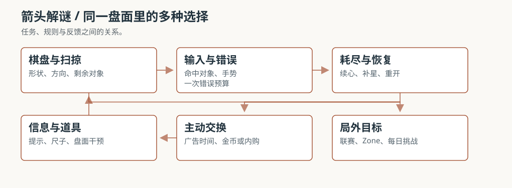

### 2.2 资源与失误

Amaze 每关固定 3 心，点错扣 1 心。同一支错误箭头在反馈动画期间再次点击，不会继续扣心。这个细节很重要：它保留了判断错误的代价，但不会让手快连点把一次误判迅速放大成整局失败。玩家知道自己错了一次，还有两次机会调整，心态上更容易继续找解法。

Point 每关固定 3 星，点错扣 1 星。同一支错误箭头在动画期间再次点击，会继续扣星。3 星预算本来就不宽，连续点同一个对象可能很快把资源打空。玩家在那一刻会从找解法转去处理资源恢复，解题节奏被打断。这个差异不是操作手感的问题，而是失败反馈会不会被重复计费的问题。

Maze 普通关 3 心，HARD 4 心，SUPER HARD 5 心。它的高难关用加心补偿，而不是改变规则。Maze 的重复误触保护没有单独测试，所以本文不把它放进三款的误触横向比较。能确认的是，Maze 的失败恢复和 Point 不一样：它允许直接重开，复活只是保留当前进度的一个可选项。

三种资源规则带来的体验差别很清楚。Amaze 的 3 心是固定预算，但错误只计一次；Point 的 3 星也是固定预算，错误可能被连续计费；Maze 的预算是浮动的，高难关多给心，代价是复活价格更高。玩家在 Amaze 里更容易把失败归因到自己的判断，在 Point 里容易把失败归因到资源不够，在 Maze 里则容易直接选择重开。

### 2.3 难度标签与预算

Amaze 的高难标签出现在 L5、L8、L10、L13、L15、L18，L20 标超难。困难关之间会插回普通关，压力有起伏。标签的作用不是告诉玩家这关有多难，而是告诉玩家这一关值得认真对待；普通关也不是送分，只是没有额外标签。

Point 的标签从 L10 开始，L10、L16、L20 标 HARD，L18 标 SUPER HARD。标签出现了，预算却没有变化，始终是 3 星。玩家看到 SUPER HARD 会预期规则或预算发生变化，实际遇到的仍是更大的图案和更多的箭头。标签升级和玩法变化不同步，会让标签逐渐失去信息量。

Maze 的标签和预算绑在一起。L10、L15 标 HARD，心数从 3 加到 4；L20 标 SUPER HARD，心数加到 5。它没有用标签承诺新机制，而是直接用更多容错来降低失败率。这个做法很直接，玩家也能马上理解：这一关更难，所以多给一颗心。

三款对标签的使用，其实代表三种设计取向。Amaze 用标签组织节奏，Point 用标签制造期待，Maze 用标签解释预算。哪一种更有效，要看标签后面有没有跟得上玩家的实际体验。Amaze 的困难关确实换了形状，Point 的 HARD 多数还是加量，Maze 的 HARD 至少兑现了多一颗心。

### 2.4 读图辅助与操作

Amaze 的辅助集中在信息。灯泡会高亮一支可点箭头，并提示当前还有几支能点；L18 起灯泡出现 AD 角标，说明提示需要看广告。玩家得到的是下一步能点哪里，仍然要自己完成移除。提示没有替玩家过关，也没有改变排位结构，广告出现在玩家主动需要信息的时候。

Point 把辅助拆成四件道具。灯泡负责提示，橡皮负责移除或修正，魔法棒负责更强的辅助，尺子提供基准线读图，价格分别是 3 个 900、3 个 1400、3 个 1900、5 个 250 金币。道具种类多，玩家需要先理解每件道具解决什么问题，再决定买哪一件。前二十关可以不用道具完成，但一旦需要辅助，最低 900 的门槛会立刻出现。

Maze 把尺子和基准线做成常驻免费能力，玩家不需要先付费才能读懂长箭身。它也有深浅色切换，能适应不同观看环境。Maze 的辅助不是商品，而是基础读图能力；这一点直接改善了单次体验，也让玩家把注意力放在解谜上，而不是先算道具够不够。

三种辅助的差别，可以概括为信息、能力和商品。Amaze 卖信息，Point 把能力拆成商品，Maze 把最基础的读图能力免费给玩家。对箭头解谜来说，读图是玩法的前提，不是可选的增强；把前提做成商品，短期能提高转化，长期会让玩家把失败归因到没买道具。

## 3 难度与二十关节奏

### 3.1 Amaze：用换形和标签组织爬坡

Amaze 的前四关是一段很短的教学。L1 教点击，L2 教箭头会沿指向离开，L3 在数量不变的情况下加入内外层，L4 加到 7 支并出现长箭身和小 U 的误读。四关分别增加点击、指向、层级、整支箭身四个维度，没有一次把所有东西同时堆上来。玩家在四次小失败里学会规则，进入 L5 时已经具备读整块板的基础。

L5 是第一个台阶。棋盘换成眼镜形大板，同时弹出双指缩放提示，难度标签第一次出现。它没有把箭头数量翻倍，而是换了一种读图规模。玩家需要缩放去看局部，也需要重新判断整块板的层次。这个变化比单纯加量更容易被感知，因为它改变了玩家看棋盘的方式。

L5 之后，困难关和普通关交替出现。L6 和 L7 没有标签，但密度和咬合程度仍在上升；L8 再标困难；L9 继续加宽。玩家在困难关消耗注意力，回到普通关可以恢复，再进入下一段压力。这种紧松交替让玩家感觉自己在一段一段地推进，而不是被持续加量拖垮。

L10 到 L14 加入了社会证明。L10 和 L13 标困难，同时给出通过率或难度认同；L12 和 L14 没有标签，却用低通过率制造压力。标签告诉玩家这是难关，百分比告诉玩家别人也过不去。两种难度语言交替出现，让压力不显得单调。

L15 到 L20 收束到超难和联赛。L18 的灯泡出现 AD 角标，L20 标超难，清空后进入青铜联赛。联赛页显示分数、排行榜和倒计时，金箭头计排位分。前十九关的难度、提示和社会证明，最终在 L20 收成一个结果。玩家通关以后不只知道下一关是什么，还知道自己这一局算进了哪里。

Amaze 的节奏之所以清楚，是因为它同时在三个层面做变化。关卡形状在变，标签在变，社会证明也在变。玩家不需要看攻略，也能从画面和文案里知道自己正在爬坡。困难关之后的普通关不是退步，而是让玩家把刚学会的读图方式再用一遍。

### 3.2 Point：一条不断加长的练习

Point 的前五关是教学之后直接加量。L1 是点击教学，L2 到 L3 增加数量和层级，L4 到 L5 增加视图。五关里没有新的解谜规则，变化是数量、层数和缩放。L3 还有一个很重要的体验：我在这一关把 3 星打到 0，触发了 Out of Stars。前五关就可能耗尽预算，说明 Point 的失败门槛并不高。

L6 到 L11 继续放大图案。L7 的对称降低了读图成本，L8 的长箭头变多，L9 的箭头开始互相穿插，L10 第一次标 HARD，L11 的密度继续上升。这一段的主要变化是看哪里和先拆哪一层，没有出现 Amaze 那种整板换形。HARD 标签出现在 L10，但玩法仍然是加量。

L12 到 L16 加入了道具和分段结算。L12 通关后解锁魔法棒，L16 弹出 ZONE COMPLETED。玩家此时已经可以用金币买道具，但约 700 的累计金币仍低于最低 900 的三件包门槛。道具系统在 L12 解锁，经济门槛却在更晚的地方才被玩家感知。

L17 到 L20 是标签升级、规则不变的一段。L18 标 SUPER HARD，L20 标 HARD，但难点仍是大盘搜索与拆层。玩家看到 SUPER HARD 会期待一次规则变化，实际遇到的还是更大的图案。标签在这里更像难度宣传，而不是玩法承诺。

Point 的曲线基本是一条斜线：箭头更多、图案更大、层数更多。玩家在前期会觉得轻松，到了中后期突然发现自己一直在做同一件事，只是量变大了。标签出现得太晚，也没有和规则变化绑定，难以形成 Amaze 那种一段一段的爬坡感。

### 3.3 Maze：用加心抚平曲线

Maze 的第一关只有 4 支独立箭头，规则一眼可读，没有长教学。L2 直接进入 12 支对称十字，我在这一关用完 3 心，第一次看到复活面板。L3 和 L4 展示了长框、彩色 U 和逐层拆解，玩家很快进入完整的读图状态。

L5 到 L9 主要增加轮廓和层数。宝塔、屋檐、圆角方框、T 形和十字、不规则几何板，难度仍由轮廓和层数推动，和 Point 的体感接近。Maze 的图案比 Point 更接近具象形状，玩家容易记住这一关长什么样，也容易被轮廓掩盖箭头的方向。

L10 到 L15 用加心补偿高难关。L10 和 L15 标 HARD，心数从 3 加到 4；L11 到 L14 回到 3 心。Maze 的高难关没有改变规则，而是多给一颗心。这个做法直接降低失败率，也让 HARD 更像预算标签，而不是机制标签。

L16 到 L20 是形状收束。曼陀罗、三角形、心形、猫和机器人、四方阵，都是视觉上很强的轮廓。L20 标 SUPER HARD，5 心，通关后解锁每日挑战。Maze 用每日挑战接后续回访，单关结果本身没有像 Amaze 联赛那样的排位去处。

Maze 的整体曲线和 Point 很像，都是靠箭头量和图案复杂度推动。它比 Point 多做了两件事：高难关加心，读图辅助免费。加心降低了失败率，免费尺子降低了读图负担，两者都让前二十关更顺。但复活价格没有跟着产出调整，玩家在失败后仍然会选择重开。

### 3.4 三种曲线

Amaze 的难度是台阶式的。前四关建立规则，L5 换形，L6 到 L9 紧松交替，L10 到 L14 标签和社会证明一起加码，L15 到 L20 收束到超难和联赛。玩家每隔几关就能感到一次变化，困难关之后还有普通关恢复。

Point 的难度是斜线式的。前五关教学加量，L6 到 L11 图案变大，L12 到 L16 加入道具和 Zone，L17 到 L20 标签升级但规则不变。玩家一直在做同一件事，只是盘子越来越大。它不难，但缺少让人记住的台阶。

Maze 的难度是斜线加预算补偿。L1 到 L4 直接给出完整规则，L5 到 L9 增加轮廓，L10 到 L15 高难关加心，L16 到 L20 形状收束。它的体感接近 Point，但读图负担更低，高难关也更容易过。问题在于，难度被加心压低以后，复活的价格没有跟着降低，失败恢复和难度曲线脱节。

三款放在一起，Amaze 最像一段有起伏的关卡序列，Point 最像一条不断加长的练习，Maze 最像一条被免费尺子和加心抚平的曲线。哪一种更适合 IAA，要看产品想让玩家在失败后做什么。Amaze 想让玩家继续解，Point 想让玩家补资源，Maze 想让玩家保留进度。三种目标对应三种节奏，也对应三种不同的长线结果。

## 4 数据口径与关卡判定

### 4.1 关卡与截图

本文的二十关指每款产品的 L1 到 L20，共六十关。Point 和 Maze 的 L21 只用于确认通关后的衔接，不进入六十关表。每关至少一张截图，截图来自实机，不使用商店图。L1 的教学层、转场和结算卡会遮挡棋盘，遇到这种情况优先保留能确认关卡号与资源的一帧，并在附录写明。

为什么要把截图口径写得这么细，是因为箭头解谜的画面很容易误导。转场帧可能没有关卡号，结算卡可能只显示星星，教学遮罩会盖住棋盘。如果只按文件顺序选图，很容易把上一关的结算当成下一关的棋盘。本文用 HUD 关卡号 OCR 校验，再用 MD5 去重，目的不是让截图好看，而是让每一张图都能对应到具体关卡。

### 4.2 标签口径

Amaze 的困难、超难，Point 的 HARD LEVEL、SUPER HARD，Maze 的 HARD、SUPER HARD，都按截图原文记录。截图中没有标签的关卡统一写一条横线，不推断为普通。正文里说普通关，指的是没有高难标签的关卡，不是官方分类。

这条口径会影响很多判断。比如 Amaze 的 L6、L7 没有标签，但密度和咬合程度仍在上升；如果把它们当成普通关，就会低估这一段的压力。Point 的 L12 没有标签，却解锁了魔法棒；如果只看标签，会漏掉道具系统对体验的影响。Maze 的 L11 到 L14 没有标签，但心数回到 3，和 HARD 关的 4 心形成对照。标签是入口，不是全部。

### 4.3 资源与金币

心数和星数按截图左下或顶部的图标计数。Amaze L16 的 2 心是已经掉了 1 心，不是该关预算；Maze L5 的 2 心也是截图时已经掉血。金币数字来自本人口述与截图：Maze 普通关 10、L10 20、L20 30，二十关约 230；Point 到约 29 关累计约 700。它们是体验记录，不是后台账本，误差范围用约数标注。

金币口径直接决定经济判断。Maze 的 230 和 300 只差 70，看起来接近，但玩家在第二十关时仍然买不起一次复活；Point 的 700 和 900 只差 200，看起来也接近，但最低档的三件包就是 900，玩家在需要道具时仍然跨不过门槛。两个差距都不大，却都刚好卡在玩家最需要的那一刻。这种差一点点的定价，比明显买不起更容易让人产生挫败感。

### 4.4 证据分级

本文把证据分成三级。A 级是截图中可以直接看到的内容，比如难度标签、剩余心数、按钮、价格和文案。B 级是实机操作中确认、但截图中不完整的内容，比如同一支错误箭头在动画期间会不会继续扣心、免费继续补几心、重开是否保留进度。C 级是本人口述或商店页面，比如金币累计、广告入口、商店价格。

正文里的判断优先使用 A、B 两级。只有 C 级依据的数字会写约或口述，不把它们当成精确统计。这样写会让文章显得保守，但能避免把体验记录说成后台数据。比如 Amaze 的免费继续补 3 心，是操作中确认的 B 级证据；Point 的 700 金币是口述的 C 级证据；Maze 的 300 金币复活是截图中可见的 A 级证据。三种证据的可信度不同，结论的力度也应该不同。

### 4.5 未验证项

本次没有验证 Maze 的重复误触保护，所以不把它放进三款的误触比较。广告频次和 eCPM 不可见，本文只判断广告出现的位置，不估算收入。留存曲线没有后台数据，本文只分析局外目标的设计意图。Point 和 Maze 的金币产出只有部分记录，经济判断以门槛和单次价格为主。三款的长期难度只到 L20 和 L21，不评价二十关之后的曲线。

这些未验证项不是文章的免责声明，而是结论的边界。比如 Maze 的复活是否真的无效，取决于玩家对当前进度的在意程度；本文只能确认二十关累计约 230、复活 300、重开免费这三个事实，不能替所有玩家下结论。Point 的补星是否过重，也取决于玩家是否愿意看广告；本文能确认的是 3 星预算下重复误触会继续扣星，以及补星入口同时有广告、金币和 Safety Net。把能确认的和不能确认的分开，后面的判断才有依据。

### 4.6 为什么不用后台指标

这是一篇设计拆解，不是数据报告。没有后台数据，就不应该用留存、ARPU、eCPM 这些指标去反推产品好坏。本文能用的是六十张截图、实机操作和商店快照，能回答的是玩家在关卡里看到了什么、失败后有什么选择、这些选择对应什么设计意图。它不能回答哪一款赚得更多，也不能回答广告频次对留存的影响。

不用后台指标，不代表不做量化。二十关的标签分布、心数变化、金币产出和道具价格都是量化信息，只是它们来自体验记录，不是服务器日志。把这些数字放在一起，已经足够解释三款产品在难度、恢复和经济上的差异。再往上走，就需要真实的后台数据，本文不假装拥有它。

## 5 二十关分段分析

### 5.1 Amaze L1 到 L4：把规则拆成四步

L1 只教点击。画面用一次手指演示告诉玩家箭头可以点，结算卡显示今日关卡 1、用时 00:12、1300 分、3 星。它没有解释路径、层级和长箭身，只让玩家建立一个最基本的动作。L2 用 4 支短箭头让玩家看到箭头会沿指向离开，路径一眼可读，玩家开始把点击和箭头方向联系起来。

L3 的数量仍然是 4 支，但加入了内外层嵌套。玩家要先拆外圈，才能碰到内圈；数量没变，读图顺序变了。L4 加到 7 支，棋盘明显变大，出现小 U 其实是大箭头的读图陷阱。玩家开始需要追踪整支箭身，而不是只盯箭头尖端。四关分别增加点击、指向、层级、整支箭身四个维度，没有一次把所有东西同时堆上来。

这一段的教学效率很高。它没有用大段文字解释规则，而是用关卡本身出题：L1 让玩家学会点，L2 让玩家看到方向，L3 让玩家遇到遮挡，L4 让玩家误读一次长箭身。玩家在四次小失败里学会规则，进入 L5 时已经具备读整块板的基础。

### 5.2 Amaze L5 到 L9：第一次换形与紧松交替

第三章已经从节奏角度讲过 L5 的位置，这里只看玩家在关卡里实际要做的动作。眼镜形大板把棋盘拉宽，玩家必须用双指缩放才能在局部和整体之间切换；缩放不是难度本身，但它改变了玩家读图的顺序。过去玩家可以从边缘一路扫过去，现在要先决定看哪一块，再把局部放回整体。L5 的困难标签只是提醒，真正让玩家停下来的是这块板不再能用同一种方式读完。

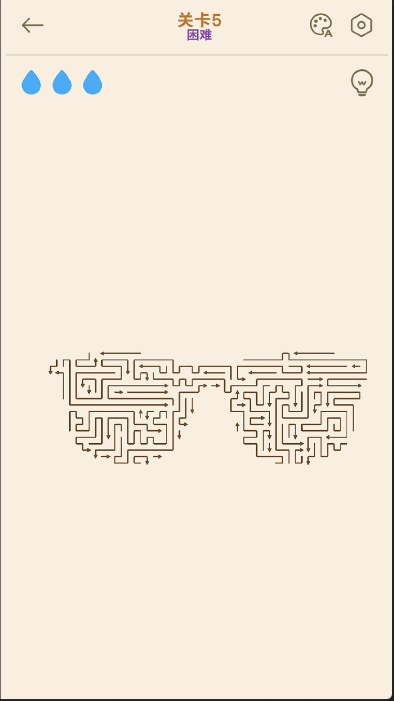

L6 是大回形和方框嵌套，箭头密度上升，但没有标签；L7 接近满屏的方形迷宫，箭头互相咬合，需要从边缘找突破口；L8 再标困难，截图里的绿色高亮是一整支可点箭头；L9 继续加宽，仍然是 3 心、没有标签。这一段形成紧、松、紧、松的节奏。玩家在困难关消耗注意力，回到普通关可以恢复，再进入下一段压力。

L8 的提示值得单独说。绿色高亮不是替玩家点掉箭头，而是把一支可以走的箭头照亮，玩家仍然要自己判断下一支。提示给的是信息，不是答案。这个设计让玩家在求助以后还能保留解谜过程，也让广告出现在玩家主动需要信息的时候，而不是失败以后强制弹出。

L9 没有标签，但棋盘继续加宽。普通关不是送分，只是没有额外标签。玩家在这一关仍然要花时间搜索，只是没有社会证明和困难标签带来的心理压力。Amaze 用标签组织节奏，而不是用标签定义所有难度，这一点在 L6、L7、L9 上体现得很清楚。

### 5.3 Amaze L10 到 L14：标签与社会证明一起加码

L10 标困难，同时弹出通过本关可以超越 74.59% 玩家的提示。难度标签告诉玩家这是难关，百分比告诉玩家别人也在这一关花时间。L11 的黄色高亮是提示，棋盘是细长回形加外圈；提示不会直接指出目标箭头，只亮当前可点的一支。L12 弹出仅 42.38% 玩家通关的提示，没有困难标签，却用低通过率制造压力。

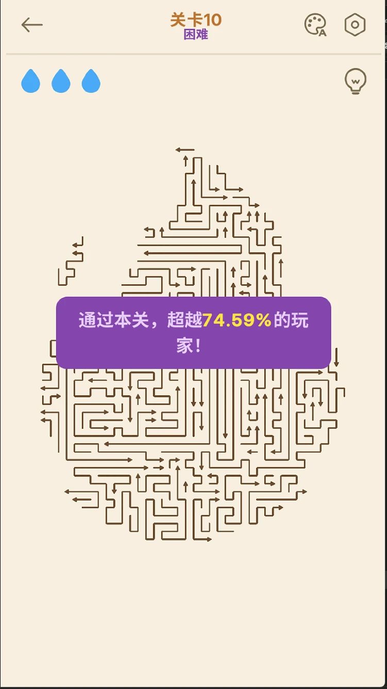

L13 标困难，并写 65.05% 的玩家认为本关难度很高。这个文案的作用不是增加难度，而是降低玩家的自我怀疑：既然大多数人都觉得难，自己卡住就不是个人问题。L14 写仅 41.20% 的玩家在此清除了全部箭头，把通过率和清空率分开，让玩家知道即使通关，也不一定清得干净。

这一段出现了两种难度语言。标签是官方的，百分比是社会的。标签告诉玩家这一关被设计成难关，百分比告诉玩家这一关在实际体验里也很难。两种语言放在一起，会让玩家同时感到被挑战和被理解。Amaze 没有只靠标签，也没有只靠百分比，而是让两者交替出现，形成一种有节奏的压力。

L12 和 L14 没有标签，却用低通过率制造压力，说明标签不是唯一的难度信号。玩家看到 42.38% 和 41.20% 时，会自己判断这一关值不值得认真对待。Amaze 把一部分难度解释权交给了玩家，而不是全部由标签定义。

### 5.4 Amaze L15 到 L20：收束到超难与联赛

L15 标困难，配 70.49% 的玩家在此关失败。L16 截图时已经掉了 1 心，黄色提示亮起，说明普通关也会消耗容错。L17 写仅有 40.00% 的玩家掌握了这个棘手关卡，百分比开始走低，制造少数人能做到的感觉。L18 标困难，写 85.35% 的玩家表示此处的图案太难了，灯泡从这关起出现 AD 角标，提示需要看广告。

L19 写仅有 39.44% 的玩家解出了这道谜题，是 L20 前的最后一关。L20 标超难，整板大图案，清空后进入青铜联赛。联赛页显示 40、32、32 分和 23 小时 34 分倒计时，金箭头计排位分。单关结果在这里第一次接到局外排名，通关不再只是进入下一关，而是这一局算进了某个地方。

L20 的收束很重要。前十九关的难度、提示和社会证明，最终都需要一个去处。如果没有联赛，玩家通关以后只会进入下一关，单关表现没有积累；有了联赛，金箭头、分数和倒计时会把这一局变成长期目标的一部分。Amaze 不是靠某一关留住玩家，而是靠最后一关把前面的体验收成一个结果。

L18 的 AD 角标也值得注意。提示从这关起明确标出需要广告，玩家在点之前就知道要看广告。它没有在失败后突然弹出广告，而是把广告放在求助入口上。玩家可以选择不看，继续自己找；也可以选择看，换取一支可点箭头。广告是选项，不是门槛。

### 5.5 Point L1 到 L5：教学之后直接加量

L1 是点击教学，4 支箭头，提示玩家点一支箭头让它离开。L2 加到 5 支，出现外框和内回形；L3 到 9 支，红色外框加四象限，要求玩家先拆外层再处理内部。L4 是多层矩形 U，外层拆完内部才露出来；L5 首次弹出双指缩放，棋盘变大。

五关里没有新的解谜规则，变化是数量、层数和视图。L3 还有一个很重要的体验：我在这一关把 3 星打到 0，触发了 Out of Stars。前五关就可能耗尽预算，说明 Point 的失败门槛并不高。玩家还没学会所有读图方式，就已经要面对补星入口。

Point 的教学比 Amaze 短。它用 L1 一关建立点击，L2 和 L3 增加数量与层级，L4 和 L5 增加视图。玩家能很快上手，但也很快进入重复的加量。前五关的节奏是平的，没有 Amaze L5 那种换形带来的明显台阶。

### 5.6 Point L6 到 L11：图案变大，标签出现

L6 是上下两大块、青橙分色，单屏信息量明显上升；L7 是对称塔形，蓝黄红三层，对称降低了读图成本；L8 是绿色主板的复杂回形，边缘长箭头变多；L9 多色混合，箭头开始互相穿插；L10 第一次标 HARD，粉色环加中心空洞，难点是环很宽、要找入口；L11 是浅蓝和绿的方框迷宫，密度继续上升。

这一段的主要变化是看哪里和先拆哪一层，没有出现 Amaze 那种整板换形。HARD 标签出现在 L10，但玩法仍然是加量。玩家看到 HARD 会期待新的规则或更强的压力，实际遇到的还是更大的图案。标签和体验之间的落差，会削弱标签的可信度。

L7 的对称是一个有趣的反例。它的图案很大，但对称让玩家可以只读一半，再镜像到另一半，实际读图成本比 L6 低。Point 的难度并不完全由面积决定，对称、颜色分区和长箭身的位置都会改变玩家的搜索路径。只看箭头数量，会低估或高估某一关的实际难度。

### 5.7 Point L12 到 L16：道具解锁与 Zone 结算

L12 是红色异形板，通关后解锁魔法棒；L13 是橙紫的 W 形和 M 形板；L14 是紫青橙竖条分层；L15 是蓝色高塔加红色侧翼；L16 标 HARD，红金菱形板，通关后弹出 ZONE COMPLETED。

L12 的新鲜感来自道具解锁，不是关卡规则。玩家在这一关第一次知道还有魔法棒，但关卡本身仍然是加量。L16 的 Zone 结算把十六关收成一段，给玩家一个完成度节点。它和 Amaze 的联赛不同，联赛是把单关结果接到排名，Zone 是把一段关卡收成一个地图进度。两种都能提供目标，但前者更强调单局表现，后者更强调收集和推进。

玩家此时已经可以用金币买道具，但约 700 的累计金币仍低于最低 900 的三件包门槛。道具系统在 L12 解锁，经济门槛却在更晚的地方才被玩家感知。玩家先知道有道具，再发现自己买不起，这个顺序会让道具更像一个看得见但摸不着的东西。

### 5.8 Point L17 到 L20：标签升级，规则不变

L17 是绿红 S 形迷宫，进入 Zone 2；L18 标 SUPER HARD，红绿金字塔；L19 是四块紫青方阵；L20 标 HARD，绿色房子形大板。L18 的标签比 L16 更高，但难点仍是大盘搜索与拆层，没有新的解谜规则。

Point 的二十关在 L20 结束得比较平。它没有 Amaze 那种超难关加联赛的收束，也没有 Maze 那种 L20 解锁每日挑战的后续目标。玩家通关以后进入 L21，更多是继续沿着同一条曲线走。Zone 和三星提供了完成度，但没有把单关表现接到一个更大的竞争或排名里。

这不是说 Point 没有长期目标，而是它的目标更偏收集。Zone、三星、宝箱都是完成度语言，玩家会想把地图收满；Amaze 的联赛是排名语言，玩家会想打得更好。两种目标对应两种玩家，前者适合喜欢收集和推进的人，后者适合喜欢比较和挑战的人。

### 5.9 Maze L1 到 L4：第一关就给出完整规则

L1 只有 4 支独立箭头，规则一眼可读，没有长教学。L2 直接进入 12 支对称十字，蓝黄分色，左右镜像。我在这一关用完 3 心，第一次看到复活面板：广告或 300 金币，当时只有 10 金币。L3 是粉色长框加 5 个彩色 U，长框只有右端能整条飞出，每个 U 实际含上下两支箭头，拆完还会剩一支。L4 按青外圈、蓝层、底部青层、蓝十字逐层拆，实机以 1 心通关，弹出做得好提示和烟花。

Maze 没有把 L1 拉成多关教学，L2 就要求读对称结构和内外层。它的上手速度比 Amaze 和 Point 都快，但失败也来得更早。L2 的复活入口第一次出现就不可用，玩家会很快学会直接重开。这个学习不是设计教出来的，而是价格逼出来的。

L3 和 L4 展示了 Maze 的读图特点。长框只有一端能飞出，彩色 U 里面还藏着上下两支箭头，玩家不能只看轮廓，还要看箭身的方向和端点。L4 的逐层拆解则是典型的内外层关系，先拆外圈，再处理内部。Maze 的关卡形状比 Point 更花，但规则仍然简单，难度来自轮廓和层数。

### 5.10 Maze L5 到 L9：轮廓与层数

L5 是宝塔形，橙外黄内，截图时已经掉了 1 心；L6 是多层屋檐，层与层之间互相挡路；L7 是圆角方框迷宫，外圈先拆、内圈后拆；L8 是 T 形和十字混合，中轴长箭头是突破口；L9 是不规则几何板，箭头开始跨区域咬合。

这一段的主要变化是轮廓。Maze 的图案比 Point 更接近具象形状，宝塔、屋檐、圆角方框、猫和机器人都会让玩家先看到整体，再去找箭头。具象轮廓有好处，玩家容易记住这一关长什么样；也有坏处，轮廓会掩盖箭头的方向，玩家可能先被形状吸引，再发现某支长箭头堵住了关键路径。

L8 的中轴长箭头是一个典型。它看起来像图案的一部分，实际是突破口；玩家要先找到它，才能拆开左右两边。Maze 的难度经常来自这种视觉误导，而不是箭头数量。它和 Point 的加量不同，更依赖玩家对形状和路径的理解。

### 5.11 Maze L10 到 L15：加心补偿

L10 标 HARD，心数从 3 加到 4，菱形大板；L11 回到 3 心，密集矩形；L12 是菱形和回形嵌套；L13 是钟形和穹顶形，下半部是长横箭头；L14 是矩形内挖空，要先判断拆中心还是外圈；L15 标 HARD，4 心，船形和城堡形，左右结构不对称。

Maze 的高难关没有改变规则，而是多给一颗心。这个做法直接降低失败率，也让 HARD 更像预算标签，而不是机制标签。玩家看到 HARD 会知道自己多了 1 心，但不会期待新的解谜方式。它诚实，但也保守：难度没有被重新设计，只是被容错抵消了一部分。

L15 的不对称结构比 L10 更有意思。左右不对称会让玩家无法只读一半再镜像，必须分别处理两边。它没有加心以外的变化，但形状本身提高了读图成本。Maze 的 HARD 关并不是完全一样，L10 是菱形大板，L15 是船形和城堡形，两者的难点不同，只是都被 4 心包住了。

### 5.12 Maze L16 到 L20：形状收束与每日挑战

L16 是圆形曼陀罗，径向对称，读图成本高；L17 是三角形对分，左右两半互相咬合；L18 是心形板，曲线轮廓里塞满箭头；L19 是猫和机器人轮廓，顶部双耳是难点；L20 标 SUPER HARD，5 心，四个嵌套方阵。

L20 通关后累计约 230 金币，仍不够一次 300 金币复活；L20 之后解锁每日挑战。Maze 用每日挑战接后续回访，单关结果本身没有像 Amaze 联赛那样的排位去处。它的长期目标是每天回来玩一局，而不是把这一局打成排名。

Maze 的二十关收在形状上。曼陀罗、三角形、心形、猫和机器人、四方阵，都是视觉上很强的轮廓。玩家会记住这些关卡长什么样，但不一定记得自己是怎么解的。Maze 的体验更偏感官和形状，Point 更偏搜索和加量，Amaze 更偏节奏和排位。

### 5.13 分段对照

Amaze 的分段是教学、换形、紧松交替、标签加码、超难收束。Point 的分段是教学加量、图案放大、道具与 Zone、标签升级。Maze 的分段是直接给规则、轮廓增加、加心补偿、形状收束。三款都在前二十关里完成了自己的节奏，但只有 Amaze 在最后给了单关结果一个排位去处，Point 给的是 Zone 和三星，Maze 给的是每日挑战。

这三种收束方式对应三种留存逻辑。Amaze 让玩家想把这一局打得更好，Point 让玩家想把这一段收满，Maze 让玩家想明天再回来。它们都能支撑长期游玩，但支撑的点不同。Amaze 的排位最贴近单关表现，Point 的收集最贴近关卡数量，Maze 的每日挑战最贴近日常习惯。

## 6 重点盘面对照

### 6.1 Amaze L4 与 L5

L4 的 7 支箭头仍在同一块矩形板上，难点是长箭身和小 U 的误读；L5 换成眼镜形大板，并引入缩放。数量只多了一点，读图方式却变了。这是我判断 Amaze 难度可感知的主要依据。

如果只看箭头数量，L4 和 L5 的差别不大；如果看玩家要做的事，差别很大。L4 要求玩家追踪更长的箭身，L5 要求玩家缩放、看局部、重新建立整块板的空间关系。前者是同一套读图方式的延伸，后者是换了一套读图方式。玩家在 L5 会明显感到自己进入了另一种关卡。

这也是 Amaze 和 Point 最大的区别。Point 的关卡也在变大，但玩家一直用同一种方式读图：找边缘、找长箭头、拆层。Amaze 会在某个节点换形，让玩家重新学习一次。换形不一定更好，但它更容易被记住，也更容易形成台阶感。

### 6.2 Amaze L13 与 L14

L13 标困难，配 65.05% 的玩家认为本关难度很高；L14 没有标签，却写仅 41.20% 的玩家在此清除了全部箭头。两关都用社会证明，但一个靠标签，一个靠低通过率。

L13 的文案是在解释难度。它告诉玩家这一关难，而且大多数人都觉得难，玩家卡住时不会觉得自己特别差。L14 的文案是在制造挑战。它没有标签，却用更低的清空率告诉玩家，这一关不仅难过，还很难清干净。两种文案对应两种心理：一种是安慰，一种是刺激。

Amaze 把标签和百分比交替使用，说明它不依赖单一难度信号。标签负责组织节奏，百分比负责制造社会比较。玩家在不同关卡会收到不同的压力，有时是被理解，有时是被挑战。这个交替让难度不显得单调。

### 6.3 Point L3、L10 与 L20

L3 只有 9 支箭头，但我在这一关耗尽 3 星；L10 标 HARD，粉色环加中心空洞；L20 标 HARD，绿色房子形大板。三关的预算都是 3 星，难度从层数与象限走到图案规模，但没有出现新的解谜规则。

L3 的失败说明预算和难度不是一回事。9 支箭头不算多，但红框和四象限要求玩家先拆外层，判断顺序错了就会连续扣星。L10 和 L20 的图案更大，但玩家已经熟悉了拆层和找入口，实际压力不一定比 L3 高。Point 的难度曲线不是单调上升的，它更像一条有波动的斜线。

这也是为什么标签在 Point 里不够好用。L10 和 L20 都标 HARD，但 L3 没有标签却可能更难。标签没有覆盖真正的难点，玩家只能靠自己的体验判断。标签越多，反而越容易让玩家忽略那些没有标签但实际很卡的关卡。

### 6.4 Point L10 与 L18

L10 是第一次 HARD，L18 是 SUPER HARD。两关的差别主要在图案轮廓与搜索量：L10 是宽环找入口，L18 是红绿金字塔拆层。标签升了一级，玩法没有换层。

玩家看到 SUPER HARD 会预期一次更强的挑战，实际遇到的还是更大的图案。它不一定更简单，但它的难和 L10 是同一种难。Point 的标签在纵向上升级，在横向上没有变化。玩家会感到难度在增加，但不会感到自己在学新东西。

Amaze 的困难标签也会重复，但它的关卡形状在变。L5 是眼镜，L10 是社会证明，L18 是 AD 角标，玩家每次遇到困难关，都会遇到一点不同的东西。Point 的 HARD 和 SUPER HARD 更多是同一套难度的不同尺寸。

### 6.5 Maze L2 与 L20

L2 是 12 支对称十字，3 心，第一次死亡就遇到 300 金币复活；L20 是四个嵌套方阵，5 心，通关累计约 230 金币。两关都把心数和金币放在同一个恢复循环里：L2 金币不够，L20 金币仍不够。

L2 的问题不是复活太贵，而是玩家还没有投入。刚玩到第二关，重开的成本很低，300 金币没有任何吸引力。L20 的问题不是玩家没有投入，而是产出仍然不够。打了二十关，累计 230，还是买不起一次 300 的复活。复活价格没有随着关卡推进变得可用，反而一直被免费重开架空。

如果 Maze 想让复活成立，它需要让玩家感到进度值得保留。前二十关的关卡重走成本不高，玩家很难为保留十几支已清箭头付 300。要么降低价格，要么让复活保留的东西更多，比如保留关卡进度、奖励或连续通关状态。只保留当前盘面，玩家算一下就会选择重开。

### 6.6 Amaze L20 与 Maze L20

两关都标到最高难度，但收束方式不同。Amaze 用青铜联赛、金箭头排位把单关结果接到长期目标；Maze 用每日挑战接后续回访。前者是这一局算分，后者是明天还有一局。

Amaze 的联赛让玩家在通关后知道自己打得好不好，分数、排名和倒计时都会推动玩家再打一局。Maze 的每日挑战让玩家在通关后知道明天还有新内容，但它不评价这一局的表现。两种收束都能提供回流理由，Amaze 的更偏竞争，Maze 的更偏习惯。

对 IAA 产品来说，两种收束都有效，但适用人群不同。喜欢比较的玩家会更在意 Amaze 的排位，喜欢日常的玩家会更在意 Maze 的每日挑战。Point 的 Zone 和三星介于两者之间，偏收集，不偏竞争，也不偏日常。

### 6.7 对照结论

六组对照看下来，三款的差异可以归成三句话。Amaze 用换形和排位制造台阶，玩家知道自己在一段一段地爬。Point 用加量和标签制造压力，玩家知道自己在一关一关地变大，但不知道自己有没有变强。Maze 用加心和免费尺子降低难度，玩家玩得更顺，但失败恢复没有跟上。

这三句话也解释了三种失败感受。Amaze 的失败更像判断错误，玩家愿意再试；Point 的失败更像资源不足，玩家要先处理补星；Maze 的失败更像选择问题，玩家可以直接重开。失败感受不同，广告的位置也就不同。

## 7 失误、误触与失败恢复

### 7.1 Amaze：一次误判只扣一次

Amaze 每关 3 心，点错扣 1 心。同一支错误箭头在反馈动画期间再次点击，不会继续扣心。它保留判断错误的代价，也避免手快连点把一次误判放大成整局失败。玩家知道自己错了一次，还有两次机会调整，心态上更容易继续找解法。

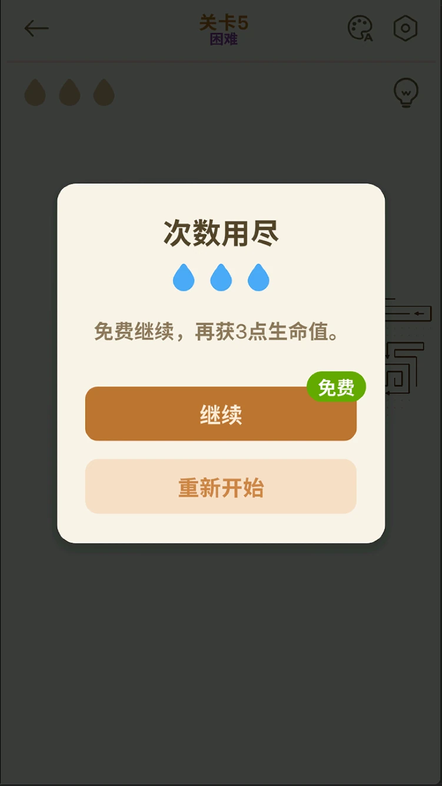

3 心耗尽后，面板提供免费继续并补 3 心，或重新开始。失败恢复没有直接变成广告门槛；广告主要出现在玩家主动点灯泡求助时。这个设计让失败和商业化分开：失败是玩法的一部分，广告是求助的一部分。玩家不会觉得游戏在利用失败赚钱。

Amaze 的恢复还有一种心理作用。免费继续补 3 心，玩家会觉得自己还有机会，不会因为一次失误就放弃。重新开始也在，玩家可以选择从头来。两种选项都不收费，玩家会把注意力放在怎么过，而不是怎么付。这个细节看起来小，实际会影响玩家对整款游戏的信任。

### 7.2 Point：动画期间的重复扣星

Point 同一支错误箭头在动画期间再次点击，会继续扣星。3 星预算下，连续点同一个对象可能很快进入 Out of Stars。这个体验让我从找解法转去处理资源恢复，打断了原来的解题节奏。

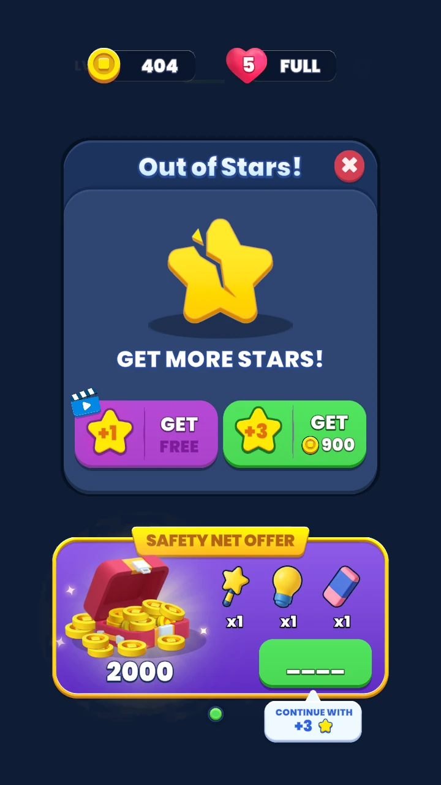

0 星时出现 Out of Stars，提供广告加 1 星、900 金币加 3 星，或 Safety Net。前二十关本身偏简单，但误触连扣与补星门槛叠加，使失败显得更重。玩家不是败给关卡，而是败给一次手快。这个归因会让挫败感更强，因为玩家知道自己本来可以过。

Point 的恢复选项看起来很多，实际上每一条都要付出。广告要时间，金币要积累，Safety Net 要理解规则。玩家在失败瞬间要先做一道资源题，才能回到解谜。恢复不再是继续玩，而是另一套系统。对 IAA 产品来说，这可能是收入点，但对玩家来说，这是解题之外多出来的一层负担。

### 7.3 Maze：复活保留进度，但重开更便宜

Maze 的复活面板提供广告或 300 金币，复活保留当前盘面的已清进度；关卡也可以直接重开。前二十关重走成本不高，300 金币又高于二十关累计约 230，复活选项在本次体验中没有成立。

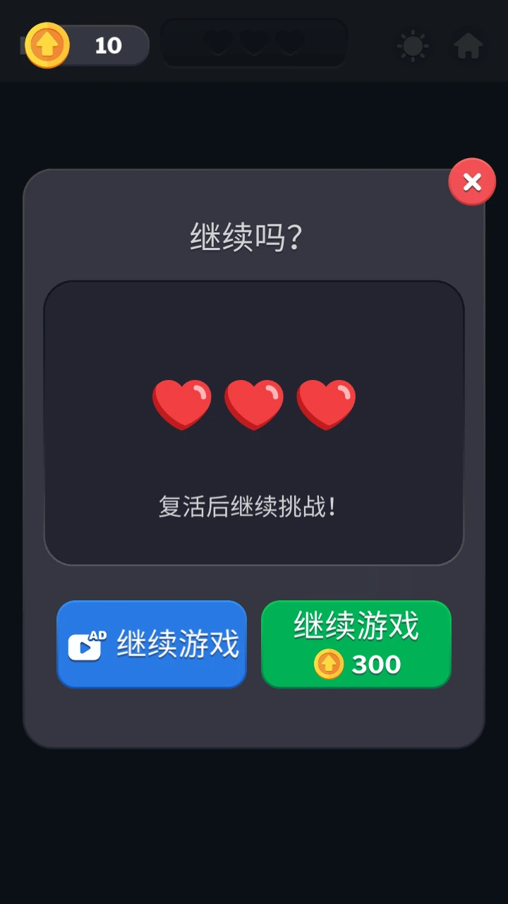

复活卖的是进度。玩家愿意付钱，是因为不想重走已经清掉的箭头。但 Maze 前二十关的关卡不长，重开成本低，玩家对已清进度的在意程度也低。300 金币的价格没有对应到玩家感知到的价值，复活就变成了一个看得见但不会点的按钮。

如果只改价格，50 到 100 金币可能更接近玩家愿意付的范围。如果改价值，可以在按钮上写清保留了多少支已清箭头，让玩家知道自己在买什么。复活不是不能卖，而是要卖玩家真正在意的东西。只保留当前盘面，玩家算一下就知道重开更划算。

### 7.4 三款恢复路径比较

Amaze 的恢复是免费继续。玩家失败后可以补 3 心，继续当前盘面，也可以重新开始。它保留了进度，也不收费。广告在提示入口，不在失败面板。玩家对失败的感受是再来一次，而不是付一次。

Point 的恢复是补星。玩家 0 星后可以看广告加 1 星、花 900 金币加 3 星，或者用 Safety Net。它保留了进度，但每一条路都要付出。广告和金币都把失败和资源绑在一起，玩家要先处理资源，才能回到关卡。

Maze 的恢复是复活或重开。复活保留进度，价格 300 金币；重开免费，但失去进度。前二十关的重开成本低，复活的价格高，玩家自然选择重开。恢复选项存在，但没有形成实际价值。

三种恢复路径的摩擦排序是 Amaze、Maze、Point。Amaze 最轻，因为免费继续；Maze 居中，因为可以重开，只是复活不划算；Point 最重，因为补星同时涉及广告、金币和 IAP。这个排序不是按价格排的，而是按玩家失败后要做多少额外决定排的。

## 8 道具、金币与广告经济

### 8.1 Amaze：信息型提示

Amaze 的灯泡高亮一支可点箭头，并提示可点数量；L18 起灯泡出现 AD 角标。玩家得到的是下一步能点哪里，仍要自己完成移除。提示不替代解法，也不改变排位结构；广告出现在玩家主动需要信息时，而不是失败后强制弹出。

这种提示的边界很清楚。它不会告诉玩家整关的解法，也不会直接点掉箭头。它只把当前可点的一支照亮，让玩家少花一点搜索时间。对卡在搜索阶段的玩家，这很有用；对卡在路径判断的玩家，提示只能帮他找到下一步，不能帮他规划整局。

Amaze 没有金币经济，提示是唯一的辅助入口。它把商业化集中在一个动作上：玩家主动点灯泡，选择看广告，换取信息。这个动作发生在玩家需要帮助的时候，而不是失败的时候。广告没有打断失败恢复，也没有和进度绑定。

### 8.2 Point：四件道具与价格

Point 的道具分得很细。灯泡 3 个 900 金币，橡皮 3 个 1400，魔法棒 3 个 1900，尺子 5 个 250，补星 900 金币加 3 星。每件道具解决不同问题，玩家要先理解自己缺的是提示、修正、强辅助还是读图，再决定买哪一件。

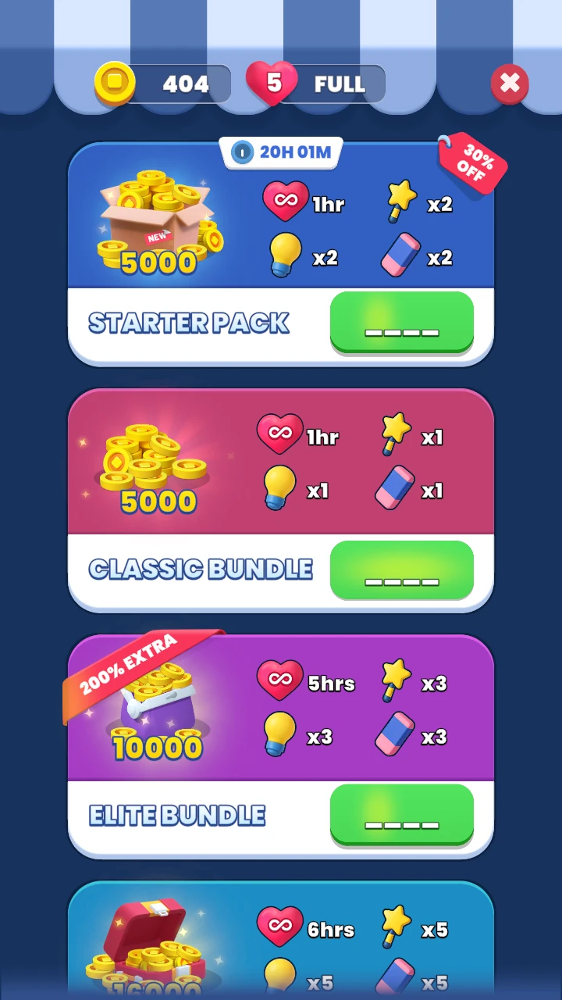

我打到约 29 关时累计约 700 金币，仍达不到最低 900 的三件包门槛。前二十关可以不用道具，但一旦需要辅助，自然积累和购买门槛之间的差距就会被明显感知。玩家不是不想买，而是买不起。这个差一点点的门槛，比明显买不起更容易让人挫败。

Point 的道具系统还有一个学习成本。四件道具的名字和作用需要玩家自己摸索，游戏没有在前期把它们逐个教清楚。玩家在 L12 解锁魔法棒，但那时已经积累了一些金币，也遇到了一些难关。道具出现得晚，价格又高，玩家很难在需要的时候刚好用上。

### 8.3 Maze：金币只有一个主要出口

二十关通关奖励约 230，复活价格 300，且有免费重开。金币在本次体验中的主要出口是复活，使用意愿因此受到价格和重走成本共同影响。免费尺子很好用，但没有缓解复活的购买门槛。

Maze 的金币产出很稳定，普通关 10，L10 20，L20 30，玩家能算出自己打完二十关大概有多少。问题是这个数字刚好低于复活价格。玩家会觉得自己一直在攒钱，但攒到最后还是买不起一次复活。金币只有一个出口，出口又刚好够不着，经济循环就没有形成。

如果 Maze 想让金币有意义，可以增加其他出口，比如提示、主题或跳过，让玩家在复活之外有地方花。也可以降低复活价格，让玩家在关键关卡能用一次。现在的情况是，金币看起来很重要，实际只能用于一个玩家不太想用的按钮。

### 8.4 广告位置对照

Amaze 的广告在提示入口。玩家主动点灯泡，看广告，换一支可点箭头。广告出现在玩家需要信息的时候，玩家可以选择不看，继续自己找。

Point 的广告在 Out of Stars 补星，也在商店和道具入口。玩家失败后可以看广告加 1 星，或者花金币买道具。广告出现在玩家资源耗尽的时候，玩家要先看广告或花钱，才能继续。

Maze 的广告在复活面板。玩家失败后可以看广告复活，也可以花 300 金币，或者直接重开。广告出现在玩家可以绕过的时候，玩家算一下就知道重开更便宜，广告的吸引力因此下降。

三款的广告都不是看完必过。Amaze 给信息，Point 给资源，Maze 给进度。区别在于玩家当时的处境：Amaze 是还想自己解，Point 是已经没有资源，Maze 是愿不愿意为进度付 300。三种处境对应三种广告效果，也对应三种玩家感受。

### 8.5 经济自洽

Amaze 没有金币经济，提示广告不挡进度，经济循环最干净。玩家不需要攒钱，也不需要算道具价格，只要决定要不要看广告换信息。商业化存在，但不影响失败恢复。

Point 的经济不自洽。通关金币约 29 关 700，最低道具包 900，补星也是 900。玩家在需要辅助时，产出低于门槛；在不需要辅助时，金币又没有别的用途。经济系统像是为付费设计的，而不是为玩法设计的。

Maze 的经济也不自洽。二十关约 230，复活 300，且有免费重开。金币的唯一主要出口是复活，复活又不划算。玩家没有动力攒金币，也没有动力看广告复活。经济系统存在，但没有形成循环。

三款放在一起，Amaze 的经济最轻，Point 的最重，Maze 的最空。轻不是没有商业化，而是商业化不挡玩法；重不是价格高，而是玩家在失败后要先处理资源；空不是没有金币，而是金币没有形成有意义的选择。

## 9 局外目标与留存

### 9.1 Amaze：联赛与金箭头

L20 超难通关后进入青铜联赛，金箭头计排位分。记录画面包含 40、32、32 分和 23 小时 34 分倒计时。单关表现接入局外排名，提供后续继续解题的目标。

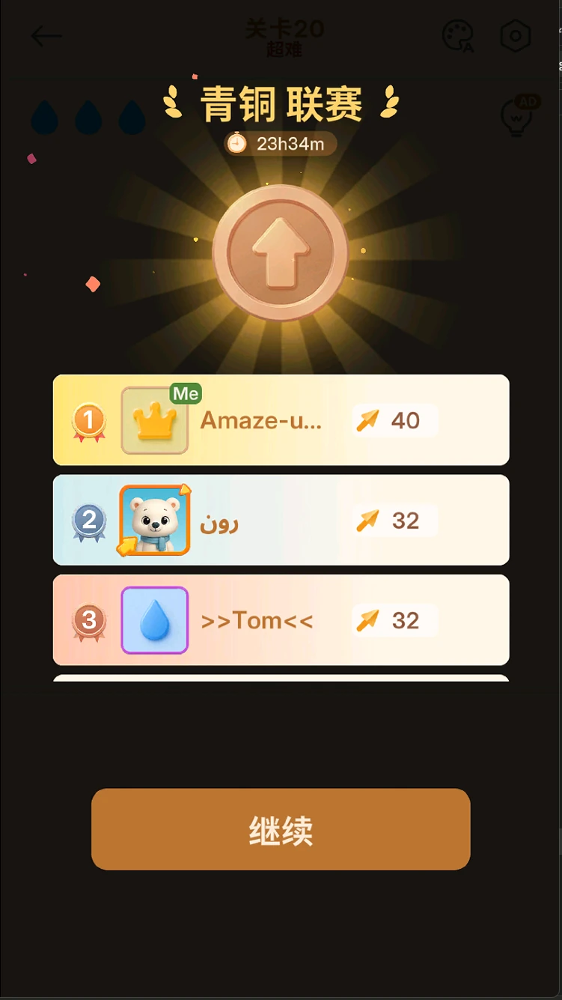

联赛的作用不只是排名。它把单关结果变成一个可比较的数字，玩家会想知道自己下一局能不能打得更好。倒计时又给了一个短期节奏，玩家会在结束前再打几局。分数、排名和倒计时三个元素放在一起，形成了一个轻量的长期目标。

Amaze 的关卡里还有社会比较文案，比如仅 42.38% 的玩家通关、70.49% 的玩家在这关失败。这些文案在单关内制造压力，联赛在单关外接住结果。一个负责让玩家想挑战，一个负责让挑战有去处。两者配合，留存不靠单一系统。

### 9.2 Point：Zone 与三星

Point 用分段 Zone、通关地图和宝箱、三星收集组织进度。L16 后记录到 ZONE COMPLETED。它提供完成度目标，但前二十关的玩法变化仍主要来自箭头量和图案。

Zone 的好处是让玩家知道自己在哪一段。每十六关收成一段，玩家会有阶段感。三星则让玩家想把每一关打得更干净，即使通关了，也可能想回来补星。宝箱和地图提供收集目标，玩家会想解锁下一段。

Point 的问题是，Zone 和三星都没有把单关表现接到一个更大的比较里。玩家知道自己收满了多少，但不知道自己打得比别人好还是差。它适合喜欢收集的玩家，不适合喜欢竞争的玩家。对 IAA 产品来说，收集目标能撑住一部分留存，但很难像排位那样持续制造挑战。

### 9.3 Maze：每日挑战与主题

Maze 通过 L20 后解锁每日挑战；主页另有 Remove Ads 入口。深浅色与免费尺子改善单次使用，每日挑战承担后续回访目标。

每日挑战的作用是给玩家一个每天回来的理由。它不需要玩家推进主线，也不需要玩家重新学规则，只要每天玩一局。对休闲解谜来说，这是一种很自然的留存方式。玩家不会觉得有压力，也不会觉得自己落后。

Maze 还有主题和 Remove Ads。主题改变视觉体验，Remove Ads 提供一次性付费选项。两者都不影响核心玩法，但都能让玩家对产品产生更多归属感。Maze 的留存更偏日常和舒适，不像 Amaze 那样强调竞争。

### 9.4 留存衔接比较

Amaze 的单关结果接到联赛和排位，玩家会想再打一局，看看能不能提高分数。Point 的单关结果接到 Zone 和三星，玩家会想收满这一段，或者回来补星。Maze 的单关结果接到每日挑战，玩家会想明天再回来玩一局。

三种留存逻辑对应三种玩家。Amaze 适合喜欢挑战和比较的人，Point 适合喜欢收集和完成度的人，Maze 适合喜欢日常和轻松体验的人。三款都没有错，但对 IAA 产品来说，Amaze 的排位最容易把单局表现转化成长期目标，Point 的收集需要更多内容支撑，Maze 的每日挑战需要稳定的内容更新。

留存不是靠一个系统就能解决的。Amaze 的联赛之所以有效，是因为前面的关卡节奏已经让玩家在意自己的表现；Point 的 Zone 之所以有效，是因为前面的关卡数量足够多，玩家有收集的欲望；Maze 的每日挑战之所以有效，是因为前面的关卡已经让玩家熟悉规则，每天玩一局不需要重新学习。局外目标必须接住局内体验，否则就只是一个空入口。

## 10 商店资料与产品规模

### 10.1 商店快照

商店资料按 2026 年 10 月 21 日 Google Play 美国区、英语页面记录。Amaze GO! 的开发者是 Oakever Games，下载档位 100M+，评分 4.8，评价展示量 439K，商店页含广告，没有标注内购，传输加密申报为是，版本 1.34.1，2026 年 2 月 13 日首次发布，2026 年 10 月 15 日最近更新，支持 Android 7.1 及以上。

Point Out 的开发者是 Lion Studios Plus，下载档位 10M+，评分 4.6，评价展示量 632K，含广告，内购展示为每件 1.99 到 199.99 美元，传输加密申报为是，版本 2.1.1，2025 年 10 月 10 日首次发布，2026 年 10 月 9 日最近更新，支持 Android 7.0 及以上。

Maze Madness 的开发者是 Ashita Games，下载档位 5M+，评分 4.9，评价展示量 188K，含广告，内购展示为每件 9.99 美元，传输加密申报为否，版本 2.0.1，2026 年 2 月 12 日首次发布，2026 年 10 月 20 日最近更新，支持 Android 9 及以上。

这些数字放在一起，能看到三种不同的产品位置。Amaze 的下载档位最高，评分 4.8，商店页没有标注内购，广告是主要商业化入口；Point 的下载档位低一档，但内购价格跨度最大，从 1.99 到 199.99，工具和补星都能直接购买；Maze 的评分最高，4.9，内购只展示 9.99 一档，但它是三款里唯一明确写传输加密为否的产品。

### 10.2 规模与商业化读法

下载档位不能直接当成活跃用户，但它能说明产品的量级。Amaze 的 100M+ 是三款里最高的，配合 4.8 的评分和 439K 的评价展示量，说明它已经过了大规模验证阶段。Point 的 10M+ 和 632K 评价展示量说明它的评价参与度更高，用户更愿意留下评价，或者产品更早开始积累。Maze 的 5M+ 和 188K 评价展示量说明它的规模较小，但 4.9 的评分说明现有用户满意度很高。

内购展示的差别也很明显。Amaze 没有标注内购，广告是主要收入入口；Point 的内购价格跨度最大，说明它把道具、补星和礼包做成了不同价位；Maze 只展示 9.99 一档，可能是去广告或单一礼包。IAP 价格跨度不代表实际付费分布，但它能说明产品愿意在哪些地方收费。

传输加密申报是一个容易被忽略的字段。Amaze 和 Point 都写是，Maze 写否。这个字段是开发者申报，不是抓包验证，但它会影响商店页的可信度。对玩家来说，数据加密与否不一定影响下载，但对重视隐私的用户来说，这是一个明确的信号。

### 10.3 口径与边界

商店资料只能补充产品规模和商业化背景，不能替代实机体验。下载量是档位，不是精确安装数；评价展示量不等于活跃用户；IAP 价格是商店展示区间，不代表实际付费分布；数据安全是开发者申报，本文没有做抓包验证。广告频次、eCPM 和留存曲线不在本次资料范围内。

这也是本文把商店数据和关卡体验分开写的原因。商店数据能回答产品有多大、怎么收费，不能回答玩家在某一关为什么失败、失败后会不会继续。关卡体验能回答后者，但不能回答收入。两部分放在一起，才是完整的产品判断。

## 11 评分卡与三款取舍

### 11.1 评分维度

评分只用研究判断，不代表产品后台数据。五个维度，每项 1 到 5 分：压力可读性、恢复摩擦、广告位置、经济自洽、长期衔接。压力可读性看玩家能不能感知难度变化；恢复摩擦看失败后要做多少额外决定；广告位置看广告出现在玩家需要还是被拦住的时刻；经济自洽看产出和价格能不能形成循环；长期衔接看单关结果能不能接到局外目标。

评分不是为了给产品排名，而是为了把前面的观察收成一张可比较的表。每个分数都要有依据，不能凭感觉。比如压力可读性给 Amaze 5 分，是因为它有换形、标签和社会证明三种难度信号；给 Point 和 Maze 3 分，是因为它们的难度主要靠加量，标签和机制变化不同步。

### 11.2 分项解释

Amaze 的压力可读性 5 分。L5 换形，L10 到 L14 用标签和百分比交替，L20 超难接联赛，玩家每隔几关就能感到一次变化。恢复摩擦 5 分。3 心耗尽后免费继续补 3 心，也可以重开，失败不收费。广告位置 5 分。广告在玩家主动点灯泡时出现，给的是信息，不是资源。经济自洽 4 分。没有金币经济，提示广告不挡进度，扣分点在于提示仍然要看广告，且 L18 才明显标出 AD。长期衔接 5 分。青铜联赛、金箭头、排行榜和倒计时把单关结果接进了长期目标。合计 24 分。

Point 的压力可读性 3 分。HARD 和 SUPER HARD 标签存在，但规则变化不明显，难度主要靠箭头数量和图案变大。恢复摩擦 2 分。3 星耗尽后，补星要广告、900 金币或 Safety Net，玩家要先处理资源。广告位置 2 分。广告出现在 Out of Stars 和道具入口，玩家在资源耗尽时被迫做选择。经济自洽 1 分。约 29 关 700 金币，低于最低 900 的三件包，产出和价格没有形成循环。长期衔接 3 分。Zone 和三星提供完成度，但没有把单关表现接到更大的比较里。合计 11 分。

Maze 的压力可读性 3 分。难度曲线接近 Point，靠加量，高难关用加心补偿，标签和预算绑定，但机制变化少。恢复摩擦 2 分。复活要 300 金币或广告，虽然可以重开，但复活选项本身不成立。广告位置 2 分。广告在复活面板，玩家可以绕过。经济自洽 1 分。二十关约 230 金币，低于一次 300 的复活，金币只有一个主要出口。长期衔接 4 分。L20 后解锁每日挑战，主题和 Remove Ads 提供后续理由。合计 12 分。

### 11.3 三款取舍

我更倾向 Amaze。它的难度有台阶，失败有免费出口，广告出现在玩家主动求助时，单关结果还能接进联赛。它不是没有商业化，而是商业化没有挡住玩法。玩家可以先解谜，实在需要帮助再看广告；失败以后可以继续，不会因为一次误判被迫付资源。

Point 和 Maze 的前二十关对我偏简单，难度更多来自图案和数量。Point 的连扣和高门槛，让这种简单和恢复压力形成反差；Maze 的免费尺子是直接改善体验的能力，复活的价格和重开成本却没有给我同样清楚的价值。两款都有可取的地方，但它们的恢复循环没有像 Amaze 那样把失败变成继续玩的理由。

评分卡的分数不是绝对的。Amaze 24 分不代表它没有缺点，Point 11 分不代表它不好玩，Maze 12 分也不代表它不值得学。分数只反映本文关注的五个维度。如果换一个维度，比如美术、题材或买量，排序可能完全不同。

### 11.4 一句话结论

Amaze 的循环最健康，Point 的失败摩擦最高，Maze 的复活定价被免费重开架空。三款都不是有没有广告的差别，而是广告出现在玩家愿不愿意继续的那一秒的差别。

## 12 关卡与提示道具设计

### 12.1 参考 Amaze 的难度与排位

我会参考 Amaze 的难度节奏：困难关和普通关交替，让压力有起伏；保留金箭头、联赛和排行榜，让通关表现有长期目标。Amaze 的困难关节奏之所以有效，是因为它不是一直加量，而是用换形、标签和社会证明三种方式制造台阶。玩家在困难关消耗注意力，回到普通关可以恢复，再进入下一段压力。

保留排位，是因为排位能把单关结果接进长期目标。玩家通关以后不只知道下一关是什么，还知道自己这一局算进了哪里。金箭头、分数、排行榜和倒计时，都是把单局表现变成长期目标的工具。没有排位，玩家通关以后只会继续下一关，单关表现没有积累。

这套参考不是照搬 Amaze。Amaze 有它的美术、题材和关卡库，我的方案只取它的节奏和排位结构，不取它的具体关卡形状。难度可以参考，内容必须自己的。

### 12.2 提示从免费信息改成道具

把当前还有几个箭头可点的免费提示去掉，改成提示道具。使用后才获得当前可点信息；每 5 关获得 1 个，也可以由玩家主动看广告获得 1 个。不弹窗，不用提示也能继续解题，道具不改变排位结构。

为什么要去掉免费提示，是因为免费提示会把搜索过程直接抹掉。玩家不需要自己找可点箭头，只要看提示数量，就能知道还有没有路。提示从信息变成了答案，解谜的搜索阶段被跳过。把它改成道具，玩家需要在需要的时候主动使用，搜索过程仍然保留。

为什么要保留广告获取，是因为提示需要一个额外来源。每 5 关 1 个是基础供给，主动看广告是额外供给。玩家可以不用广告，也可以在用完免费提示后选择看一次。广告出现在玩家主动领取提示的动作上，不出现在失败面板，也不强制弹出。

### 12.3 产出与消耗

前 20 关按每 5 关 1 个，可得到 4 个提示。Amaze 的高难标签关共 7 个，包括 6 个困难和 L20 超难。即使每关只用 1 个，困难关的需求也高于免费产出，缺口是 3 个。这个缺口由主动广告补。

这个账的目的不是逼玩家看广告，而是让提示在困难段有实际价值。如果免费产出高于困难关数量，提示会变成用不完的赠品，玩家不会珍惜，也不会在需要的时候想起它。如果免费产出低于困难关数量，提示会在困难段变成稀缺资源，玩家会开始考虑什么时候用、用在哪一关。缺口 3 个，刚好让玩家感到不够，但不至于完全用不了。

缺口也不能太大。如果免费产出只有 1 个，困难关有 7 个，玩家会在第一关就用完，后面只能靠广告。提示会从选择变成门槛，玩家会觉得游戏在逼他看广告。4 对 7 是一个比较温和的比例：免费提示能覆盖一半多的困难关，剩下的靠广告或不用提示过关。

### 12.4 不弹窗与广告位置

提示入口常驻，玩家需要时自己点；失败后不弹出看广告得提示。广告只绑定在主动领取提示这个动作上，和 Amaze 的灯泡逻辑一致：玩家先产生信息需求，再选择是否看广告。

不弹窗的原因很简单。失败已经是负面体验，玩家在那一刻需要的是继续或重开，不是另一个选择。如果在失败面板上弹出看广告得提示，玩家会觉得游戏在利用失败赚钱。提示应该在玩家主动需要的时候出现，而不是在玩家最脆弱的时候出现。

广告位置也会影响玩家对提示的看法。如果提示是主动领取的，玩家会把它当成一个工具；如果提示是失败后弹出的，玩家会把它当成一个收费点。同一个提示，放在不同位置，玩家对它的感受完全不同。

### 12.5 只保留提示，不加其他道具

这套方案只保留提示道具，不加入橡皮、魔法棒、尺子，也不改排位分、不做额外标记、不做纯净徽章。原因是前三款产品的对照已经说明：辅助越多，玩家越难判断失败原因；提示只给信息，能把看不懂和点错了分开。

橡皮和魔法棒会直接改变棋盘，玩家用完以后很难判断自己是因为理解了解法，还是因为道具替自己解决了问题。尺子会降低读图负担，但它解决的是看清的问题，不是想通的问题。提示只告诉玩家当前哪支能点，不改变棋盘，也不替玩家规划整局。它保留了解谜过程，也保留了失败原因。

不改排位分，是因为提示不应该影响竞争。玩家用提示过关，和不用提示过关，在排位上应该是一样的。否则玩家会在用提示和保排名之间纠结，提示就不再是帮助，而是负担。不做额外标记和纯净徽章，是因为它们会把玩家分成不同等级，增加不必要的比较。

### 12.6 玩家在前二十关会怎样遇到提示

前五关是教学和基础读图，提示不需要出现太多。玩家在 L1 到 L4 学会点击、方向、层级和长箭身，L5 遇到第一次换形。此时玩家可能第一次需要提示，因为眼镜形大板需要缩放和重新建立空间关系。免费提示在每 5 关给 1 个，玩家在 L5 前后刚好有 1 个，可以用，也可以留着。

L6 到 L9 是紧松交替，玩家会在困难关前后感到压力。L10 到 L14 标签和社会证明一起加码，玩家可能在高难标签关用掉提示。L15 到 L20 收束到超难，玩家会在 L20 前用完免费提示，考虑看广告或不用提示硬解。这个节奏让提示在困难段有存在感，但不会在前几关就被用完。

如果玩家一直不用提示，他也能过关。提示是可选工具，不是通关条件。玩家不用提示，说明他更愿意自己解；玩家用提示，说明他需要一点信息。两种选择都应该被允许，排位也不应该因为用提示而改变。

## 13 设计判断与可迁移方法

### 13.1 三款取舍

我更倾向 Amaze，是因为能感觉到关卡节奏，也能接受一次失误后的处理。Point 和 Maze 的前二十关对我偏简单，难度更多来自图案与数量；Point 的连扣和高门槛，使这种简单和恢复压力形成反差；Maze 的免费尺子是直接改善体验的能力，复活的价格和重开成本却没有给我同样清楚的价值。

Amaze 最值得学的不是某一关的设计，而是它把难度、失败和长期目标串成了一条线。难度用换形和标签制造台阶，失败用免费继续接住，长期目标用联赛和排位收束。三件事各自不复杂，放在一起就形成了一个完整的循环。玩家在关卡里遇到压力，失败后不会被收费，通关后知道自己算进了哪里。

Point 最值得学的是它的道具分类。灯泡、橡皮、魔法棒、尺子分别解决不同问题，玩家可以根据自己的缺口选择。这个分类很细，但价格门槛太高，玩家在需要的时候买不起。它的教训是，道具分类再细，如果产出和价格不匹配，玩家也不会用。

Maze 最值得学的是免费读图能力。尺子和基准线常驻免费，玩家不需要先付费才能读懂长箭身。这个设计直接改善了单次体验，也让玩家把注意力放在解谜上。它的教训是，免费能力降低了难度，复活价格却没有跟着调整，恢复循环和难度曲线脱节。

### 13.2 从压力到回流的五步

这套拆解可以收成一个五步框架。第一步看压力，难度怎样被制造，是换形、加量、标签还是社会证明。第二步看失败，0 心或 0 星之后玩家看到什么，是继续、补星、复活还是重开。第三步看恢复，玩家还能不能保留进度，恢复要不要付费。第四步看变现，广告解决的是当下问题，还是只增加一次曝光。第五步看回流，单关结果接到哪里，是联赛、Zone 还是每日挑战。

五步之间是连着的。压力决定玩家会不会失败，失败决定玩家看到什么，恢复决定玩家要不要继续，变现决定广告出现在哪里，回流决定玩家下次还来不来。只看其中一步，很容易得出片面结论。比如只看广告位置，会觉得 Amaze 广告少、Point 广告多；把五步连起来看，会发现 Amaze 的广告出现在求助时，Point 的广告出现在资源耗尽时，两者的效果完全不同。

这个框架也可以用来判断一个 IAA 产品健不健康。压力可读、失败有出口、恢复不挡进度、广告出现在主动需求、单关结果有去处，五个条件都满足，循环就比较健康。缺少任何一个，玩家都会在某个环节流失。

### 13.3 可迁移到同品类

这套拆法不依赖箭头品类。只要产品满足单局短、失败清楚、可重复，都可以先看三个量：一次失误扣多少、恢复要不要付费、单关结果有没有去处。三个量对不上时，广告越靠前，玩家越容易把失败理解成收费点。

同品类的产品还可以看第四个量：读图辅助是信息还是能力。如果读图是玩法的前提，把前提做成商品，短期能提高转化，长期会让玩家把失败归因到没买道具。Amaze 把提示做成信息，Maze 把读图能力免费给玩家，Point 把两者都做成商品。三种做法对应三种玩家感受。

第五个量是局外目标。单关结果有没有去处，决定了玩家通关后会不会再打一局。联赛、Zone、每日挑战都是去处，但它们接住的东西不同。联赛接住单局表现，Zone 接住关卡收集，每日挑战接住日常习惯。产品要先想清楚自己要接住什么，再设计局外目标。

### 13.4 本次研究的局限

本次只覆盖每款前二十关，Point 和 Maze 的 L21 只用于确认衔接；没有后台数据，广告频次、eCPM 和留存曲线不可见；Maze 的重复误触保护未单独测试；Point 和 Maze 的金币累计部分来自本人口述。正文中的约数都表示体验记录，不是精确统计。

这些局限不会改变本文的主要判断，但会影响判断的力度。比如 Maze 的复活是否无效，取决于玩家对当前进度的在意程度；本文只能确认二十关约 230、复活 300、重开免费这三个事实，不能替所有玩家下结论。Point 的补星是否过重，也取决于玩家是否愿意看广告；本文能确认的是 3 星预算下重复误触会继续扣星，以及补星入口同时有广告、金币和 Safety Net。

如果继续研究，我会做两件事。第一，找几名没玩过的玩家，从前二十关开始试玩，观察他们在哪些关卡第一次使用提示、哪些关卡第一次失败、失败后选择继续还是重开。第二，把三款的后二十关也打一遍，看难度曲线在二十关之后有没有变化。两件事都不需要后台数据，但能让本文的判断更稳。

## 附录 A 60 关记录与截图

三款各 20 关。关卡号、标签、截图中的预算、广告/道具观察与逐关记录列在下表；HTML 中点击关卡号可打开原图，PDF 对照缩略索引。

### Amaze GO!

| 关卡 / 原图 | 标签 | 截图中的预算 | 广告/道具 | 记录与判断 |
|---|---|---|---|---|
| [L01](<assets/截图/amaze/L01.png>) | — | 3 心 | — | L1 是单击教学（点击箭头，手指演示一次）；结算卡显示今日关卡 1、00:12、1300 分、3 星。教学只占一屏。 |
| [L02](<assets/截图/amaze/L02.png>) | — | 3 心 | — | 4 支箭头、双线回形；箭头本身短，路径一眼可读。仍无难度标签，属于看懂规则阶段。 |
| [L03](<assets/截图/amaze/L03.png>) | — | 3 心 | — | 仍是 4 支，但内外层嵌套；要先拆外圈再拆内圈。从 L2 到 L3 只加层级，不加数量。 |
| [L04](<assets/截图/amaze/L04.png>) | — | 3 心 | — | 7 支、明显变大；出现小 U 其实是大箭头的读图陷阱。要点箭身而不是只盯箭头尖端。 |
| [L05](<assets/截图/amaze/L05.png>) | 困难 | 3 心 | — | 整板换成眼镜形大板；弹双指缩放教程；灯泡提示入口在右上。第一次困难标签；难度从数量转为整板读图。 |
| [L06](<assets/截图/amaze/L06.png>) | — | 3 心 | — | 大回形/方框嵌套，箭头密度明显上升；仍无难度标签。困难关之后回到普通关，形成紧—松节奏。 |
| [L07](<assets/截图/amaze/L07.png>) | — | 3 心 | — | 接近满屏的方形迷宫；箭头互相咬合，需要从边缘找突破口。 |
| [L08](<assets/截图/amaze/L08.png>) | 困难 | 3 心 | 提示高亮（绿色整支箭头） | 第二次困难；截图中绿色高亮是提示亮起的整支箭头。提示只亮一支，玩家仍需自己找下一支。 |
| [L09](<assets/截图/amaze/L09.png>) | — | 3 心 | — | 大板继续加宽；仍 3 心、无标签。普通关不是送分，只是没有额外标签。 |
| [L10](<assets/截图/amaze/L10.png>) | 困难 | 3 心 | — | 困难＋社会证明：通过本关，超越 74.59% 的玩家！难度标签与百分比一起给压力。 |
| [L11](<assets/截图/amaze/L11.png>) | — | 3 心 | 提示高亮（黄色） | 棋盘是细长回形＋外圈；黄色高亮为提示。提示不会直接指出目标箭，只亮当前可点的一支。 |
| [L12](<assets/截图/amaze/L12.png>) | — | 3 心 | — | 弹仅 42.38% 的玩家通关此关！同一关内既有棋盘压力，也有社会比较。 |
| [L13](<assets/截图/amaze/L13.png>) | 困难 | 3 心 | — | 困难＋65.05% 的玩家认为本关难度很高！官方直接把难说出来，降低玩家自我怀疑。 |
| [L14](<assets/截图/amaze/L14.png>) | — | 3 心 | — | 弹仅 41.20% 的玩家在此清除了全部箭头！百分比文案比单纯困难更能制造挑战欲。 |
| [L15](<assets/截图/amaze/L15.png>) | 困难 | 3 心 | — | 困难＋70.49% 的玩家在此关失败！失败率文案与高难关卡绑定。 |
| [L16](<assets/截图/amaze/L16.png>) | — | 2 心（截图时已掉 1） | 提示高亮（黄色） | 截图中已掉 1 心；黄色为提示高亮。普通关也会掉心，说明容错不是无限。 |
| [L17](<assets/截图/amaze/L17.png>) | — | 3 心 | — | 弹仅有 40.00% 的玩家掌握了这个棘手关卡！百分比开始走低，制造少数人能做到的感觉。 |
| [L18](<assets/截图/amaze/L18.png>) | 困难 | 3 心 | 灯泡可见 AD 角标 | 困难＋85.35% 的玩家表示此处的图案太难了！灯泡从这关起可见 AD 角标（提示需广告）。 |
| [L19](<assets/截图/amaze/L19.png>) | — | 3 心 | — | 弹仅有 39.44% 的玩家解出了这道谜题！L20 前的最后一关，难度已经接近超难。 |
| [L20](<assets/截图/amaze/L20.png>) | 超难 | 3 心 | — | 超难＋整板大图案；清空后进入青铜联赛。联赛页：40/32/32 分、23h34m 倒计时；金箭头计排位分。 |

### Point Out

| 关卡 / 原图 | 标签 | 截图中的预算 | 广告/道具 | 记录与判断 |
|---|---|---|---|---|
| [L01](<assets/截图/point/L01.png>) | — | 3 星 | — | L1 是点击教学；4 支箭头，提示Tap an arrow to exit。星星 3 颗全亮，属于纯教学关。 |
| [L02](<assets/截图/point/L02.png>) | — | 3 星 | — | 5 支箭头、外框＋内回形；比 L1 多一层。仍未出现难度标签。 |
| [L03](<assets/截图/point/L03.png>) | — | 3 星 | 0 星触发 Out of Stars | 9 支、红色外框＋四象限；先拆红框，再按象限清。本关实测把星打到 0，触发 Out of Stars。 |
| [L04](<assets/截图/point/L04.png>) | — | 3 星 | — | 多层矩形 U；外层拆完后内部才露出来。没有新机制，仍是层数 + 数量。 |
| [L05](<assets/截图/point/L05.png>) | — | 3 星 | — | 首次弹 Pinch to zoom；棋盘变大，需要双指缩放看局部。缩放是操作负担，不是新解谜规则。 |
| [L06](<assets/截图/point/L06.png>) | — | 3 星 | — | 上下两大块、青/橙分色；单屏信息量明显上升。体感仍是箭头变多、图案变大。 |
| [L07](<assets/截图/point/L07.png>) | — | 3 星 | — | 左右对称的塔形，蓝/黄/红三层。对称降低了读图成本。 |
| [L08](<assets/截图/point/L08.png>) | — | 3 星 | — | 绿色主板的复杂回形；边缘长箭头变多。 |
| [L09](<assets/截图/point/L09.png>) | — | 3 星 | — | 多色混合的大板；箭头开始互相穿插。 |
| [L10](<assets/截图/point/L10.png>) | HARD LEVEL | 3 星 | — | 第一次 HARD LEVEL；粉色环＋中心空洞。难点主要是环很宽、要找入口，不是新规则。 |
| [L11](<assets/截图/point/L11.png>) | — | 3 星 | — | 浅蓝/绿的方框迷宫；箭头密度继续上升。 |
| [L12](<assets/截图/point/L12.png>) | — | 3 星 | 通关解锁魔法棒 | 红色异形板；通关后解锁 Magic Wand。道具解锁是这一关的主要新鲜感。 |
| [L13](<assets/截图/point/L13.png>) | — | 3 星 | — | 橙/紫的 W/M 形板；仍靠层数与长箭头。 |
| [L14](<assets/截图/point/L14.png>) | — | 3 星 | — | 紫/青/橙竖条分层；视觉更花，规则不变。 |
| [L15](<assets/截图/point/L15.png>) | — | 3 星 | — | 蓝色高塔＋红色侧翼；整板高度拉满。 |
| [L16](<assets/截图/point/L16.png>) | HARD LEVEL | 3 星 | — | HARD LEVEL；红/金菱形板。本关后弹 ZONE COMPLETED，进入下一段地图。 |
| [L17](<assets/截图/point/L17.png>) | — | 3 星 | — | 绿/红 S 形迷宫；Zone 2 的普通关。 |
| [L18](<assets/截图/point/L18.png>) | SUPER HARD | 3 星 | — | SUPER HARD；红/绿金字塔。标签升级，但仍没有新解谜机制。 |
| [L19](<assets/截图/point/L19.png>) | — | 3 星 | — | 四块紫/青方阵；视觉分区明显。 |
| [L20](<assets/截图/point/L20.png>) | HARD LEVEL | 3 星 | — | HARD LEVEL；绿色房子形大板。完成 20 关后继续到 L21；金币约 700（口述到 29 关的累计）。 |

### Maze Madness

| 关卡 / 原图 | 标签 | 截图中的预算 | 广告/道具 | 记录与判断 |
|---|---|---|---|---|
| [L01](<assets/截图/maze/L01.png>) | — | 3 心 | — | L1 只有 4 支独立箭头，规则一眼可读。没有长教学；直接开始。 |
| [L02](<assets/截图/maze/L02.png>) | — | 3 心 | 3 心用完：广告 / 300 金币复活 | 12 支对称十字；蓝/黄分色，左右镜像。本关实测 3 心用完；当时金币只有 10，第一次复活就买不起。 |
| [L03](<assets/截图/maze/L03.png>) | — | 3 心 | — | 粉色长框＋5 个彩色 U；长框只有右端能整条飞出。5 个 U 实际各含上/下两支箭头，拆完还会剩一支。 |
| [L04](<assets/截图/maze/L04.png>) | — | 3 心 | — | 青外圈→蓝层→底部青层→蓝十字，逐层拆。实机以 1 心通关，弹出做得好！烟花。 |
| [L05](<assets/截图/maze/L05.png>) | — | 2 心（截图时已掉 1） | — | 宝塔图案，橙外/黄内；截图时已掉 1 心。仍无难度标签；与 Point 的加量体感一致。 |
| [L06](<assets/截图/maze/L06.png>) | — | 3 心 | — | 多层屋檐的塔形；层与层之间互相挡路。 |
| [L07](<assets/截图/maze/L07.png>) | — | 3 心 | — | 圆角方框迷宫；外圈先拆，内圈后拆。 |
| [L08](<assets/截图/maze/L08.png>) | — | 3 心 | — | T 形/十字混合；中轴长箭头是突破口。 |
| [L09](<assets/截图/maze/L09.png>) | — | 3 心 | — | 不规则几何板；箭头开始跨区域咬合。 |
| [L10](<assets/截图/maze/L10.png>) | HARD | 4 心 | — | HARD 标签，同时心数从 3 加到 4；菱形大板。Maze 的难度补偿是加心，不是改规则。 |
| [L11](<assets/截图/maze/L11.png>) | — | 3 心 | — | 密集矩形；普通关回到 3 心。 |
| [L12](<assets/截图/maze/L12.png>) | — | 3 心 | — | 菱形/回形嵌套；对称度下降。 |
| [L13](<assets/截图/maze/L13.png>) | — | 3 心 | — | 钟形/穹顶形；下半部是长横箭头。 |
| [L14](<assets/截图/maze/L14.png>) | — | 3 心 | — | 矩形内挖空；要先拆中心还是外圈需要判断。 |
| [L15](<assets/截图/maze/L15.png>) | HARD | 4 心 | — | HARD＋4 心；船/城堡形，左右结构不对称。 |
| [L16](<assets/截图/maze/L16.png>) | — | 3 心 | — | 圆形曼陀罗；径向对称，读图成本高。 |
| [L17](<assets/截图/maze/L17.png>) | — | 3 心 | — | 三角形对分；左右两半互相咬合。 |
| [L18](<assets/截图/maze/L18.png>) | — | 3 心 | — | 心形板；曲线轮廓里塞满箭头。 |
| [L19](<assets/截图/maze/L19.png>) | — | 3 心 | — | 猫/机器人轮廓；顶部双耳是难点。 |
| [L20](<assets/截图/maze/L20.png>) | SUPER HARD | 5 心 | 通关累计约 230 金币 | SUPER HARD＋5 心；四个嵌套方阵。通关累计约 230 金币（10/关，L10+20、L20+30），仍不够一次 300 复活。 |

## 附录 B 20 关标签与预算总表

标签按截图原文记录，横线表示截图中没有难度标签。Amaze L16 的 2 心是截图时已经掉了 1 心，不是该关预算；Maze L5 的 2 心同理。

| 关卡 | Amaze GO! | Point Out | Maze Madness |
|---|---|---|---|
| L01 | — / 3 心 | — / 3 星 | — / 3 心 |
| L02 | — / 3 心 | — / 3 星 | — / 3 心 |
| L03 | — / 3 心 | — / 3 星 | — / 3 心 |
| L04 | — / 3 心 | — / 3 星 | — / 3 心 |
| L05 | 困难 / 3 心 | — / 3 星 | — / 3 心 |
| L06 | — / 3 心 | — / 3 星 | — / 3 心 |
| L07 | — / 3 心 | — / 3 星 | — / 3 心 |
| L08 | 困难 / 3 心 | — / 3 星 | — / 3 心 |
| L09 | — / 3 心 | — / 3 星 | — / 3 心 |
| L10 | 困难 / 3 心 | HARD / 3 星 | HARD / 4 心 |
| L11 | — / 3 心 | — / 3 星 | — / 3 心 |
| L12 | — / 3 心 | — / 3 星 | — / 3 心 |
| L13 | 困难 / 3 心 | — / 3 星 | — / 3 心 |
| L14 | — / 3 心 | — / 3 星 | — / 3 心 |
| L15 | 困难 / 3 心 | — / 3 星 | HARD / 4 心 |
| L16 | — / 2 心（已掉 1） | HARD / 3 星 | — / 3 心 |
| L17 | — / 3 心 | — / 3 星 | — / 3 心 |
| L18 | 困难 / 3 心 | SUPER HARD / 3 星 | — / 3 心 |
| L19 | — / 3 心 | — / 3 星 | — / 3 心 |
| L20 | 超难 / 3 心 | HARD / 3 星 | SUPER HARD / 5 心 |

## 附录 C 规则、恢复与经济数据

### C.1 规则与资源

| 产品 | 单关资源 | 失误扣减 | 耗尽后的恢复 | 读图辅助 |
|---|---|---|---|---|
| Amaze GO! | 3 心 | 点错扣 1 心，同一错箭头反馈期间不重复扣 | 免费继续并补 3 心，或重新开始 | 灯泡提示、双指缩放、深浅色 |
| Point Out | 3 星 | 点错扣 1 星，动画期间再点仍会扣 | 广告 +1 星、900 金币 +3 星、Safety Net | 灯泡、橡皮、魔法棒、尺子、双指缩放 |
| Maze Madness | 普通 3 心 / HARD 4 心 / SUPER HARD 5 心 | 点错扣 1 心 | 广告或 300 金币复活，也可直接重开 | 尺子/基准线常驻免费、双指缩放、深浅色 |

### C.2 恢复路径

| 产品 | 耗尽资源 | 免费替代 | 付费/广告替代 | 保留进度 |
|---|---|---|---|---|
| Amaze GO! | 3 心 | 免费继续 +3 心；重新开始 | 提示广告（主动） | 继续保留当前盘面 |
| Point Out | 3 星 | 未记录到免费补星 | 广告 +1 星；900 金币 +3 星；Safety Net | 补星后继续 |
| Maze Madness | 3–5 心 | 重新开始 | 广告或 300 金币复活 | 复活保留已清进度 |

### C.3 道具与价格

| 商品 | 记录价格 | 作用 |
|---|---|---|
| Point 灯泡 | 3 个 / 900 金币 | 提示 |
| Point 橡皮 | 3 个 / 1400 金币 | 移除或修正 |
| Point 魔法棒 | 3 个 / 1900 金币 | 辅助解谜；L12 通关后解锁 |
| Point 尺子 | 5 个 / 250 金币 | 基准线读图 |
| Point 补星 | 900 金币 / +3 星 | 失败恢复 |

### C.4 金币与广告位置

| 产品 | 主要产出 | 主要出口 | 广告位置 | 是否强制 |
|---|---|---|---|---|
| Amaze GO! | 无金币经济 | 提示广告 | 主动点灯泡（L18 起可见 AD 角标） | 否，主动请求 |
| Point Out | 通关金币，约 29 关 700 | 道具包 900 起、补星 900 | Out of Stars 补星；商店/道具入口 | 失败后可选择 |
| Maze Madness | 20 关约 230 | 复活 300 | 复活面板 | 失败后可选择，也可重开 |

### C.5 Google Play 商店快照

2026-10-21，美国区，英语页面。

| 信息项 | Amaze GO! | Point Out | Maze Madness |
|---|---|---|---|
| 开发者 | Oakever Games | Lion Studios Plus | Ashita Games |
| 下载档位 | 100M+ | 10M+ | 5M+ |
| 评分 / 评价展示量 | 4.8 / 439K | 4.6 / 632K | 4.9 / 188K |
| 广告 | 含广告 | 含广告 | 含广告 |
| 内购展示 | 未标注 | $1.99–$199.99 / item | $9.99 / item |
| 版本 | 1.34.1 | 2.1.1 | 2.0.1 |
| 最近更新 | 2026-10-15 | 2026-10-09 | 2026-10-20 |
| 首次发布 | 2026-02-13 | 2025-10-10 | 2026-02-12 |
| Android | 7.1+ | 7.0+ | 9+ |
| 传输加密申报 | 是 | 是 | 否 |

## 附录 D 评分卡与提示道具方案

### D.1 评分卡明细

评分 1 到 5 分，只做研究判断，不代表产品后台数据。

| 维度 | Amaze GO! | Point Out | Maze Madness | 判断依据 |
|---|---|---|---|---|
| 压力可读性 | 5 | 3 | 3 | Amaze 用换形和标签；Point/Maze 主要是加量 |
| 恢复摩擦 | 5 | 2 | 2 | 免费继续 vs 补星墙 vs 300 金币复活 |
| 广告位置 | 5 | 2 | 2 | 主动求助 vs 失败后资源入口 vs 复活面板 |
| 经济自洽 | 4 | 1 | 1 | 无金币墙；Point 产出 < 价格；Maze 产出 < 复活 |
| 长期衔接 | 5 | 3 | 4 | 联赛排位；Zone/三星；每日挑战 |
| 合计 | 24 / 25 | 11 / 25 | 12 / 25 | 研究判断，不是后台数据 |

### D.2 提示道具方案

| 设计项 | 方案 |
|---|---|
| 难度 | 参考 Amaze 的普通与困难节奏，保留换形 |
| 长期目标 | 保留金箭头、联赛与排行榜 |
| 提示内容 | 显示当前可点信息，不直接代为完成关卡 |
| 免费产出 | 每 5 关获得 1 个 |
| 额外取得 | 玩家主动看广告获得 1 个 |
| 排位影响 | 不使用、使用都不改变排位结构 |
| 删除项 | 橡皮、魔法棒、尺子、额外标记、纯净徽章、排位分折损 |
| 产出与缺口 | 前 20 关免费提示 4 个，高难标签关 7 个，按每关 1 个计算缺口 3 个；缺口由主动广告补，不使用提示也能继续过关 |

## 附录 E 缩略索引

三款 L1 到 L20 的原图缩略索引，用于快速定位。完整原图保留在 assets/截图 下，HTML 中点击关卡号可以打开。

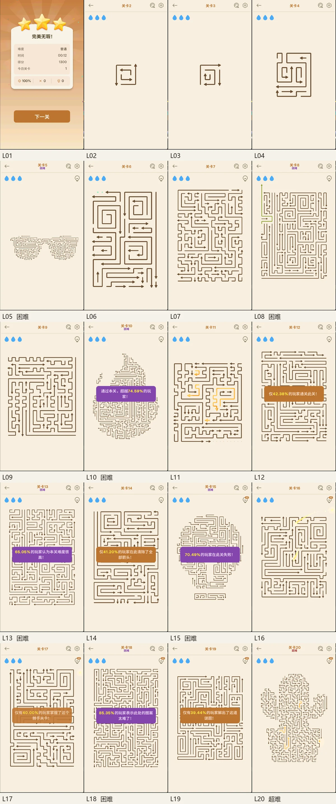

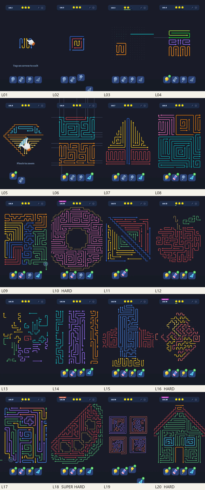

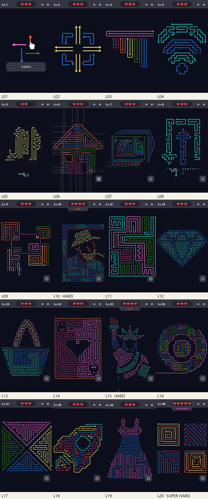

## 附录 F 参考资料

| 来源号 | 参考资料 | 内容 |
|---|---|---|
| A01 | 《AmazeGO笔试题-最终版-黄开元.docx》 | 体验判断、失败恢复、金币记录与设计思路 |
| A02 | 《三款游戏20关对比-最终版.xlsx》 | 60 关记录、截图、IAA 循环与关卡设计部分 |
| A03 | 《三款游戏GooglePlay信息对比-2026-10-21.xlsx》 | 美区英语商店登记 |

实机范围为三款各 20 关；Maze 的误触保护未单独验证。Point 的约 29 关金币累计属于补充记录。广告频次、eCPM 和留存曲线不在本次资料范围内。
