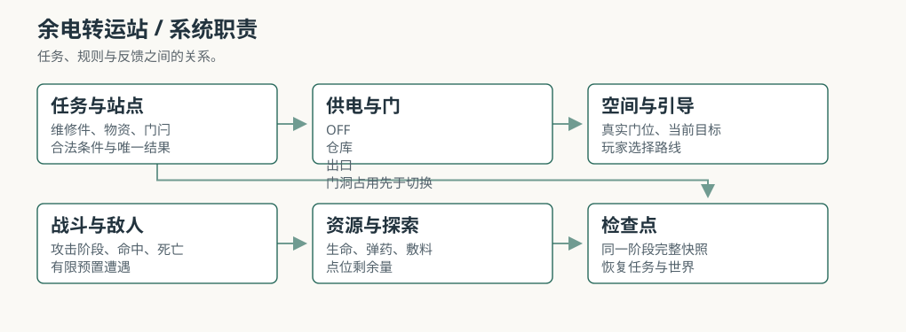
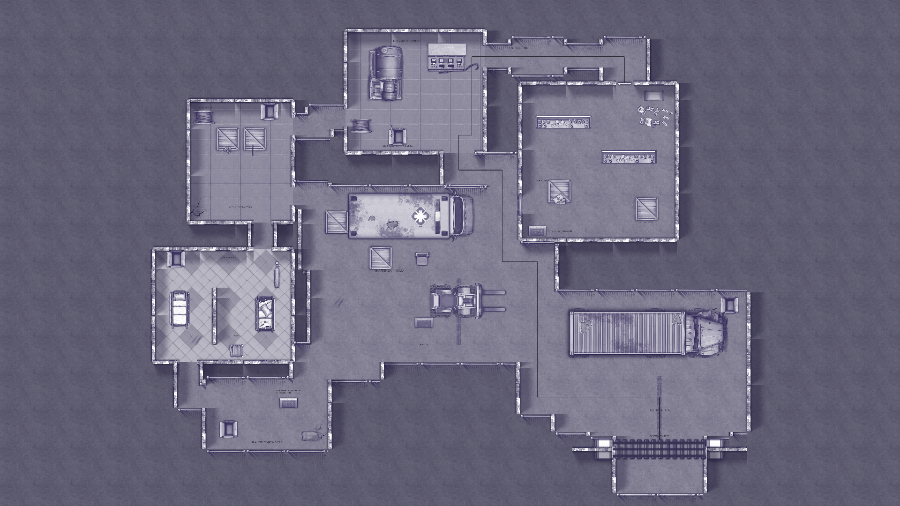
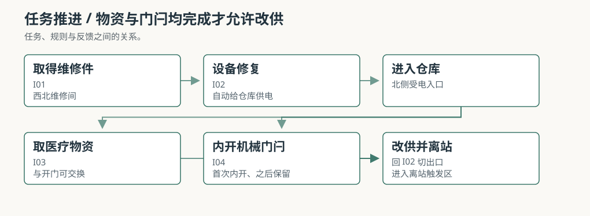
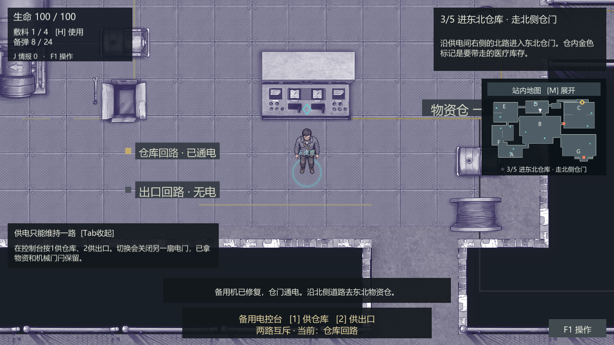
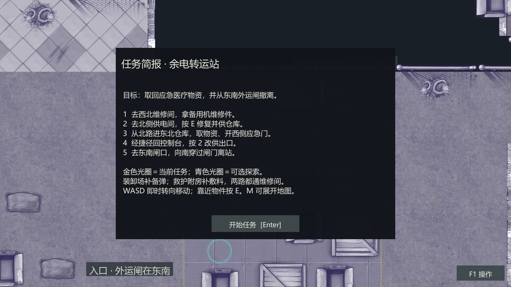

# 余电转运站｜场景与系统执行策划案

黄开元 / 系统策划作品集 / 2026-10-24

本文讨论《余电转运站》的场景与系统设计，范围限于空间、供电、路线、战斗资源与引导；不展开完整商业版的装备、成长或联机。文中的示意图与截图只用于说明结构。

## 1 研究范围与体验结论

### 1.1 这份案子的范围

余电转运站是一个 2D 俯视角生存探索场景。玩家作为幸存者营地的接应员，进入一座断电的应急转运站，取回医疗物资，再从东南外运闸撤离。场景围绕供电、通路、有限补给和预置遭遇组织，单局目标时长 15–25 分钟。

本文只讨论四件事：空间怎么组织、电怎么走、两条路怎么取舍、玩家怎么读懂状态。战斗、数值和美术只写到能支撑这些判断的程度，不展开成完整商业方案。文中的检查数据来自内部原型，不是商业版验收，也不等于真人试玩已经通过。

### 1.2 体验结论

取物必须改变返程。仓库和出口不能同时供电。玩家在仓库取到物资后，出口没有电，必须回控制台把电切到出口。仓内捷径又只能首次从内部打开，所以返程会走一条和去程不同的路。取物不只是一个任务标记，它改变了门禁、通路和回程方向。

状态必须可读。回路、门、线缆、灯和任务目标要表达同一状态。玩家应该能看懂门为什么关、出口为什么没电、下一步该去哪里，而不是反复试交互。屏幕上出现的每一个提示，都要能对应到场景里的一个真实对象。

路线差异必须能被感知。主路经过装卸场，备弹较多、空间开阔；外路经过救护附房，敷料较多、转角更碎。两条路都通往维修间，玩家选择的是到达维修件之前的资源和遭遇。路线差异要能在第一次走完时被说出来，而不是只存在于表格里。

### 1.3 设计口径

本文把完成定义为玩家带着医疗物资真正穿过外运闸。站在闸门前按一次交互、原路回到入口、或者只把闸门打开却没有穿过去，都不算完成。这个口径会影响后面对路线、供电和检查点的所有判断。

零可选收益也算完成。十二个可选点提供路线情报、备弹、敷料和可整理的通行设施，但主线不以全探索为条件。死亡按最近检查点恢复；恢复后位置、生命、弹药、敷料、任务标记、探索账本、设施和敌人状态回到该阶段，而不是只把玩家送回入口。

### 1.4 边界

角色是四向原型，没有完整背包、装备、跨次存档或联机。场景是原创概念案，不是商业版设计文档，也不是可公开试玩的原型说明。美术密度、转向手感、首次理解和两路平衡仍需真人确认；内部检查只能证明状态和流程被覆盖过。

## 2 场景结构与任务链

### 2.1 总平面

地图设计边界为 144D×78D，D 取 0.60 Unity 单位，对应约 86.4×46.8 Unity 单位，总面积约 11,232D²。扩建通过新增工作面、回环和探索段落完成，不整体拉伸场景素材。D 是走查碰撞直径，不是模型的视觉单位。

入口在南，维修间在西北，供电间在北侧中间，仓库在东北，外运闸在东南。整条线从西往东绕一圈，回程才有捷径可开；B 装卸场是回环的枢纽。A 区只负责开场识别两路，回入口不算离站。七个区不是七个孤立房间，而是任务链上的七个判断点。

### 2.2 七区的职责

A 南侧入口。入口道路、门岗和路线告示承担开场识别。玩家在这里第一次看到两条去程，要知道两条路都通维修间，而不是二选一。入口不作为完成出口，回头不算离站；这一点要在任务栏和场景标识里同时成立。

B 中央装卸场。车辆、货架、验货台和开阔绕行面把全站连起来。主路在这里补备弹，仓内捷径也从这里回到供电间。装卸场是回环枢纽，去程和返程都会经过它；它既要支持正面战斗，也要留出绕行的空车道。

C 东北物资仓。分拣货架、封存物资、北侧受电入口和西侧内开门构成任务核心。玩家从北门进仓，取得医疗物资，再从内部打开应急门。西侧捷径只能从里面开，这样取物才会改变返程；如果从外面就能打开，北门就失去意义。

D 北侧供电间。发电设备、控制台、检修面和两条出线构成供电系统。修复和切换在同一个控制台完成，不拆成两个点位凑交互数量。玩家第一次把电给仓库，取完物资后再回来把电切到出口；这个回头是整个场景的中心。

E 西北维修间。拆检装置、工作台、工具和存线构成维修工作面。两条去程都经过这里，维修件是整条链的物理前提；没有件，控制台不能修，没有电，仓库和出口都开不了。它放在最西，是为了让两条路都绕不开它。

F 西侧救护间。床位、隔断、候诊和应急包构成救护附房。外路从这里经过，补敷料、利用转角观察；隔断把视野切碎，近身遭遇更突然。救护间不是主任务点，但它让外路有自己的资源身份。

G 东南外运闸。排队带、车辆、门禁和南侧服务道构成离站段。正面可以交战，也可以从东侧服务道绕行；不要求全歼。真正的完成条件是向南穿过已放行的闸门，而不是在闸前按一次交互。

### 2.3 五个必需点

维修件、控制台、医疗物资、西侧应急门和外运闸构成五个必需点。维修件在 E 工作台取得，件从场景移除后可以送回 D；控制台在有件时修复，修复后选择回路；医疗物资在仓库取得，保留为主任务物资，不作为敷料消耗；应急门首次只能从仓内打开，开后永久双向通行；外运闸负责最终离站。

取物资和内开应急门可以交换顺序。玩家可以先拿物资再开门，也可以先开门再拿物资；只要离站前两者都完成。维修件不能跳过，控制台不能在没有件时修复；出口的完成条件绑定实际穿闸，在闸前按 E 只提供状态说明。这些规则让玩家有局部自由，但不放过必要条件。

### 2.4 取物与开门的可交换

把取物和开门做成可交换，是为了避免任务链变成一条固定按钮序列。玩家进仓后可以先观察货架和敌人位置，再决定先拿物资还是先开西侧门；两种顺序都会改变他离开仓库时的路线和遭遇。可交换不等于可以跳过，两个动作都必须完成。

如果两个动作被拆成前后强顺序，玩家就只需要跟着任务栏走，空间判断会退化成执行步骤。现在的做法保留了局部选择，同时用离站条件兜底；玩家可以按自己的节奏处理，但最终仍要把物资和通路都准备好。

### 2.5 回程捷径

仓内捷径只能首次从内部打开。这个限制让取物真正改变返程：玩家进仓走北门，出仓可以走西侧应急门，经 B 装卸场回控制台。返程不再是沿原路再走一遍，而是利用自己在仓内打开的新通路。

如果捷径从外面就能打开，玩家会在进仓前就把它当入口，西侧捷径会替代北门，C 的先进入再打开就不存在了。只能从里面开，取物才会改变返程路线，而不是只改一个任务标记。B 装卸场在去程和返程都被使用，承担全站回环枢纽的作用。

## 3 供电、门禁与失败状态

### 3.1 为什么只留一路电

备用供电只有一路，是我刻意留下的限制。如果仓库和出口能同时供电，玩家取完物资直接走就行，任务会变成一条直线；现在他必须在取完物资后做一个回头的决定，这个回头就是整个场景的中心。

一路电还让场景里的设备、门禁和通路围绕同一条限制安排：开仓库，就暂时不能开出口；取到物资以后，还要回头改供。这比单纯增加怪物或装饰，更能让玩家感到场景里的设施正在发挥作用。

### 3.2 两回路状态机

未修复时，仓库门和出口门都关；设备修复后，控制台可以给仓库或出口供电。仓库回路通电时，仓库门开、出口门关；出口回路通电时，仓库门关、出口门开。断电时两扇门都关，玩家需要恢复可用供电状态。

切换条件不只是电。设备未修复、物资未取或应急门未开时，控制台拒绝切到出口；玩家或活敌人占据将关闭的门洞时，保留原回路，离开门洞后再试。开关门与碰撞同步，切换不清除已取物资、已修复设备或已经打开的机械门闩。断电时不能新开消防或应急门。

### 3.3 门体与碰撞

门体和碰撞必须同步。门开着，玩家和敌人能通过；门关着，碰撞要真实挡住。切换回路时，如果门洞被玩家或活敌人占据，不能强行关门，否则会把角色夹进墙里。当前做法是保留原回路，等门洞空出来再允许切换。

已经打开的机械门闩不会因为切换回路而重置。玩家在仓库内部打开西侧应急门之后，即使把电切到出口，门闩仍然保持打开；这样回程捷径不会因为一次改供而失效。控制台只改变哪一路有电，不重置已经完成的物理动作。

### 3.4 条件反馈

缺维修件时，控制台要说明去西北维修间寻找；物资或门闩未完成时，要指出尚缺的步骤；门洞有人时，要说明切换未发生。出口无电时，闸门提示返回北侧供电间改供。任务信息、门、线缆和指示灯要用同一套状态语言，不能各自说一套。

条件反馈的目标不是替玩家做决定，而是让失败有解释。玩家按了控制台却没有反应，必须知道是因为缺件、缺物资、门洞被占，还是出口本来就没电。没有解释的拒绝，会让玩家以为是交互坏了。

### 3.5 离站判定

离站看位置，不看交互。在闸门前按 E 不会完成；向南穿过已放行的闸门才触发完成。外运闸的放行状态由出口回路决定，出口回路又要求设备修复、物资取得、应急门打开。玩家不能靠站在门口结算，G 的放行状态才有意义。

完成条件同时约束了任务链的终点。玩家可以把出口段敌人清掉，也可以走东侧服务道绕行；但只要没有真正穿闸，任务就还在进行。这个判定让最后一段不是一次按钮确认，而是一次空间上的离开。

### 3.6 检查点与恢复

入口、设备修复后、物资与捷径完成后、出口通电后有四个检查点。恢复内容包括位置、生命、弹药、敷料、任务标记、探索账本、设施与敌人状态；这是单次运行内的检查点，不是跨次存档。死亡界面说明原因，并提供恢复入口。

检查点按任务阶段分布，而不是按时间均匀分布。入口到修复、修复到取物、取物到改供、改供到离站，每段都有一个恢复点；死亡不会把玩家送回整局开头。恢复后玩家仍在同一阶段，不需要重新完成已经做过的主线动作。

## 4 路线、资源与探索

### 4.1 两条去程

两条去程都汇合在 E 维修间，区别在到达维修件之前的路。主路 A→B→E 经过装卸场，车辆与货架可换位，可选收益偏备弹；外路 A→F→E 经过救护附房，隔断多，补给偏敷料。B→D 允许玩家提前观察控制台需要什么，但修复仍要求维修件，不能跳过。

主路的压力在开阔区的距离和弹药消耗，外路的压力在转角的近身和恢复资源。主路不是更难，外路也不是更简单；它们把压力放在不同位置。当前自动策略偏向外路，但这不能证明真人难度已经等价，两路的真实平衡仍要看玩家第一次走完后的资源余量和受伤记录。

### 4.2 资源差异

生命上限 100，初始备弹 8、上限 24，初始敷料 1、上限 4，每份敷料恢复 35。备弹决定你能多打几个遭遇，敷料决定你能扛几次失误。主路补备弹，外路补敷料；玩家在入口选择路线时，实际上是在选择自己更怕弹药不够，还是更怕恢复不够。

补给满容量时，未领取部分留在原地，不会无限刷新。主任务医疗物资和恢复用敷料分开，拿到任务物资不等于取得治疗资源。这个区分让取物和补给成为两条不同的线，避免玩家把任务目标当成一个大血包。

### 4.3 十二个可选点

可选点分四类：路线情报、备弹、敷料和可整理的通行设施。它们不提供隐藏主线密码，主任务不以全探索为完成条件。路线情报提前说明维修间、供电间、仓库和出口的关系，降低第一次读图的成本；备弹支持主路更主动地处理遭遇；敷料支持外路在转角遭遇后继续推进。

两处可整理设施会真实改变侧道通行。O04 整理回收器具、清扫破损片后开放箱体之间的南北侧道；O09 收束备线后开放备件架后的检修通道。设施收益不是任务标记，而是玩家能走的新路线；这一点让可选探索和空间发生关系，而不是只给资源。

可选点不替代主任务，也不应被误设成必要条件。零可选收益的玩家仍然可以完成主线；如果某个可选点变成必须，任务链就会从主线设计变成收集设计。完整点位表放在附录 A。

### 4.4 环境叙事

18 个纯环境叙事点分布在工作面和通路附近，展示装卸中断、退货分拣、维修拆检、救护改造与未完成外运。它们用于建立转运站的作业关系，不和任务物资、有限补给混为一类。环境叙事不制造虚假交互，玩家不需要逐个点开才能推进。

这些点位让七个区看起来像同一次转运工作被打断，而不是七个互不相关的布景。车辆、货架、拆检装置、床位和外运单指向同一条作业链；玩家在读空间时，也在读这里曾经发生过什么。

### 4.5 零可选与回程

零可选收益也能完成主线，是对路线设计的底线检查。如果玩家不领任何补给和设施收益就走不通，说明可选点被误设成必要条件。零可选路线资源更紧，但仍然要能完成取物、开门、改供和离站。

回程利用仓内捷径回到 B，再去控制台或外运闸。B 在去程和返程都被使用，是回环枢纽；没有 B，仓内捷径就只是一条死路。G 的服务道则给最后一段一个可绕行的选择，让出口不必全靠正面交战。

## 5 战斗与敌人

### 5.1 战斗的职责

站内预置 9 名敌人，分为 5 组遭遇，没有无限增援或随机背刷。战斗制造路线与资源压力，不要求全歼。击倒敌人以后留下更安全的通行空间；绕开敌人也是完成任务的方法。战斗不是主要内容，而是让玩家在路线和资源之间做判断的压力源。

### 5.2 三种威胁

近身压迫型感知后接近，准备攻击，脱战后返回。它的作用是施加距离压力，逼玩家换位或提前出手；玩家可以绕柱、穿门、退开再出手。区域攻击型对停留区域准备范围攻击，事先给预兆；玩家要看落点换位，避开生效区域。出口群体与侧道则把正面排队带和东侧服务道都打开，玩家可以留弹药处理出口，也可以走服务道绕行。

三种威胁对应三种空间问题：距离、落点和出口选择。近身型让开阔区不安全，区域型让站桩不安全，出口群体让最后一段需要决定打还是绕。敌人不是按血量堆出来的，而是按它们在空间里制造的压力分工。

### 5.3 玩家战斗

角色为四向原型。WASD 立即决定移动和身体朝向，静止鼠标不抢回方向；鼠标攻击朝向点击点，F/Q 按当前意图方向出手。攻击开始后锁定本次方向，攻击忙碌期移动速率为正常状态的 35%。这是战斗约束，不是卡顿；玩家需要在出手和换位之间做取舍。

近战包含准备、生效和恢复阶段，一次挥击对同一目标只结算一次。远程有实际移动的弹体，墙体和大件参与遮挡与命中。受击提示要让玩家知道威胁来自哪一侧，倒地后显示原因和检查点恢复入口。攻击方向、受击方向和死亡原因要能互相对上。

### 5.4 资源循环

战斗消耗生命和备弹，敷料恢复生命。玩家每打一个遭遇，都在用弹药换通行空间；每挨一次攻击，都在用敷料换继续推进的机会。资源有限，满容量时剩余补给留在原地；这迫使玩家决定哪些遭遇值得打，哪些可以绕。

主路备弹多，外路敷料多，但两条路都可能遇到资源不够的情况。资源不够时，玩家可以选择绕行、退回检查点，或者用更谨慎的走位减少受伤。战斗系统的目标不是让玩家清空全站，而是让资源决策和路线决策互相影响。

### 5.5 遭遇节奏

5 组遭遇分布在入口、装卸场、救护区、仓内和出口。入口是单体学习，装卸场是主线压力，救护区是转角压力，仓内是混合观察，出口是最后的选择检查。每组遭遇都给绕行方式，不封路；玩家可以用战斗解决，也可以用空间解决。

没有无限增援或随机背刷，意味着玩家可以记住遭遇位置和绕行路线。固定遭遇让路线规划有意义；如果敌人随机背刷，玩家就无法判断资源该留到哪一段，路线差异也会被随机性冲掉。

### 5.6 战斗边界

四向角色原型，没有完整装备、背包、联机或跨次存档。战斗深度控制在能形成压力、不抢走探索的范围内；后续是否增加深度，要看真人试玩是否觉得战斗太浅，而不是先扩系统。当前 9 名敌人、5 组遭遇已经能形成路线压力。

## 6 引导与可读性

### 6.1 五步简报

新开局暂停显示总任务与五步简报，按 Enter 或点击开始任务进入。简报把总任务、当前步骤、地点和推进条件同时说清楚，避免玩家只看到目标却不知道下一步。仓内取物与开门合成一个阶段，玩家不会只看到去仓库而不知道需要做哪两件事。

### 6.2 任务栏

任务栏持续显示总任务、当前步骤、地点和推进条件。玩家在场景里移动时，不需要打开面板就能知道下一步；任务栏不替玩家画路线，只说明目标和原因。完成或领取完毕后，对应标记消失，避免旧信息干扰。

### 6.3 目标与可选光圈

金色光圈和菱形表示当前必要交互，青色表示可选探索与剩余补给。靠近有效操作面显示 E；完成或领取完毕后，标记消失。物资、门和地图使用相同目标关系，减少反复找路。光圈不改变碰撞和门禁，只做提示。

金色和青色要能一眼区分。金色是主线，青色是可选；如果两种颜色混在一起，玩家会把可选点当主线，或者把主线当可选。当前做法是同一套形状语言，用颜色区分优先级。

### 6.4 小地图与展开地图

右上角小地图读取真实布局、墙体、门位和玩家朝向；白色箭头为玩家，金色为当前目标，青色为可选点。开关门用不同颜色与形状表达。首次进仓前，目标先指北门，进仓后再指物资，避免把西侧内开捷径误认为入口。

按 M 展开地图并暂停，关闭后恢复原有暂停状态。地图不画完整路线，不提供自动寻路，保留玩家的路线判断。展开地图遇到可见敌人时会暂时降低透明度，让出视野；这是有意的设计，不是遮挡 bug。

### 6.5 刻意不做的事

不把完整路线画成一条线，不做自动寻路，不用金色箭头替玩家做决定。引导只回答为什么去和在哪，路线本身仍然是玩家的决策。玩家可以第一次跟着光圈走，第二次凭记忆走；两种走法都要能完成。

### 6.6 已知反馈

早期试玩里最常出现的问题是下一步去哪。简报、任务栏和光圈解决了一部分，但还需要观察玩家是否真的按维修件到供电、仓库、改供、闸门的顺序走。转向手感、攻击恢复期、小地图密度和美术细节也仍需真人确认；自动检查不能替代这些判断。

## 7 内容规模与验证

### 7.1 规模

场景有 7 个功能区、30 个空间段、35 个点位：5 个必需交互、12 个可选探索、18 个环境叙事点。敌人 9 名、5 组遭遇，检查点 4 个，两条去程加一条仓内捷径和一条外运服务道。单局目标 15–25 分钟，首次读空间约 20–25 分钟，熟悉路线后可压到 15 分钟左右。

这些数量是设计量，不是渲染物件数。30 个空间段描述可行走和视线关系，35 个点位描述交互与叙事，9 名敌人描述压力分布；它们不能直接相加成场景物件总数，也不能用来估算美术工作量。

### 7.2 检查数据

内部原型累计 303 项功能检查：转向、简报、地图、光圈 32 项；引导 47 项；战斗 52 项；探索收益与设施 100 项；核心任务 37 项；主路连续流程 18 项；外路连续流程 17 项。另有 58 组实际界面检查，覆盖 1280×720、1280×800、1680×720 三种画幅。

主路和外路各有一条连续流程，用真实移动、有限资源和实际战斗推进。检查包含不同层次的断言，不是所有项目都在验证同一件事；具体表在附录 D。构建记录为 0 错误、0 警告，只说明构建和状态检查通过。

### 7.3 数字怎么读

这些数字是检查项，不是游戏质量分。它们能说明状态和流程被覆盖过，不能说明第一次玩的人一定读得懂，也不能替代手感、美术和难度平衡的真人判断。把检查数当质量分会误导；把全绿当好玩也会误导。

路线平衡也不能只看自动策略。当前自动策略偏向外路，但这不能证明真人难度已经等价；需要用真人记录受伤、弹药和敷料消耗，才能判断主路和外路是否各自成立。

### 7.4 还没验证的部分

首次理解、转向手感、攻击恢复期、美术密度、小地图可读性和两路难度平衡仍需真人试玩确认。四向角色是原型，不是完整原作动画；墙体、地面和零散摆件的细节仍偏原型，氛围成立不等于达到商业关卡的平均画面水平。

### 7.5 构建与范围

原型使用四向角色、预置遭遇和单次运行检查点；没有完整背包、装备、跨次存档、联机或商业化系统。本文讨论的是场景设计，不是商业版完成度。后续修改要先确认场景结构和任务链，再考虑是否扩系统。

## 8 复盘与取舍

我最先定下来的不是场景长什么样，而是电这件事。转运站里仓库和出口都要用电，但备用供电只有一路；玩家每开一扇门，都要先想清楚另一头会不会断电。这个取舍比再摆几具尸体更能让我觉得这里在运转。

两条路的资源差别是我故意做偏的：主路备弹多、视野开，外路敷料多、转角多。我不想让玩家在入口就算出最优解，而是凭第一感觉选，走完再后悔或庆幸。仓内捷径只能从里面开，也是同一个道理：取物必须改变返程，而不是只改一个任务标记。

在早期原型里，试玩的人最常问的是下一步去哪。我加了五步简报、目标光圈和小地图，但没把路线画成一条线，只标当前目标和可选点，剩下的路让玩家自己走。引导应该回答为什么去，不该替玩家走。

我没做完整的背包、装备和跨次存档。这个原型的目标是让评审在几分钟内看懂取物、供电、开门、撤离这条链，而不是假装它是一个完整游戏。如果再多两天，我会先补墙体和地面的细节密度，再用真人试玩把主路和外路的难度拉平；现在这两块我只能说能玩，不敢说平衡。

### 8.1 三个判断

先让路线走通。灰盒阶段先把墙、门、关键道具的净空跑通，正式件后面再上；走不通的漂亮场景没有意义。

先让状态可见。指示灯、小地图、目标光圈都是为了回答门为什么关、下一步去哪；玩家看不懂状态时，氛围只是噪音。

先保留回头。取完物资直接走，场景就散了；所以电必须只有一路。这个约束比再加一种敌人更重要。

### 8.2 如果再多两天

如果再多两天，我会先补墙体和地面的细节密度，再把主路和外路各跑几遍真人试玩，记录受伤、弹药和敷料消耗。路线平衡不是靠自动策略算出来的；只有真人走完，才知道主路的开阔和外路的转角是否各自成立。

## 9 调整方向

### 9.1 优先级

第一，墙地细节与空间密度。先把墙体、地面、工作面和零散摆件的密度补到能支撑转运站的日常作业感，再谈更复杂的战斗或叙事。空间关系已经成立，但画面细节还没有达到商业关卡的平均水平。

第二，两路真人平衡。记录第一次路线选择、受伤、弹药和敷料消耗，确认主路和外路的代价是否真的不同；不用自动策略的结果替代真人判断。主路不是更难，外路也不是更简单，平衡要看玩家走完后的资源余量。

第三，引导与小地图可读性。观察玩家是否能在不口头提示的情况下完成取物、改供、离站，以及小地图和光圈是否在战斗中被忽略。引导解决的是目标和原因，不是替玩家画路线。

第四，战斗深度按需增加。当前 9 名敌人、5 组遭遇已经能形成路线压力；在没有确认战斗太浅之前，不扩装备、背包或成长系统。先确认场景成立，再考虑系统扩展。

### 9.2 暂时不做的事

暂时不扩完整背包、装备、跨次存档、联机或商业化系统。四向角色、预置遭遇和单次运行检查点已经足够支撑这次场景判断；在没有真人反馈之前，加系统只会增加解释成本。先把空间、供电和路线打磨好，再考虑下一步。

## 附录 A 七区与点位

| 区域 | 空间组织 | 玩法作用 |
|---|---|---|
| A 南侧入口 | 入口道路、门岗、路线告示 | 开场识别两路；回入口不算离站 |
| B 中央装卸场 | 车辆、货架、验货台与开阔绕行面 | 主路补备弹；连接仓内捷径与供电间 |
| C 东北物资仓 | 分拣货架、封存物资、北侧受电入口、西侧内开门 | 取主任务物资，并改变返程路线 |
| D 北侧供电间 | 发电设备、控制台、检修面与两条出线 | 修复供电与仓库/出口改供 |
| E 西北维修间 | 拆检装置、工作台、工具与存线 | 两条去程的共同目标；取得维修件 |
| F 西侧救护间 | 床位、隔断、候诊与应急包 | 外路治疗资源；转角观察 |
| G 东南外运闸 | 排队带、车辆、门禁与服务道 | 最后一段可战可绕，实际穿闸离站 |

| 点位 | 对象 | 条件与操作 | 完成后状态 |
|---|---|---|---|
| I01 | 维修件 | 在 E 工作台取得 | 件从场景移除，可送回 D |
| I02 | 控制台 | 有件时修复；修复后选择回路 | 初次给仓库供电，取物后可改供出口 |
| I03 | 医疗物资 | 进入仓库取得 | 主任务物资保留，不作为敷料消耗 |
| I04 | 西侧应急门 | 首次只能从仓内开门闩 | 开后永久双向通行 |
| I05 | 外运闸 | 查看放行状态，实际穿闸离站 | 满足撤离条件后完成任务 |

| 点位 | 名称 | 备弹 | 敷料 | 收益 |
|---|---|---|---|---|
| O01 | 入口路线告示 | 0 | 0 | 西北维修间存放零件，北侧供电间控制门禁；东北物资仓保存医疗库存，东南外运闸负责离站。 |
| O02 | 退回包装登记 | 2 | 0 | 退回包装中发现少量封存备弹，领取与任务物资无关。 |
| O03 | 验货交接记录 | 6 | 0 | 装卸场东侧器具回收岛有破损片，靠边观察再通过；清出侧道后可从箱体间绕行。 |
| O04 | 回收器具与侧道清理 | 0 | 0 | 收拢空包装并清扫回收岛破损片，开放箱体之间的南北侧道。 |
| O05 | 破损退货记录 | 0 | 0 | 完好货位与损坏退货分开登记；未入账的退货不能替代主任务物资。 |
| O06 | 出仓复核单 | 4 | 0 | 复核台保留少量备弹，供出仓后备用；仓内机械门闩需在内部开启。 |
| O07 | 维护标记 | 0 | 0 | 备用机仅能同时维持一条门禁回路，切换不会重置已拿物资或机械门闩。 |
| O08 | 拆检记录 | 0 | 1 | 拆检台确认所需零件在本间中部工作台；附带一份敷料，不消耗任务维修件。 |
| O09 | 备线收束与检修侧道 | 0 | 0 | 将散落线盘归置到西北存线位，开放备件架后侧检修通道。 |
| O10 | 床边应急包 | 0 | 2 | 取得独立应急敷料；东北仓库的任务医疗物资保持原样。 |
| O11 | 转运记录 | 0 | 0 | 救护附房转角较多，可先在隔断端观察；回收岛破损片可绕行，或在器具点清理后通过。 |
| O12 | 未签外运单 | 0 | 0 | 排队带已被感染体占据。南侧空车道通往东侧服务道，可从东侧接近放行闸；无需全歼。 |

## 附录 B 供电与门禁

| 状态 | 仓库门 | 出口门 | 主线下一步 |
|---|---|---|---|
| 未修复 | 关 | 关 | 取得维修件并修复设备 |
| 仓库回路 | 开 | 关 | 进仓取物并内开应急门 |
| 出口回路 | 关 | 开 | 前往东南外运闸离站 |
| 断电 | 关 | 关 | 恢复可用供电状态 |

| 规则 | 执行方式 |
|---|---|
| 单回路 | 仓库与出口同时只能亮一路 |
| 切出口条件 | 设备已修复、物资已取、应急门已开 |
| 门洞占用 | 玩家或活敌人占据将关闭的门洞时，保留原回路 |
| 状态保持 | 切换不清除已取物资、已修复设备或已开机械门闩 |
| 断电限制 | 断电时不能新开消防或应急门 |
| 离站 | 向南穿过已放行的外运闸，闸前交互不算完成 |

## 附录 C 资源与战斗参数

| 资源 | 初始 | 上限 | 使用与取得 |
|---|---|---|---|
| 生命 | 100 | 100 | 受击与环境危险降低，敷料恢复 |
| 备弹 | 8 | 24 | 射击消耗，可选点提供有限补给 |
| 敷料 | 1 | 4 | 每份恢复 35；满血不消耗 |

| 参数组 | 配置值 |
|---|---|
| 近战伤害 / 距离 / 半角 | 24 / 1.25 / 55° |
| 近战前摇 / 生效 / 收招 | 0.18 / 0.09 / 0.30 秒 |
| 远程伤害 / 弹速 | 22 / 32 单位每秒 |
| 远程前摇 / 收招 / 弹体寿命 | 0.12 / 0.32 / 1.0 秒 |
| 玩家受击保护 | 0.65 秒 |
| 首次学习型生命 | 48 |
| 近身压迫型生命 | 68 |
| 定点蓄爆型生命 | 52 |

| 组别 | 遭遇 | 敌人数 | 绕行方式 |
|---|---|---|---|
| A | 入口后的单体学习 | 2 | 可后退回入口观察，不封路 |
| B | 装卸场主线压力 | 2 | 沿西侧验货线前往维修间；中央回环可换角度 |
| F | 救护区转角压力 | 1 | 担架外侧操作带；退到候诊区脱战 |
| C | 仓内混合观察 | 2 | 双分拣带改变接敌顺序；不要求全灭才取物 |
| G | 出口前选择检查 | 2 | 南侧空车道通向东侧服务道，再从东侧接近闸口 |

## 附录 D 检查摘要

| 验证范围 | 数量 | 覆盖内容 |
|---|---|---|
| 转向、简报、地图、光圈专项 | 32 项 | WASD 朝向、开场简报、M 地图和目标标记 |
| 引导回归 | 47 项 | 任务栏、交互提示、阅读栈与实物关系 |
| 战斗校准 | 52 项 | 近战、弹体、受击、死亡与敌人行为 |
| 探索收益与设施 | 100 项 | 12 个可选点、容量、设施和门体 |
| 核心任务 | 37 项 | 维修、供电、取物、应急门、改供和离站 |
| 主路连续流程 | 18 项 | 有限资源与实际战斗流程 |
| 外路连续流程 | 17 项 | 有限资源与实际战斗流程 |
| 实际界面 | 58 组 | 1280×720、1280×800、1680×720 |

| 检查点 | 保存阶段 | 恢复后的主要行动 |
|---|---|---|
| 入口 | 初始任务与资源 | 重新选择路线并取维修件 |
| 设备修复后 | 仓库已通电 | 前往仓库 |
| 物资与捷径完成后 | 已取物资，机械门闩已开 | 返回控制台改供 |
| 出口供电后 | 出口回路与放行状态 | 前往外运闸撤离 |

功能项目合计 303 项，另有 58 组界面检查；构建记录为 0 错误、0 警告。以上是内部原型的检查摘要，不是商业版验收。首次理解、转向手感、美术密度和两路难度平衡仍需真人试玩确认。

## 附录 E 边界与来源

| 来源 | 内容 | 说明 |
|---|---|---|
| 个人场景设计稿 | 空间、任务、供电、战斗、资源、引导 | 本文的主要设计依据 |
| 自绘系统图 | 任务关系、双回路状态 | 图 P01、P03，用于说明结构 |
| 个人原型记录 | 全图、控制台、任务简报 | 图 P02、P04、P05，仅用于结构说明 |

本文为个人原创概念案，不是商业版设计文档，也不是可公开试玩的原型说明。角色是四向原型，没有完整背包、装备、跨次存档或联机；美术、手感和两路平衡仍需真人确认。
